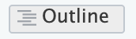
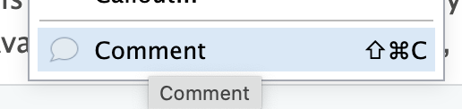
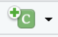
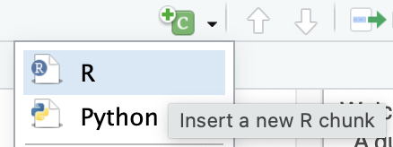
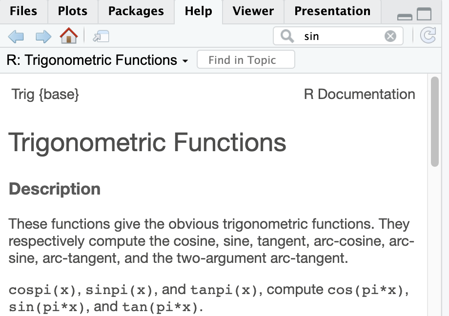
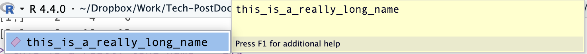
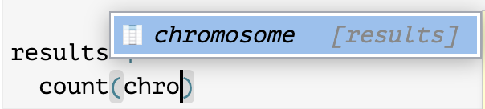

**Setup code - run this at the beginning**

```{r setup}
if (!requireNamespace("pacman", quietly = TRUE)) install.packages("pacman")
pacman::p_load(tidyverse)
```

# 1 - Welcome

Welcome to this three-part course on the *Foundations of R for Bioinformatics*. It is designed with beginners in mind, so if you already have coding experience, some sections may feel straightforward. The aim is to demystify *R* and show how it can be both approachable and powerful for making sense of biological data.

Everything we do across these three sessions uses data from **one real experiment**: a bulk RNAseq comparison of rat brain tissue after traumatic brain injury (TBI) against sham-operated controls. Eight animals in total; four per treatment group. By the end of Session 3 you will have taken that experiment from a raw table of counts-per-gene all the way to a list of differentially expressed genes, creating every figure yourself as we go.

We only have seven hours together, so this course will only scratch the surface of what is possible in *R*, but will provide you will some fundamentals to get you going on your bioinformatics journey. More advanced areas—single-cell RNAseq, batch correction, complex statistical modelling—are beyond the scope of these sessions, but you will get resources and pointers for continuing your learning.

## 1.1 - A quick note about Quarto

Throughout this course, we'll be using **Quarto**, a modern, flexible system for creating dynamic documents with embedded *R* code. (If you've ever used *R* Markdown or Jupyter before, Quarto will feel familiar.) Quarto lets us write code, text, and create plots all in one place, making it easy to produce reproducible reports, figures, and even interactive documents.

You don't need to know anything about Quarto to get started—we'll walk through the basics together. For now, all you need to know is that your `.qmd` file acts as your lab notebook: you can write plain text alongside *R* code, and Quarto will render it into a nicely formatted document with just one click.

You can also see at the top left of the document a 'source' and 'visual' tab. The *source* tab shows you the raw markdown text and code, while the *visual* tab gives a word-processor-style view of the same content. I'd recommend keeping it in *visual* for now, as it will feel more familiar if you're used to working in word processors. I'd also recommend making sure you have the {width="66"} enabled as this will allow you to jump between sections without having to scroll.

**These documents are *yours*.** Treat them like you would any set of lecture notes (except way more interactive and useful). Write notes on them using comments like this {width="219"}. <!--# this is a comment! --> Rephrase things in your own way. Add chunks of code if you have an idea and want to test it. It's a *living document* and it's here to help you learn in whatever way you find easiest. You can always re-download the original from Canvas if you accidentally delete something important!

## 1.2 - Sources and Inspirations

One of the main advantages of *R*—and all of the other tools we will be using—is that they are **open-source**. This means the code behind them is freely available for anyone to view, use, modify, and share. Open source software is developed by communities of researchers, developers, and users who contribute their time and expertise to improve it. This approach helps science stay transparent, reproducible, and accessible, which is especially important in bioinformatics, where data and methods evolve rapidly.

The other advantage is that there are *countless* tutorials, books and teaching resources explaining all aspects of the different tools we will be using. Rather than reinvent the wheel, I've drawn inspiration from a number of these:

- ***R for Data Science (2nd Edition)***—Hadley Wickham & Garrett Grolemund. **Highly recommended!**. A free and accessible introduction to the tidyverse approach to *R*. <https://r4ds.hadley.nz/intro.html>

- ***Analysis of RNAseq data in R***—Sheffield Bioinformatics Core. <https://sbc.shef.ac.uk/rnaseq-r-online/>

- ***Analyzing RNAseq data with DESeq2***—Michael I. Love, Simon Anders, and Wolfgang Huber. <https://bioconductor.org/packages/devel/bioc/vignettes/DESeq2/inst/doc/DESeq2.html>

- ***Harvard Chan Bioinformatics core training modules***—Harvard. <https://hbctraining.github.io/main/>

## 1.3 - Learning objectives

By the end of this session, you will:

- Be comfortable with **RStudio**, **Quarto**, and running code

- Understand the **fundamentals** of *R*: objects, variable types, vectors, functions, and packages

- Know how to find **help** for any function

- Load a real dataset into *R* and describe what is in it

- Create **five figures** from real RNAseq results using **ggplot2**

------------------------------------------------------------------------

# 2 - Main goal for this session

Before we learn anything, let's look at where I hope we get to by the end of this session.

Run the chunk of code below. Don't worry about understanding it—just click the green arrow in the top right of the grey box.

```{r hook}
#| warning: false

results <- read_csv("data/results_unfiltered.csv", show_col_types = FALSE)

results |>
  mutate(significant = !is.na(padj) & padj < 0.05) |>
  ggplot(aes(x = log2FoldChange, y = -log10(padj), colour = significant)) +
  geom_point(alpha = 0.4, size = 0.9) +
  scale_colour_manual(values = c("grey75", "firebrick")) +
  labs(
    title = "Gene expression changes after traumatic brain injury",
    x = "log2 fold change (TBI vs sham)",
    y = "-log10 adjusted p-value",
    colour = "Significant"
  ) +
  theme_minimal(base_size = 12)
```

That is a **volcano plot**, and it is probably the most recognisable graph in transcriptomics. Every point is a *gene*. The further right, the more it's expression went *up* after injury; the further left, the more it went *down*. The higher up the plot in the y-direction, the more confident we are that the change is real.

There are \~38,000 genes in that plot, and \~6000 of them are coloured red, meaning they passed a statistical significance and log-fold change threshold (we will come to what that means later).

**By the end of this session you will understand, and be able to write, every line of that code.** We are going to take it piece by piece, starting from the very beginning.

# 3 - The Fundamentals

## 3.1 - Running code

If you've never done it before, then the very idea of 'coding' might be enough to give you cold sweats! But it doesn't have to be intimidating. In fact, if you've ever used a calculator (which I'm sure you all have), then *congratulations—*you are a coder! You give it numbers (**input**), it applies some maths (a **function**), and it shows you the result (**output**). That's functional programming in its simplest form.

All that is meant by 'coding' is telling a computer to do a thing, and it will attempt to do that thing exactly as you have written. The frustrating thing with coding is that the computer will attempt to do the thing exactly as you have written! It doesn't know what you *mean;* it can only run the *exact* instructions provided. This can mean that even a single spelling mistake or misplaced character can cause an error. It's annoying, but it happens to everyone (even so-called experts). The only way to overcome it is to just keep trying (and also to keep your code as simple as possible).

In our *Quarto* document, code is written in chunks, which can be inserted by pressing the little green {width="35" height="22"} just above the document. A drop-down menu appears, where you can specify the programming language (in our case, we will select 'R'). {width="376"}

The resulting chunk will look something like the below:

```{r}

```

The little `{r}` box shows that we are using the *R* programming language. We can type more information in that box to give the chunk a unique label (but don't use spaces). E.g.,

```{r empty-chunk}

```

Code is run (executed) by clicking the {width="26" height="22"} in the top-right corner of the chunk. You can try it now with the above chunk, but nothing happens—**why?**

Clearly, an empty chunk is not very useful: we need to write some instructions in the chunk to tell *R* what we want it to do.

Continuing with the calculator theme, you can use *R* to perform basic calculations. If we type in 1 / 200 \* 30:

```{r maths-demo}
1 / 200 * 30
```

Nothing happens until you run the chunk by clicking the green arrowhead. The results then appear in a small box beneath the code. In *RStudio*, you'll also see the console below the document fill with the code you ran and its output. The same output will occur if you just type `1 / 200 * 30` directly into the console and hit enter.

We don't have to put just a single line of code within each chunk. Here is an example with 2 maths equations back to back:

```{r 2-equations}
(59 + 73 + 2) / 3
sin(pi / 2)
```

When you run the chunk, notice that *R* executes the code line by line. This is a key idea: *R* reads your instructions from top to bottom and from left to right, just like you would read an English sentence. The order matters—e.g., if you try to use some function or variable before it has been defined, *R* won't know what you mean.

In this example, you've also seen your first built-in function, `sin()`, and your first built-in variable, `pi`. *R* comes with many such tools ready to use. A function is always written as a name (like `sin`) followed by a pair of brackets `()`. Whatever you put inside the brackets is the *input*, and the function then returns an *output*. This input–function–output pattern is the backbone of coding in *R*.

If you're ever unsure what a function does or what kind of input it expects, *R* has built-in help. Typing `?sin` or `help(sin)` in the console will bring up its documentation, showing you how it works and giving examples you can try out. In *RStudio*, you can also use the Help window in the right sidebar:

{width="428"}

`pi` is just an *object* with an assigned *value*. We can find out what that is (to a certain level of significant figures) by just running a chunk with `pi` in it, or typing pi into the console and hitting enter:

```{r pi}
pi
```

*Quick note: you might notice in some of the chunks a line at the top starting with #\| e.g., "#\| warning: false"—these are just instructions Quarto uses when rendering a document (e.g., to a PDF or HTML file). For example, "#\| error: true" tells Quarto to expect that chunk to give an error (e.g., in some of the exercises) which would break the render of the document if not acknowledged. The chunk will still run as normal if you press the green arrow in your RStudio application.*

## 3.2 - Creating objects/variables

An **object** is a container for information, and the **variable name** is the label on the outside of that container. What's inside can be almost anything: a single number, a piece of text, a whole dataset, a table, a plot, a function...

We use objects any time we want to store something in memory.

You can create new objects with the assignment operator `<-`. For example, if wanted to store the result of multiplying 3 by 4:

```{r x}
x <- 3 * 4
```

Running this code, it seems like nothing has happened, except you might notice that something has appeared in our 'Environment' tab on the right hand side. We now have a new variable (object) called `x` which has the 'value' of 12. If you want to check that, you can either type `x` into the console and press enter, or run `x` in a new chunk, like we did with `pi`:

```{r what-is-x}
x
```

## 3.3 - Variable types in *R*

*R* classifies data into **types**. Knowing the type of a variable is important because it tells *R* what kinds of operations are possible.

The most common types you'll use are:

- **Numeric**: numbers you can do maths with. These are split into subtypes:

  - **Double:** allows you to store numbers as decimals. This is the default treatment for numbers. *Examples*: `3.14`, `6.0`
  - **Integer:** whole numbers. *Examples*: `1L`, `100L` (the `L` tells *R* it's an integer).

- **Character**: text, always written inside quotes.

  - *Examples*: `"Emp1"`, `"hello world"`

- **Logical**: true/false values (also written as `TRUE` or `FALSE`).

  - *Examples*: `TRUE`, `FALSE`

- **Factor**: categorical variables with a set of defined levels (useful for grouping).

  - *Example*: `factor(c("sham", "TBI", "TBI"))`

You can check the type of any variable with the `class()` function. For example:

```{r classes}
x <- 42
class(x)     # numeric

y <- "Emp1"
class(y)     # character

z <- TRUE
class(z)     # logical
```

Being aware of variable types will save you from many errors, because *R* will often refuse to combine or compare things of the "wrong" type. All four of these types appear in the dataset we're about to load, so it is worth understanding this concept now.

### 3.3.1 - Missing values, `NA`

In addition, missing or unknown values are represented in R as `NA`, short for “Not Available”. Real-world datasets almost always contain missing values: a sample that failed QC, a participant who skipped a question, or a measurement that was never recorded. *R* deliberately treats `NA` as “unknown” rather than zero or blank, which means any calculation involving an `NA` usually returns `NA` too. For example, `mean(c(2, 4, NA))` returns `NA`, because *R* cannot know the mean of a set containing an unknown value.

This behaviour is a safeguard, but it can also catch you out. Many functions have an `na.rm = TRUE` argument to remove missing values before calculating, and `is.na()` lets you find them. Others, however, drop or keep `NA`s quietly, so a result can look plausible while being based on fewer observations than you expected. It is important to decide on a strategy for missing data (remove, replace, or keep and report) *before* analysing it, rather than discovering the problem afterwards.

## 3.4 - Vectors

*R* is at its most powerful when working with **vectors**. You can **c**ombine multiple elements into a vector with `c()`. Here are the eight animals in our experiment. We can store them as characters (as they are names); we need to surround each name with quotes `""` and separate them by commas:

```{r samples}
# create the vector
samples <- c("TBI2", "TBI1", "sham4", "sham3", "sham2", "sham1", "TBI4", "TBI3")

# have a look at the vector
samples

# what is the variable type?
class(samples)
```

You can extract specific positions of the vector using square brackets `[]` (note that in *R*, position 1 is 1, not 0, unlike certain other programming languages...—if that sentence made no sense to you, don't worry! But IYKYK).

So if you want to extract the sample at position 1:

```{r samples-1}
samples[1]
```

Vectors don't have to contain text. Here are some made-up counts for a single gene across those eight animals:

```{r counts-vector}
# create a vector called gene_counts filled with numeric data
gene_counts <- c(412, 388, 96, 104, 88, 117, 455, 401)

# let's look at it
gene_counts

# what is its type?
class(gene_counts)
```

Basic arithmetic on numeric vectors is applied to every element:

```{r counts-maths}
gene_counts * 2

gene_counts / 1000
```

*R* has built-in functions that summarise a whole vector at once:

```{r counts-summary}
mean(gene_counts)
max(gene_counts)
length(gene_counts)
```

Worth noting here that performing those functions on the vector doesn't overwrite what is in the vector. If we wanted to store the result of those operations, we would have to assign it to a new variable name or overwrite the existing one, using the assignment operator `<-`. E.g.,

```{r new-assignment}
mean_gene_counts <- mean(gene_counts)

gene_counts_2 <- gene_counts * 2
```

#### 3.4.1 - Mixed vectors and coercion

What happens if we have multiple different data types in our vector? E.g., a list of numbers where some are spelled out:

```{r mixed-vector}
#| label: mixed-vector 

mixed_vector <- c(1, 2, "three")

mixed_vector

class(mixed_vector)
```

This illustrates an important point, which is that mixed vectors are not actually possible in *R.* The numeric data in that vector has been **coerced** into a [character]{.underline} type (because it's possible for the symbol `1` to be a character but not possible for the word `three` to become a numeric value—*R* doesn't know that `three` means `3`). Since this is now a character vector, numeric operations are not possible on it:

```{r mixed-vector-operations}
#| error: true

mean(mixed_vector)

```

As we will see later, this facet of data handling in *R* also applies to data in the columns of any data set we load into *R.*

### Have a go: which group is which?

Look at `samples` and `gene_counts` side by side. Which four animals have the higher counts for this gene? What does that suggest about the gene?

.

.

.

*Scroll down for answer*

.

.

.

.

.

.

.

.

.

**Answer:** Positions 1, 2, 7 and 8—`TBI2`, `TBI1`, `TBI4` and `TBI3`—all sit around 400, while the four sham animals sit around 100. This gene looks like it goes *up* roughly four-fold after injury. That is exactly the kind of comparison `DESeq2` will do for us, \~38,000 times over, in Session 3.

## 3.5 - Comments

You may have noticed the use of the `#` symbol in some of the code above. The `#` symbol signals to *R* that the following text on that line is not code and shouldn't be run. This allows you to write **comments**, which *R* doesn't read but we still can.

```{r comments}
# the eight animals in the experiment
samples <- c("TBI2", "TBI1", "sham4", "sham3", "sham2", "sham1", "TBI4", "TBI3")

# how many animals do we have?
length(samples)
```

For short bits of code, you don't need to comment every single line. As your scripts get longer, though, comments can be a lifesaver—they'll help you (and anyone else reading your code) quickly remember what you were trying to do.

The most useful habit is to focus on *why* you wrote the code, rather than *what* it does. The 'what' and 'how' are usually clear from the code itself, but your reasoning is much harder to recover later. In data analysis especially, comments are a great way to sketch out your overall plan and jot down insights as they come up.

Even if it feels like in the moment there's no way you can forget the point of your amazing new code, I promise you (first-hand experience right here) that code without comments can be an absolute nightmare to come back to if you've not been working on it for any stretch of time!

## 3.6 - Names and TAB autocompletion

Object names must start with a letter and can only contain letters, numbers, `_`, and `.`. You want your object names to be descriptive, so you'll need to adopt a convention for multiple words. Generally, people recommend **snake_case**, where you separate lowercase words with `_`.

Say you have, for some reason, made a really-long variable name:

```{r long-name}
this_is_a_really_long_name <- 2.5
```

This could get annoying to type out all the time (so maybe it's not a great choice of name). However, if you do insist on using it, *RStudio* has a handy autocomplete feature. You may notice if you start typing that variable into the console or code chunk a little preview window will pop up: 

Pressing TAB will autocomplete the word for you. There are other handy uses for the TAB autocomplete which we will come across later when we start working with our data (such as automatically knowing what the column names are in your data).

### *R* doesn't know what you mean

Let's make another object:

```{r rocks}
r_rocks <- 2^3
```

And try to look at it by typing the variable name:

```{r error-rocks}
#| error: TRUE
r_rock
R_rocks
```

**What has happened here? Why are we getting an error?**

.

.

.

*Scroll down for answer*

.

.

.

.

.

.

.

.

.

This illustrates the implied contract between you and *R*: *R* will do the tedious computations for you, but in exchange, you must be completely precise in your instructions. If not, you're likely to get an error saying the object you're looking for was not found.

Typos matter; *R* can't read your mind and say, "oh, they probably meant `r_rocks` when they typed `r_rock`". Case matters too; *R* can't say, "oh, they probably meant `r_rocks` when they typed `R_rocks`".

You will see this error more than any other. When you do, check your spelling and your capitals first.

## 3.7 - Using functions

*R* has a large collection of built-in functions that are used (called) like this:

```{r functions}
#| eval: false
function_name(argument1 = value1, argument2 = value2, ...)
```

Each function has a name, and then open parentheses, and then some **arguments**. At a basic level, arguments are the **input** and **options** of a function.

Let's try using `seq()`, which makes regular **seq**uences of numbers. If we are unsure how to use `seq()` we can search for it in the help window (or type `help(seq)`). Typing `seq` and then pressing TAB will automatically give us paired parentheses, which we need for functions.

`seq()` has two **input** arguments, which are `from` and `to`. These are fairly self-explanatory—they tell `seq()` the number we want to start our sequence *from* and the number we want our sequence to get *to.*

Type the name of the first argument, `from`, and set it equal to `1`. Then, type the name of the second argument, `to`, and set it equal to `10`.

```{r seq}
seq(from = 1, to = 10)
```

Note that by default, this has created a sequence of numbers that increase by 1. That is because there is another argument, an **options** argument, called `by`, which is the number we want the sequence to increase by each time. This option has a default value (which in this case leads to a sequence which increases by 1). We can overwrite that by providing our own value for `by`, e.g.,:

```{r seq_2}
seq(from = 1, to = 10, by = 2)
```

We can omit the names of the first several arguments in function calls (and this is often done in practise), so we can rewrite this as follows:

```{r seq-omit}
seq(1, 10, 2)
```

As well as automatically providing the paired parentheses when typing out functions, *R* also helps us with paired quotation marks e.g., if you type `x <- "`, a pair of quotation marks will appear for you to put a string of characters inside.

```{r hello-world}
x <- "hello world"
```

Quotation marks and parentheses must always come in a pair. *RStudio* does its best to help you, but it's still possible to mess up and end up with a mismatch. If this happens, *R* will show you the continuation character "+":

`> x <- "hello +`

The `+` tells you that *R* is waiting for more input; it doesn't think you're done yet. Usually, this means you've forgotten either a `"` or a `)`. Either add the missing pair, or press ESCAPE to abort the expression and try again.

## 3.8 - Projects: how *R* knows where to find your files

One aspect of coding which we haven't touched on yet is the need to tell *R* exactly *where* on your system you are working, i.e., **the working directory**. You will almost certainly be familiar with the idea of folders and file systems (e.g., Finder on MacOS, File Explorer on Windows...) and how to navigate them using a keyboard and mouse.

In *R*, we need to use 2 functions to figure out exactly where we are and where we want to be, so that we can save stuff in the right place, and load things into *R* from our working directory (or sub folders) if we need to. The 2 functions we need are:

- `getwd()` - tells us what our current working directory is.

- `setwd()` - allows us to set the working directory to a place of our choosing.

When you load a file into *R*, you have to tell it where that file is. Rather than typing out a full path like `C:/Users/yourname/Documents/R_course/data/results_annotated.csv`—which would be different for every single person in this room—we use an **RStudio Project**.

You already opened one to get here. When you opened `Session_1.Rproj`, RStudio set the **working directory** to that folder. Everything is now referred to relative to it. That's why the following chunk works for all of us identically:

```{r read-path}
#| eval: false
read_csv("data/results_unfiltered.csv")
```

The `data/` bit means "the folder called data, inside the project folder".

You can check where *R* thinks it is. The result of the code below will be different for each of you, so compare with your neighbour. The difference should just be your username on the cluster PCs:

```{r getwd}
getwd()
```

*R* project files are really useful when sharing code with other people.

## 3.9 - Packages

To run the code in this course, we need **3** things. If you've got this far, then you've already got 2 of them sorted: *R* and *RStudio*. *R* is the actual programming language we're using. *RStudio* is the **IDE**—the user interface that makes *R* pleasant to work in.

The third thing is a collection of **packages**. An *R* package is a bundle of functions, data, and documentation that extends the capabilities of base *R*. Using packages is key to the successful use of *R,* especially for more complicated workflows such as in bioinformatics.

Packages have to be **installed** once (they get downloaded onto the computer) and then **loaded** every time you start a new session (which makes their functions available to you). If you try to use a function from a package you haven't loaded:

```{r deseq-error}
#| error: TRUE
DESeq(dds)
```

You get the "could not find function" error. You will see this error a lot, and nine times out of ten it means you've forgotten to load a package.

### 3.9.1 - Installing and loading in one step

Packages can be installed using the built-in function called `install.packages("package_name")` and then loaded using `library(package_name)`. In `install.packages()`, the package name needs to be surrounded in quotes "", but in `library()` it doesn't.

Installing alone is insufficient, as it is only when you load the package that you get access to its features and functions. (Note: you can also use package functions without loading it via `library()` so long as you prefix each function with `package_name::` -\> see below).

For installing and loading packages in a single step, we will use **pacman**, which does the whole lot in one line. `p_load()` checks whether you have each package; installs it from wherever it lives if you don't; and loads it.

```{r pacman-demo}
#| eval: false
pacman::p_load(tidyverse) # pacman:: means "use the function from the pacman package"
```

We already ran this in the setup chunk at the very top of this document, which is why the volcano plot worked earlier. You'll see the same line at the top of Sessions 2 and 3, with more packages added.

For completeness, even though we have already loaded the `tidyverse` using`pacman::p_load()`, the following is how you would use the `library()` function to load a package you have already installed:

```{r library}

library(tidyverse)
```

### 3.9.2 - The **tidyverse**

Most of what you'll learn in this course is part of the **tidyverse**—a family of packages that share a common philosophy and are designed to work together. Loading it gives you nine packages at once: *dplyr, forcats, ggplot2, lubridate, purrr, readr, stringr, tibble* and *tidyr*. More information about the tidyverse can be found [here](https://tidyverse.org/).

Today we mostly use **readr** (for loading data) and **ggplot2** (for plotting). Session 2 is largely **dplyr** and **tidyr**.

## 3.10 - Exercises

### Question 1

Create an object which is a vector of odd numbers from 1:10. How can you use this vector to create a vector of even numbers from 1:10?

```{r student-answer-3.10.1}
#| eval: FALSE

odds <- YOUR_CODE_HERE

evens <- YOUR_CODE_HERE # hint: what happens if you add 1 to every position in odds? How can you do this using code?

```

### Question 2

Which of the following code chunks give an error? Why?

```{r student-answer-3.10.2a}
#| eval: FALSE

exercise_counts <- c(100, 233, 41, 232, 656, 12, 92)

mean(exercise_counts)
```

Your explanation:

```{r student-answer-3.10.2b}
#| eval: FALSE

exercise_counts <- c(100, 233, 41, 232, "656", 12, 92)

mean(exercise_counts)
```

Your explanation:

```{r student-answer-3.10.2c}
#| eval: FALSE

exercise_counts <- c(100, 233, 41, 232, 656, 12, 92)

mean(exercise_count)
```

Your explanation:

### Question 3

Calculate the **median**, **variance**, and **standard deviation** of `exercise_counts`. What functions do you need for this? Use the Help window (or Google!) if you are not sure. Hint: these functions are all part of the in-built `stats` package.

```{r student-answer-3.10.3}
#| eval: FALSE

exercise_counts <- c(100, 233, 41, 232, 656, 12, 92)

my_median <- YOUR_CODE_HERE

my_variance <- YOUR_CODE_HERE

my_SD <- YOUR_CODE_HERE

# Look at the objects you've created
my_median
my_variance
my_SD

```

### Question 4

Look at the following vector, `new_vector`. What happens if we try to calculate the mean?

```{r student-answer-3.10.4a}
#| eval: FALSE

new_vector <- c(141, 61, 883, 548, 981, NA, 23)

mean(new_vector)
```

Your explanation:

### Question 5

How can we deal with that `NA` value? Hint: look at the **arguments** available for the `mean()` function (type `help(mean)` into the console and press enter—it's the entry Arithmetic Mean in package `base`). Is there an option that can help us with our `NA` problem?

```{r student-answer-3.10.5}
#| eval: FALSE

mean(new_vector, YOUR_CODE_HERE)
```

------------------------------------------------------------------------

# 4 - The data

## 4.1 - Loading it in

We already loaded the results at the top of this document, but let's do it properly and look at what we've got. `read_csv()` comes from **readr** which is part of the `tidyverse`:

```{r read-results}
# load the data with read_csv()
results <- read_csv("data/results_unfiltered.csv")
```

`read_csv()` will print out some information about our file when it loads, which you can see below that chunk. It is telling us that the data comes from a `csv` file (delimiter: ","), which is essentially a text file where data points are separated by commas (**comma-separated values, csv**). It also tells us what **variable types** we have in our data. Here, we have two *character* variables (`chr`), and seven *double* variables (`dbl`) which are a subtype of *numeric* variables.

This immediately tells us that we should expect *textual* information for `GeneID` and `chromosome`, and *numeric* information for the other variables. (You may be thinking "but aren't chromosomes numbered? Shouldn't they also be numeric?"—we will come to this later!)

We have assigned this `csv` file to an object that we sensibly named `results`.

Type the object name to see a preview. This is where Quarto is really powerful as it provides a very useful window for viewing data tables:

```{r print-results}
results
```

Notice the little `A tibble: 38,675 × 9` at the top. A **tibble** is a tidyverse-friendly kind of data table—think of it as a spreadsheet, with variables in columns and observations in rows. Here, **each row is one gene**.

Two things tibbles do that ordinary data table don't: they never change your variable names or types unexpectedly, and when printed they show only the first 10 rows, so you don't flood the console.

Underneath each column name you can see its **type**—`<chr>` for character, `<dbl>` for double, and so on.

## 4.2 - What's in the data?

For a view where you can see all the variables at once, use `glimpse()`. Each variable is prefixed by `$`:

```{r glimpse}
glimpse(results)
```

Or open it as an interactive spreadsheet:

```{r View}
#| eval: false
View(results)   # opens in a new RStudio tab
```

Some other useful ways to interrogate an unfamiliar object:

```{r explore}
dim(results)      # rows and columns
names(results)    # column names
head(results)     # first six rows
```

`summary()` gives you a quick numerical overview of every column:

```{r summary}
summary(results)
```

## 4.3 - What the columns mean

This table is the output of a **differential expression analysis**—the thing we'll run ourselves in Session 3. Each row is a gene, and the columns tell us how that gene behaved:

| Column | What it means |
|------------------------------------|------------------------------------|
| `GeneID` | The gene's name |
| `chromosome` | Which chromosome it sits on |
| `gene_length` | Total length of its exons, in base pairs |
| `baseMean` | Average expression across all 8 animals |
| `log2FoldChange` | How much it changed. `+1` means doubled in TBI; `-1` means halved |
| `lfcSE` | How confident we are in that fold change (smaller = more confident) |
| `stat` | The test statistic |
| `pvalue` | Probability of seeing a change this big by chance |
| `padj` | The p-value, corrected for testing \~38,000 genes at once |

::: callout-note
## Why `padj` and not `pvalue`?

If you test, say, 20,000 genes and use a threshold of p \< 0.05, you'd expect around 1000 genes to look "significant" purely by chance. That is clearly no good. `padj` corrects for this. **Always use `padj`, never `pvalue`, when deciding what's significant.** We'll come back to why in Session 3.
:::

## 4.4 - A brief introduction to the "pipe"

One of the most useful tools in the tidyverse is the **pipe**, `|>`. Think of it as "take what is on the left and feed it into the function on the right." (You might also see it written `%>%` elsewhere—they do pretty much the same thing but `|>` is now built into *R* itself whereas `%>%` comes from a separate package).

So instead of writing `dim(results)`, we could write:

```{r first-pipe}
results |> 
  dim()
```

That looks like more effort for no gain, and for one function it is. The pipe earns its keep when you want to do several things consecutively, taking the result of one thing and using it for the input of the next. This is what Session 2 is all about, so we will talk about the pipe more next session. For now, just get used to seeing it, as every plot we build today starts with a pipe.

Here's one useful example. `count()` tallies up how many rows fall into each category (column). For example, suppose we want to know how many genes from each chromosome are in our dataset? One useful feature of piping our `results` object this way is that the columns show up in the TAB autocomplete window {width="219"}. This doesn't happen without piping!

```{r count-chr}
results |> 
  count(chromosome)
```

We can take the result of the `count()` (our table of counts), and use that as the input of the next function `filter()` by continuing the pipe. We will talk more about the `filter()` function in the next session but, unsurprisingly, it allows us to **filter** our data e.g., to just show the "Y" chromosome.

```{r count-y}
results |> 
  count(chromosome) |> 
  filter(chromosome == "Y")
```

::: {.callout-tip collapse="true"}
## Which genes on the Y chromosome have a baseMean of at least 10?

```{r y-genes}
results |> 
  filter(chromosome == "Y") |> 
  filter(baseMean >= 10) |> # >= means "greater than or equal to"
  select(GeneID, baseMean)
```

`Ddx3y`, `Eif2s3y`, `Kdm5d`, `Uty`—these are the classic male-specific Y genes. Their presence tells us something: **these rats were male.**

This is a useful quality-control step. If you analyse a dataset that's supposed to be all-female and Y genes show up, something has gone wrong. That's sex verification in three lines of code.
:::

------------------------------------------------------------------------

# 5 - Data visualisation

*R* offers several systems for making graphs, but **ggplot2** is both the most versatile and the most elegant (and its also part of the `tidyverse` so works seamlessly with other `tidyverse` functions). It's built on the *grammar of graphics*—a consistent way of describing and constructing plots. By learning this single system, you can quickly create a wide variety of visualisations without having to start from scratch each time.

The grammar has three core ideas, and every plot we build uses all three:

1.  **Data**—the table you're plotting
2.  **Aesthetics** (`aes()`)—which columns map to which visual properties (x position, y position, colour...)
3.  **Geoms** (`geom_*()`)—the geometric shapes used to represent the data (points, bars, boxes, lines...)

We're going to create five figures together. Each one adds one new idea and each is useful for RNAseq data analysis. By the fifth, you'll have the volcano plot from the start of the session.

I will not be able to even scratch the surface of all you can do in `ggplot2`. There are plenty of great `ggplot2` resources including this handy [cheat sheet](https://posit.co/wp-content/uploads/2022/10/data-visualization-1.pdf), and:

- [***A ggplot2 tutorial for beautiful plotting in R***](https://www.cedricscherer.com/2019/08/05/a-ggplot2-tutorial-for-beautiful-plotting-in-r/)—Cedric Scherer

- [***R Graphics Cookbook, 2nd edition***](https://r-graphics.org/index.html)—Winston Chang

- [***ggplot2: Elegant Graphics for Data Analysis (3e)***](https://ggplot2-book.org/)—Wickham, Navarro & Pedersen

## 5.1 - The empty canvas

Plots are created by assembling **layers** on top of a plot object. The first thing the `ggplot()` function needs is the data. Let's pipe our results into it:

```{r ggplot-empty}
results |> 
  ggplot()
```

Well that was underwhelming! But do not panic. What we've done is create a **plot object**—we've told ggplot2 to set up a canvas and expect data from `results`. We haven't yet saved this to an object. Plots made in `ggplot` are *R* objects like any other, so they can be assigned to a variable name. For example:

```{r empty-plot}

plot0 <- results |>
  ggplot()
```

That empty canvas is now saved to an object called `plot0`. We can see what it looks like by typing that object into a new code chunk and running it:

```{r plot0}

plot0
```

Note that we could have achieved the same thing by doing `ggplot(results)` rather than using the pipe; however, using the pipe has a few benefits—it looks clearer which makes debugging easier; and when actually writing the code, it means `ggplot()` is then already aware of the variables in your data, which means they appear in the TAB autocomplete window (see above with the `count()` example). Try it yourself and see the difference.

## 5.2 - Plot 1: a p-value histogram

*New idea: one aesthetic, one geom.*

Our first real plot uses a single aesthetic (`aes()`): we map `pvalue` to the x-axis. We do this using the `aes()` argument in the `ggplot()` function. Then we add a **geom** to say how we want it displayed. Geoms are added with `+`, and it's good practice to start a new line after it as it makes the code more readable.

```{r hist-1}

# Make a new plot called plot1
plot1 <- results |> 
  ggplot(aes(x = pvalue)) +
  geom_histogram()

# View the plot
plot1
```

A histogram chops the x-axis into bins and counts how many genes fall in each. You'll notice a message telling you it picked 30 bins; we can set that ourselves:

```{r hist-2}

plot1a <- results |> 
  ggplot(aes(x = pvalue)) +
  geom_histogram(bins = 50)

plot1a
```

Alternatively, we can set the bin width:

```{r hist-3}

plot1b <- results |> 
  ggplot(aes(x = pvalue)) +
  geom_histogram(binwidth = 0.1)

plot1b
```

Note that we've been getting a warning when plotting each of those graphs. This isn't an error—we still get the graph plotted, it's just letting us know that 9767 of the rows (genes) have a value outside of the plotting range, which is actually the value `NA` or **no value**. This happens when there is effectively zero expression for that gene, so a p-value cannot be calculated for it.

::: callout-important
## This is a real QC plot, not just a demonstration

A p-value histogram is one of the first things any bioinformatician looks at, because its **shape** tells you whether your experiment worked.

- A **tall spike near zero** means there is a real transcriptional response—lots of genes really did change.
- The rest should be **roughly flat**, because genes that didn't change produce p-values spread evenly between 0 and 1.

Ours has both, which is a good sign of a successful experiment. If you ever see a histogram that is humped in the middle, or that slopes upward towards 1, something is wrong with the model or the data, and it's worth stopping to find out what before you go any further.
:::

## 5.3 - Plot 2: genes per chromosome

*New idea: categorical variables and factor order.*

Let's count how many genes sit on each chromosome. This time we will plot `chromosome` on the x-axis by putting that inside of the `aes()` argument. `geom_bar()` then does the counting for us:

```{r bar-1}

plot2 <- results |> 
  ggplot(aes(x = chromosome)) +
  geom_bar()

plot2
```

Something looks a bit off with the ordering. Chromosome 10-19 has landed between 1 and 2, and X and Y are at the end. That's because `read_csv()` read `chromosome` as **character** text, and text sorts alphabetically: "10" comes before "2" because there is a "0" character after the "1". The reason `read_csv()` has assumed this variable is a `chr` is because of the presence of "X" and "Y". As soon as any `string` (letters/characters) appears in a variable, the whole variable is **coerced** into `chr` format, in the same way our mixed vector ([3.4.1 - Mixed vectors and coercion]) was coerced into a character vector. This is why it's always worth checking your data before using it.

Because we need "X" and "Y" in there, we can't convert this whole column to `numeric`. (e.g., *R* has a function called `as.numeric()` which will try to convert whatever is in the brackets to `numeric` form). But we can still fix the order on our graph.

To fix the ordering it, we convert the `chromosome` column to a **factor**—the categorical type we met earlier (\[3.3 - Variable types in R\])—and tell *R* explicitly what order the levels should be in. `mutate()` allows us to create new columns or change existing columns in our data, while `factor()` allows us to change variables to factors—more on these in session 2:

```{r make-factor}
results <- results |> 
  mutate(
    chromosome = factor(chromosome, levels = c(as.character(1:20), "X", "Y", "unplaced")) # convert the chromosome column to the factor type with the numbers changed to characters and ordered from 1 to 20, and then followed by X and Y and unplaced
  )
```

Now try again:

```{r bar-2}

plot2 <- results |> 
  ggplot(aes(x = chromosome)) +
  geom_bar()

plot2
```

Much better. This is a genuinely useful trick—any time a plot's categories are in a daft order, it's because they're characters rather than factors and you haven't yet specified the "levels" (i.e., the order).

## 5.4 - Plot 3: fold change by chromosome

*New idea: plotting two variables—one categorical, one numerical.*

Now let's put a numerical variable on the y-axis and keep chromosome on the x. `geom_boxplot()` draws (unsurprisingly) a **box plot** showing the middle 50% of values, with a line at the median. The individual points which are plotted above and below the vertical lines are **outliers**, defined as being at least 1.5 x IQR above/below the top/bottom of the box:

```{r box-1}
#| warning: false

plot3 <- results |> 
  ggplot(aes(x = chromosome, y = log2FoldChange)) +
  geom_boxplot()

plot3
```

**Stop and look at this properly before reading on. What is it telling us?**

.

.

.

*Scroll down for answer*

.

.

.

.

.

.

.

.

.

.

.

.

**There is no meaningful log-fold change difference between each chromosome.** Every box sits on zero. The median log2 fold change per chromosome ranges from about −0.08 to +0.02—which is, for practical purposes, no change at all.

And that makes sense. Traumatic brain injury doesn't preferentially affect one chromosome—the genes that respond to injury are scattered all over the genome. This illustrates an important principle in data science: it is useful to interrogate your data to see if there are unexpected hidden patterns which might otherwise confound the conclusions you make. If we *had* seen one chromosome shifted well away from zero, that would be a red flag for something technical going wrong (a mapping problem, a copy-number difference between the animals).

Keep this figure in your head—we're about to look at the same data a different way and see something very different indeed.

## 5.5 - Plot 4: the MA plot

*New concepts: plotting two numerical variables, and using log scales.*

Let's plot the `baseMean` (average expression across all 8 animals) against the `log2FoldChange`. Now both axes are numerical, so we use points—`geom_point()`—to make a **scatterplot**. We'll put average expression on x and fold change on y:

```{r ma-1}
#| warning: false

plot4 <- results |> 
  ggplot(aes(x = baseMean, y = log2FoldChange)) +
  geom_point()

plot4
```

Almost every point is crushed against the left edge, because `baseMean` ranges from 0 to 78,000—a few enormously expressed genes are stretching the axis.

The fix is to plot expression on a **log scale**, so each step along the axis is a ten-fold increase rather than a fixed amount. 2 ways of doing the same thing:

```{r ma-2a}
#| warning: false

plot4 <- results |> 
  ggplot(aes(x = baseMean, y = log2FoldChange)) +
  geom_point() +
  scale_x_log10() # use the log10 x scale

plot4
```

```{r ma-2b}
#| warning: false
plot4 <- results |> 
  ggplot(aes(x = log10(baseMean), y = log2FoldChange)) + # change the aesthetics to be plotting log10 baseMean
  geom_point()

plot4
```

That's an **MA plot**, and now the shape is more informative. Notice the **funnel**: on the left, where genes have low counts, fold changes scatter wildly. On the right, where genes are highly expressed, they cluster tightly around zero.

This shape is classic for an RNAseq experiment and it's due to measurement precision. If you count 3 reads in one group and 6 in the other, that's a two-fold change based on almost nothing. If you count 3,000 and 6,000, you'd take it much more seriously. Low counts give noisy estimates. Remember this shape; it's the reason for several things we will do in Session 3.

### 5.5.1 - Customising plot appearance

`ggplot2` geoms also always have ways of customising their appearance. We can do this with additional *arguments* which, as we discussed earlier, are the customisable inputs we can put into a function.

In the plot above, the points are heavily overlapping. Two arguments help—`alpha` makes points semi-transparent, and `size` shrinks or expands them:

```{r ma-3}
#| warning: false

plot4 <- results |> 
  ggplot(aes(x = baseMean, y = log2FoldChange)) +
  geom_point(alpha = 0.3, size = 0.8) +
  scale_x_log10()

plot4
```

::: callout-note
## Inside `aes()` or outside?

`alpha` and `size` are set **outside** `aes()` here because we're giving them fixed values—every point gets the same transparency.

If you put something **inside** `aes()`, you're saying "vary this according to the data," which is what we do in the next plot.
:::

## 5.6 - Plot 5: the volcano plot

*New concept: colour as an aesthetic, set by the data.*

A **volcano plot** puts fold change on the x-axis and significance on the y-axis. But `padj` runs from 0 to 1 with all the interesting values squashed near zero, so by convention we plot `-log10(padj)`—which flips it, so **more significant genes go higher up**.

```{r volcano-1}
#| warning: false
plot5 <- results |> 
    ggplot(aes(x = log2FoldChange, y = -log10(padj))) +
    geom_point(alpha = 0.4, size = 0.9)

plot5
```

Now let's colour genes which pass a statistical significance threshold (usually p=0.05). First we need a column saying which ones they are. `mutate()` creates a new column (much more on this in Session 2):

```{r volcano-flag}
results <- results |> 
  mutate(
    significant = !is.na(padj) & padj < 0.05 # see below for explanation
  )


# look at our results object
results
```

### 5.6.1 - Conditional logic

This line `significant = !is.na(padj) & padj < 0.05` looks confusing at first, but it uses a really powerful programming technique called **conditional logic.**

Essentially, is contains 2 logical statements stuck together. Every piece of it produces **TRUE** or **FALSE**. If both are **TRUE** then `significant` = **TRUE** for that gene.If either are **FALSE** then `significant` = **FALSE** for that gene.

Start with the simplest piece. A comparison asks its question of every value at once e.g., "which of these values are below 0.05?":

```{r logic-1}
# create a vector of example padj values
example_padj <- c(0.001, 0.04, 0.6, NA)

# which ones are below 0.05?
example_padj < 0.05
```

Notice that for `NA`, *R* cannot decide if the answer is true or not, so it just returns `NA`. This would be a problem in any dataset which contains NAs which ours does. So we can be *defensive* about this and decide that NAs will be **FALSE**. The way we do this is by using the `!` operator, which means **NOT**. This explains the first part of our little line of code:

`significant = !is.na(padj)` means `significant` will be **FALSE** if the `padj` is `NA`.

The final part is to put the 2 conditions together using the `&` operator which means **AND**. So in order for a gene to be considered significant (i.e., `significant = TRUE`), the `padj` has to both **NOT** be `NA` **AND** be `< 0.05`.

How many made the cut?

```{r count-sig}
results |> 
  count(significant)
```

Now map that column to the `colour` aesthetic—**inside** `aes()`, because we want the colour to vary with the data (i.e., be one colour for **FALSE** and another for **TRUE**).

We will assign our plot object to the name `volcano` as this is a sensible name. It will make life easier later on as we can just keep adding `ggplot` layers to it without typing out the whole code again.

```{r volcano-2}
#| warning: false
volcano <- results |> 
    ggplot(aes(x = log2FoldChange, y = -log10(padj), colour = significant)) +
    geom_point(alpha = 0.4, size = 0.9)

# look at the plot so far

volcano
```

### 5.6.2 - Scales

The default colours are fine, but we can choose our own using `scale_colour_manual()`. **Scales** in `ggplot` control how the data is mapped onto the aesthetics (`aes`). Every `aes` will have a default scale e.g., `colour` for points defaults to the teal and reddish pink you see in the plot above. `scale_colour_manual()` allows us to manually set the scale for the `colour` aesthetic. There are many built-in named colours, such as the two I have chosen below. But as long as you know the hex code, you can use any colour you like (and *Rstudio* will preview it for you!).

Seeing as we saved the plot object above, we can just add this scale onto `volcano` and overwrite it

```{r volcano-3}
#| warning: false
# Any colour can be displayed in code blocks just by using the hex code:
some_cool_colours <- c("#32213A", "#A4BFEB", "#7B9E87")

# Or you can use in-built named colours
volcano <- volcano + 
  scale_colour_manual(values = c("grey75", "firebrick")) # this sets FALSE to grey75 and TRUE to firebrick.

volcano
```

### 5.6.3 - Labels and themes

We are so close to our goal plot. Adding two more layers can turn this working plot into a publication-quality one. `labs()` sets the text (e.g., axes, title, subtitle, legend), and `theme_*()` controls the overall look. I like `theme_minimal()` because it removes the background colour, but there are plenty of others.

```{r volcano-final}
#| warning: false

volcano <- volcano + 
  labs(
    title = "Gene expression changes after traumatic brain injury",
    x = "log2 fold change (TBI vs sham)",
    y = "-log10 adjusted p-value",
    colour = "Significant"
  ) + 
  theme_minimal(base_size = 12) # base_size sets the default font size

# to see our plot, we can just run its variable name
volcano 
```

The one potentially confusing thing here is that in `labs()`, to set the legend heading, we have to use `colour =`. This is because the legend comes from the `colour` variable i.e., labelling whether a point (gene) is significant or not. The reason we do this is because there may be multiple aesthetics in the legend e.g., we might have the `shape` aesthetic which changes the points from circles to triangles for genes which are up- vs down-regulated, in which case we would need another label for `shape =` to give a heading to this part of the legend.

If we put the whole thing together from scratch, the code is:

```{r volcano-full}

volcano <- results |>
  mutate(significant = !is.na(padj) & padj < 0.05) |>
  ggplot(aes(x = log2FoldChange, y = -log10(padj), colour = significant)) +
  geom_point(alpha = 0.4, size = 0.9) +
  scale_colour_manual(values = c("grey75", "firebrick")) +
  labs(
    title = "Gene expression changes after traumatic brain injury",
    x = "log2 fold change (TBI vs sham)",
    y = "-log10 adjusted p-value",
    colour = "Significant"
  ) +
  theme_minimal(base_size = 12)


# view the plot

volcano
```

**That is the plot from the start of the session, and (hopefully) you now know what every line does.**

Notice again that we saved this plot to an object called `volcano`. Plots are objects like anything else, which means you can store them, add more layers later, and pass them to other functions.

## 5.7 - Saving plots

`ggsave()` writes the last plot you made to a file. Give it a filename with the extension you want, and the dimensions. We will use the `pdf` extension which should stay sharp at any size:

```{r ggsave-pdf}
#| eval: false
ggsave("volcano_plot.pdf", plot = volcano, width = 6, height = 5)
```

------------------------------------------------------------------------

## 5.8 - Exercises

### Question 1

Make a histogram of `log2FoldChange`, with 100 bins, sensible axis labels and a minimal theme. What does the shape of the plot tell you?

```{r 5.8.1}
#| eval: false
#| warning: false
results |> 
  ggplot(aes(x = YOUR_CODE_HERE)) +
  geom_histogram(bins = YOUR_CODE_HERE) +
  labs(
    x = "YOUR_LABEL_HERE",
    y = "YOUR_LABEL_HERE"
  ) +
  theme_minimal()
```

### Question 2

**Adding extra conditionals:** in bioinformatics, it's quite common to only be interested in genes which show a **biologically-relevant fold change difference**. While a gene's expression may statistically increase or decrease, if it hasn't actually gone up or down by a significant *magnitude*, maybe it isn't that biologically relevant.

How can we show this on our plot? We just add another conditional to our `significant = !is.na(padj) & padj < 0.05` code.

Let's say we only care about genes who's expression has at least doubled or halved, which is a log2fold change of 1 or -1. Since we don't care about the direction, we can use `abs()` to extract the absolute value of log2fold change. Complete the following code to alter the way the significant TRUE/FALSE flag is assigned:

```{r 5.8.2}
#| eval: false
#| warning: false

results <- results |> 
  mutate(
    significant = !is.na(padj) & padj < 0.05 & YOUR_CODE_HERE # hint: you will need to use abs()
  )
```

Now make the plot and assign it to the name `newvolcano`:

```{r 5.8.2b}
#| eval: false
#| warning: false

newvolcano <- results |> 
  ggplot(aes(x = log2FoldChange, y = -log10(padj), colour = significant)) +
  geom_point(alpha = 0.4, size = 0.9) +
  scale_colour_manual(values = c("grey75", "firebrick")) + 
  labs(
    title = "Gene expression changes after traumatic brain injury",
    x = "log2 fold change (TBI vs sham)",
    y = "-log10 adjusted p-value",
    colour = "Significant and |LFC| > 1"
  ) +
  theme_minimal(base_size = 12)

# look at the plot

newvolcano

```

### Question 3

**Adding extra geoms:** Because `ggplot2` plots are built in layers, it is entirely possible to overlay extra `geoms` on top of each other. One way we can use this is to more clearly see our different thresholds for significance.

Use `geom_hline()` to draw a horizontal dashed line at our `padj` threshold and `geom_vline()` to draw vertical dashed lines at our `log2FoldChange` threshold. `yintercept` and `xintercept` are where the lines cross the respective axes, `linetype` sets the line type (e.g., dashed, solid etc) and `colour` allows us to choose the colour.

Add these geoms to the `newvolcano` you made in the last question.

```{r 5.8.3}
#| eval: false
#| warning: false
# overwrite our volcano object with some more geoms
newvolcano <- newvolcano +
  YOUR_CODE_HERE(yintercept = -log10(0.05), 
             linetype = "dashed", 
             colour = "black") + 
  YOUR_CODE_HERE(xintercept = c(-1, 1), 
             linetype = "dashed", 
             colour = "black") # notice here we create a vector of x intercepts using c() so that we can have more than one x intercept


# look at the plot 
newvolcano
```

------------------------------------------------------------------------

# Summary

Today you have:

- Run code in Quarto chunks and stored values in **objects**
- Met *R*'s **variable types**—numeric, character, logical, factor—and seen them in real data
- Built and indexed **vectors**, and ran **functions** on them
- Learned about **packages** and how to install and load them using **`pacman::p_load()`**
- Read a real dataset with **`read_csv()`** and interrogated it with `glimpse()`, `dim()` and `summary()`
- Built five figures with **ggplot2**—a histogram, a bar chart, a boxplot, an MA plot and a volcano plot
- Learned the grammar underneath all of them: **data → aesthetics → geoms → scales → labels → theme**
- Saved a publication-ready figure with **`ggsave()`**

## What's coming next

Today we worked with a results table that I prepared earlier. **Session 2** goes back a step: we'll start from the raw count matrix—\~38,000 genes across 8 animals—and learn to reshape, filter and join data with **dplyr** and **tidyr**. **Session 3** is where you build the results table you used today, from scratch, with **DESeq2**.

# Session Info

Recording your setup makes your analysis reproducible—and helps someone debug if something goes wrong on your machine.

```{r session-info}
sessionInfo()
```
