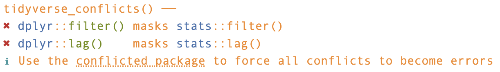

**Setup code - run this at the beginning**

```{r setup}
#| message: false
if (!requireNamespace("pacman", quietly = TRUE)) install.packages("pacman")
pacman::p_load(tidyverse, scales)
```

::: callout-note
If you ever need to update packages, the function is `update.packages()`. Using `update.packages(ask = FALSE)` prevents *R* from asking about each individual package. Note that some packages require extra tools to be installed (e.g., [Rtools](https://cran.r-project.org/bin/windows/Rtools/) for Windows, or [MacOS command line tools](https://mac.r-project.org/tools/)).
:::

# 1 - Welcome

Welcome to part 2 of the *Foundations of R for Bioinformatics* course. Last week we worked with an RNAseq results data table I had prepared earlier—one row per gene, with fold changes and *p*-values already calculated. This data came from a [real-world study](https://doi.org/10.7150/ijms.80942) where researchers were analysing transcriptomic changes following traumatic brain injury using a rat model. The data consisted of 8 samples: 4 TBI samples, and 4 control (sham) samples. We used this data table to do some data exploration, by plotting different aspects of the data using **ggplot2**.

Today we’re going to continue using this data and build on our previous work in two stages, both focused on another key aspect of data science in *R*: **data wrangling**, i.e., exploring data and getting it into the shape you need to analyse or plot it. First, we’ll start with last week’s `results` table and use it to help us learn the handful of **dplyr** functions (part of the **tidyverse**) that will do the vast majority of your data wrangling for the rest of your coding career.

Then we go back a step and start from the actual raw output that comes from RNA sequencing: a **count matrix**, in our case \~38,000 genes across 8 animals. This is where data wrangling really earns its keep. Not all data that you generate or receive from others will be ready to use or plot in the way our example data last week was, as we will see with the count matrix.

Getting from that matrix to something you can plot is what this session is ultimately about. Along the way, you’ll learn to reshape and **tidy** data and join separate tables together.

You may already be wondering what is meant by "tidying" data—can data even be *un*tidy? The answer, from the perspective of *R*, is yes! We will get to that later in this session.

As before, this session is inspired by [*R for Data Science (2nd Edition)*](https://r4ds.hadley.nz/) by Hadley Wickham & Garrett Grolemund, adapted for our real-world RNAseq data.

## 1.1 - Goals for session 2

This document will teach you how to:

- Use the **pipe** to build clear, readable, reproducible code

- Apply `filter()`, `arrange()`, `select()`, `mutate()`, `group_by()` and `summarise()` to explore and transform real data

- **Import** several related datasets into *R* and explain how they fit together

- Explain what "**tidy data**" means and why it matters

- Convert between **wide** and **long** format with `pivot_longer()`

- Combine tables with **`left_join()`**

- Calculate **TPM** for comparisons of gene counts across samples

## 1.2 - Packages required

We're using `readr` (import), `dplyr` (transformation), `tidyr` (reshaping), `ggplot2` (plotting) and `forcats` (factors)—all part of the `tidyverse`, so loading that covers us. I've added an extra one, called `scales`, which helps format big numbers on plot axes.

These were all loaded in the setup chunk at the top.

If you use the `library()` function to load a package, you might get something like the following warning:



This says that `dplyr` overwrites some functions in base *R*. If you want the base version after loading `dplyr`, you need the full name: `stats::filter()`. We've mostly ignored which package a function comes from because it doesn't usually matter—but knowing helps you find help and related functions. When we need to be precise we use *R*'s own syntax: `packagename::functionname()` (it's actually good practice to *always* do this). You saw this already with `pacman::p_load()`. This will come up again in Session 3, when we start using `DESeq2`.

------------------------------------------------------------------------

# 2 - Session 1 recap of key concepts

## 2.1 - Writing and running code

All our work happens in a Quarto document loaded into RStudio, which lets you write normal text alongside code that can be run separately. Code goes in a **chunk**, inserted with the green C button , and runs when you click the green triangle in the top right corner of each chunk:

```{r recap-maths}
1 + 1
```

Output appears below the chunk and in the console. You can also run code directly in the console by typing it in and pressing Enter. This is not usually recommended as it makes it harder to keep track of all the code you have typed. Alternatively, you can run a single line of code, either in a chunk in Quarto or in an *R* Script, by selecting your cursor to the start of that line and pressing Ctrl (Cmd on Mac) Enter.

## 2.2 - Objects, variables and functions

Data is stored in **objects** which will have some kind of **value** (this could be a single digit, or the result of some function, or it could even be an entire dataset).

Some objects are built into *R* (e.g., `pi`); most of the time, **you** create them.

You create an object using the [**assignment operator**]{.underline} `<-`:

```{r recap-x}
x <- 12

# And you can print an object by typing its name
x
```

This means "take the value on the right and store it in the name on the left". The object appears in your Environment pane (top right).

Every object in *R* has a **type**, which tells *R* how it can be used. The most common types are:

- **Numeric**: numbers you can do maths with. These are split into subtypes:

  - **Double:** A double allows you to store numbers as decimals. This is the default treatment for numbers. *Examples*: `3.14`, `6.0`
  - **Integer:** whole numbers. *Examples*: `1L`, `100L` (the `L` tells R it’s an integer).

- **Character**: text, always written inside quotes.

  - *Examples*: `"geneA"`, `"hello world"`

- **Logical**: true/false values (also written as `TRUE` or `FALSE`).

  - *Examples*: `TRUE`, `FALSE`

- **Factor**: categories (useful for groups or experimental conditions)

  - *Example*: `factor(c("TBI", "sham", "sham"))`

You can check the type of any variable with the `class()` function. For example:

```{r classes}
x <- 12
class(x)     # numeric

y <- "geneA"
class(y)     # character

z <- TRUE
class(z)     # logical

a <- factor("control")
class(a)    # factor
```

Last session, we used some basic **functions** and learned their overall structure. Every function takes the format `function_name()` and within those brackets you will specify **inputs** (otherwise known as **arguments** or **options**) which the function will use to produce an **output**:

```{r function-structure}
#| eval: false
function_name(argument1 = value1, argument2 = value2, ...)
```

For example, we used the `seq()` function to make a sequence of numbers, and we used the `ggplot()` function to produce plots from our `results` dataset.

We are going to be using many more functions in this session, the majority of which come from the `tidyverse` **package**, which is why we have installed and loaded that package at the beginning of this session. Remember, packages are essentially just a collection of functions (and sometimes datasets) written and maintained by other data scientists which **extend the functionality** of *R*. Without packages, we would be limited to just the functions found in **base R** and would be unable to do more complex analyses, such as those required for bioinformatics and RNAseq.

#### Our data:

Before we move on, we will load the data in, the same as last week.

This data is a **results** table following **differential gene expression** analysis using `DESeq2`, comparing transcriptomic changes **following traumatic brain injury** in rats. The table contains log2 fold-changes in gene expression (how much expression increased or decreased) as well as adjusted *p*-value (how statistically significant those changes were), among other information. If the log2 fold-change is positive, then that gene's expression was *increased* following TBI; if it is negative, then that gene's expression was *decreased* following TBI.

The data table is in the ".csv" file format, which is a very common way of storing tabular data. We can load it into *R* using `read_csv()` which comes from the `tidyverse` package, and assign it (`<-`) to an object called `results`. **Make sure you run this chunk or a lot of the subsequent code won't work!**

```{r read-results-recap}
results <- read_csv("data/results_unfiltered.csv")
```

## 2.3 - The pipe `|>`

The **pipe** takes the result of one step and passes it as the first argument to the next function. You saw simple examples last week; its real power appears when combining multiple steps.

Suppose we want to take our results from last week, keep only the significant genes, sort them by fold change, and show the top few.

The logical flow is:

**data → filter by significance → arrange by fold change → select the top few**

**I** [**don't expect**]{.underline} **you to know any of the functions** required to do this yet (hopefully by the end of the session you will!), but consider the 3 options we have below (**You do not need to master all three** — I’m showing them so you can see why the pipe is nicer).

Here are the 3 different options for achieving what we want.

Option 1 — **nesting functions:**

```{r nesting}
head(
  select(
    arrange(
      filter(
        results,        # our data - look how buried it is!
        padj < 0.05
      ),
      desc(log2FoldChange)
    ),
    GeneID, log2FoldChange, padj
  )
)
```

Option 2 — **intermediate objects:**

```{r intermediate}
results_sig     <- filter(results, padj < 0.05)
results_sorted  <- arrange(results_sig, desc(log2FoldChange))
results_slim    <- select(results_sorted, GeneID, log2FoldChange, padj)
head(results_slim)
```

Option 3 — **the pipe:**

```{r pipe-demo}
results |>                              # data right at the front
  filter(padj < 0.05) |>
  arrange(desc(log2FoldChange)) |>
  select(GeneID, log2FoldChange, padj) |>
  head()
```

**Run all three. What do you notice about the output?**

*Write down your thoughts here:*

.

.

.

*Then scroll down for answer*

.

.

.

.

.

.

.

.

.

.

.

*Answer*

The output is **identical**. But the piped version reads like a sentence:

1.  Take the `results` data
2.  Keep only rows where padj is below 0.05
3.  Sort by fold change, largest first
4.  Keep just three columns
5.  Show the first six rows

There's no rule about which you choose—you may find you prefer intermediate objects, and that's fine. But (in my opinion) the pipe makes code easier to type, read and troubleshoot, so it's the style used throughout this course.

## 2.4 - Making graphs with `ggplot()`

Last week we made five figures using `ggplot2`, finishing with the volcano plot. Every one of those plots was built from the same **grammar of graphics** (the gg in ggplot), and the same three core ideas:

1.  **Data**—the table you're plotting
2.  **Aesthetics** (`aes()`)—which columns map to which visual properties (x position, y position, colour...)
3.  **Geoms** (`geom_*()`)—the geometric shapes used to represent the data (points, bars, boxes, lines...)

On top of these, we can add **layers** to control how the plot looks:

- **Scales** (`scale_*()`) control *how* the data is mapped onto an aesthetic, e.g., `scale_x_log10()` or `scale_colour_manual()`
- **Labels** (`labs()`) set the text: axes, title, legend headings
- **Themes** (`theme_*()`) control the overall look, e.g., `theme_minimal()`

Here's the MA plot from last week as a reminder, with each part labelled:

```{r recap-ggplot}
#| warning: false
results |>  # data
  ggplot(aes(x = baseMean, y = log2FoldChange)) + # aesthetics
  geom_point(alpha = 0.3, size = 0.8) + # geom
  scale_x_log10() +     # scale
  labs(x = "Mean expression", y = "log2 fold change") + # labels
  theme_minimal()      # theme
```

Remember that `|>` is used to pipe the data into the `ggplot()` function, whereas `+` is used to add on additional layers. Both have to go at the end of the line, not at the start.

Two other things about `ggplot()` from last week are important to remember:

- **Inside or outside `aes()`?** If you want something to *vary with the data* (e.g., colour points by whether a gene is significant), it goes **inside** `aes()`. If you want it to be a *fixed value* for every point (e.g., all points semi-transparent), it goes **outside** `aes()`, in the geom. That's why `alpha = 0.3` sits in `geom_point()` above, but `colour = significant` sat inside `aes()` in our volcano plot last week.

- **Plots are objects.** Like anything else in *R*, a plot can be assigned to a name with `<-`, and you can keep adding layers to it later with `+`.

## 2.5 - Exercises

**1. What type is it?** Without running the code, predict what `class()` will return for each line by typing in a comment next to it. Then run the chunk and check. Were any of them surprising?

```{r ex-2.5.1-types}
#| eval: false
class(42) # comment
class("42") # comment
class(42L) # comment
class(TRUE) # comment
class("TRUE") # comment 
```

**2. What's in the box?** Read the code below carefully and predict what `y` will be when it is printed at the end. Then run it.

```{r ex-2.5.2-assign}
#| eval: false
x <- 10
y <- x * 2
x <- 3
y # what value will y be?
```

**3. One bad value.** Imagine you've typed read counts for one gene into *R*, but one value has crept in as text. Run the code below. What type is `gene_counts`, and why does `mean()` not give you a number? How would you fix it?

```{r ex-2.5.3-coercion}
#| eval: false
gene_counts <- c(120, 85, "203", 97)
class(gene_counts)
mean(gene_counts)
```

**4.** **Without running it**, predict what this code will produce. More rows than `results`, fewer, or the same? Which columns will be present? Will `results` be overwritten? (You might not know exactly what these functions are, but try to have a guess what they might do)

*Your answer*:

Then run it. Were you correct?

```{r ex-2.5.4}
#| eval: false
results |>
  filter(chromosome == "X") |>
  select(GeneID, log2FoldChange)
```

**5. Find the missing piece.** This code is meant to keep the significant genes and then sort them by fold change, largest first. Run it. You'll get some output *and* an error. Why does part of it work, and what is missing?

```{r ex-2.5.5}
#| error: true
results |>
  filter(!is.na(padj) & padj < 0.05)
  arrange(desc(log2FoldChange))
```

**6. Fix the broken pipe.** The code below is intended to give a table of the genes on chromosome 1 that have an adjusted p-value (i.e., not `NA`), sorted from smallest to largest `padj`. The final table should contain only the `GeneID`, `log2FoldChange` and `padj` columns. So the logical flow is: filter for anything which has a proper padj (not NA) \> filter for genes on chromosome 1 \> select the columns we want \> arrange by padj.

Run the code and read the error. Then rearrange the lines to fix it, without writing in any more code.

```{r ex-2.5.6}
#| error: true
results |>
  select(GeneID, log2FoldChange, padj) |>
  filter(!is.na(padj)) |>
  filter(chromosome == "1") |>
  arrange(padj)
```

**7. Translate into a pipe.** The code below uses intermediate objects to find the genes on chromosome 7, sorted from smallest to largest `padj`, and shows the first six rows. Rewrite it as a single pipe that gives the same output, without creating any new objects.

```{r ex-2.5.7}
#| eval: false
results_chr7        <- filter(results, chromosome == "7")
results_chr7_sorted <- arrange(results_chr7, padj)
head(results_chr7_sorted)
```

```{r ex-2.5.7-student-answer}
#| eval: false

results |> 
  YOUR_CODE_HERE
```

**8.** **Adding aesthetics to a plot.** Here's the code we used in Section 2.4 above for making the MA plot. Just one small addition will allow us to colour every point by which chromosome it is on: `, colour = chromosome`. Where does this need to go?

```{r ex-2.5.8}
#| warning: false
#| eval: false


results |>  # data
  ggplot(aes(x = baseMean, y = log2FoldChange)) + # aesthetics
  geom_point(alpha = 0.3, size = 0.8) + # geom
  scale_x_log10() +     # scale
  labs(x = "Mean expression", y = "log2 fold change") + # labels
  theme_minimal()      # theme
```

------------------------------------------------------------------------

# 3 - Transforming data with `dplyr`

The following sections will introduce you to the fundamental `dplyr` **functions** which will solve the majority of your data exploration challenges. `dplyr` is part of the `tidyverse` and was loaded when we ran our setup code at the beginning of the document.

We will use our `results` from last week to help us with this, so let's load it in using `read_csv()`:

```{r load-results}
results <- read_csv("data/results_unfiltered.csv")
```

All of these `dplyr` functions share a common structure:

- They take a **data table (or tibble)** as their first input

- Then they take instructions about **what to do to the data**

- The output is always a new data table.

- And they’re designed to work especially well with the **pipe** (`|>`), which lets us *send the data into the function* without writing it as the first argument

So even though the first argument is the data table, we usually *pipe* the data into the function instead of typing it:

```{r}
results |>
  filter(GeneID == "Gfap")
```

This is equivalent to:

```{r}
filter(results, GeneID == "Gfap")
```

Each function typically does just one thing. Therefore, complex problems typically involve combining these functions one after another, which is what makes the pipe so useful.

Here’s a quick example:

> *Take the results data, then group it by chromosome, then count the number of genes.*

```{r dplyr-demo}

results |>
  group_by(chromosome) |>
  summarise(n_genes = n()) # n() is a quick way of counting
```

All of these functions are organised by what they operate on: **rows**, **columns**, **groups** or **tables**. We'll meet the most important of the table functions (`left_join()`) later in the document, so this section will focus on rows, columns and groups.

## 3.1 - Rows: `filter()`, `arrange()` and `distinct()`

The 2 most important functions here are:

- `filter()` - changes which rows are present without changing their order

- `arrange()` - changes the order of the rows without changing which are present

The columns are left unchanged. Another function is `distinct()` which finds rows with unique values (and can optionally modify the columns, unlike the other two).

### 3.1.1 - `filter()`

`filter()` allows you to keep rows based on the values of the columns. The first argument is the data table/tibble (we skip this in our case because we are piping our data *into* the function). The second and subsequent arguments are the **conditions** that must be **true** to keep the row.

Above, we used this to select just the row for Gfap. For this, the condition was that the "GeneID must equal Gfap", which is written as `GeneID == "Gfap"`:

```{r}
results |>
  filter(GeneID == "Gfap")
```

Note we have to use the double equals `==` here, because otherwise *R* might think we are trying to *assign* the name "Gfap" to `GeneID` (in other programming languages e.g., Python, the assignment operator is `=`, so *R* is very specific about when to use a single equals sign to try to avoid confusion with other languages).

Running that chunk shows us a preview of a new data table that satisfies the requirements of our filter. Note that this **hasn't changed our original data** (we haven't overwritten it) and we also **haven't saved it to a new object**, so it literally only exists as a preview below that chunk.

We could use a different condition to select genes where their adjusted *p*-value is below a certain threshold (e.g., 0.05), like we did in Session 1. This is written as `padj < 0.05`:

```{r filter-demo}
results |>
  filter(padj < 0.05)
```

Note again this *hasn't* changed `results`—and we didn't save the output anywhere by assigning it to an object. Look at `results` in your Environment tab: still 38,675 rows. To keep the result, assign it to a new variable with a sensible name, e.g., in this case `sig_genes`:

```{r filter-save}
sig_genes <- results |>
  filter(padj < 0.05)

# How many genes are significant? We can count the number of rows using nrow():
nrow(sig_genes)
```

This example reiterates the key difference between the *assignment operator `<-`* and the *pipe* `|>`.

- `<-` means assign what's on the right to the thing on the left.

- `|>` means take what's on the left and do the thing on the right to it.

Any code where we don't *assign* the result to a new object—think of this as your **working memory**. It's for testing code and quickly visualising the output, and everything is just contained within that chunk.

If we are happy with the code and want to store the output in a new *R* object, that's where the assignment operator `<-` comes in—this is more like your **long term memory.**

Alternatively, if we started that chunk of code with `results <- results |>`, what do you think would happen?

*Write down your thoughts here:*

.

.

.

*Then scroll down for answer*

.

.

.

.

.

.

.

.

.

Answer: we would have overwritten our `results` object with whatever changes we made to it in the pipe.

Back to `filter()`...

Among the different options for filtering are: `>` (greater than), `>=` (greater than or equal to), `<` (less than), `<=` (less than or equal to), `==` (equal to), and `!=` (not equal to). You can also combine conditions with `&` or `,` to indicate “and” (check for both conditions) or with `|` to indicate “or” (check for either condition). And `!` before something means `NOT`, e.g., `!is.na(padj)` means "NOT NA for adjusted *p-*value":

```{r filter-multi}
# the abs() function takes the absolute value independent of sign
results |>
  filter(!is.na(padj), padj < 0.05, abs(log2FoldChange) > 1) |>
  nrow()
```

Those are the 1,955 red points from the volcano plot in Section 5.8, Exercise 2 last week—all of the genes which have an adjusted *p*-value below 0.05 and a log2 fold-change of at least 1 in either direction (log2 fold-change of 1 would be a doubling of expression levels, and -1 would be a halving in expression levels).

::: callout-important
### `NA` in filters

`filter()` silently drops rows where the condition is `NA`. That's usually what you want, but it means `filter(padj < 0.05)` quietly discards the untestable genes. Being explicit — `filter(!is.na(padj), padj < 0.05)` — makes your intent visible to the next person reading your code (which is often you, in six months).
:::

There’s a useful shortcut when you’re combining OR `|` and EQUALS `==`, which is `%in%`. It keeps rows where the variable equals one of the values in the little `c()` brackets:

```{r in}
results |>
  filter(GeneID %in% c("Gfap", "Ttr"))
```

A common mistake is writing “OR” statements like you would naturally in English. We might read the code below as "filter the GeneIDs to only include Gfap or Ttr" but that is not how it is interpreted by *R.* With some variables, this might not cause an error (but still won't give you what you meant). In our case it does cause an error:

```{r bad-or}
#| error: true

results |>
  filter(GeneID == "Gfap" | "Ttr")
```

To fix it, you either use the `%in%` trick above, or you have to be explicit with what comes after the "OR":

```{r fixed-or}

results |>
  filter(GeneID == "Gfap" | GeneID == "Ttr")
```

### 3.1.2 - `arrange()`

`arrange()` lets us **reorder the rows** of a data table based on the values in one or more columns.

By default, it sorts **from smallest to largest**. If you sort by more than one column, the second column is only used when the first column has ties.

A useful helper function is `desc()`, which tells `arrange()` to sort in **descending order** (largest to smallest):

```{r arrange-demo}
results |>
  filter(padj < 0.05) |>
  arrange(desc(log2FoldChange))
```

To sort the same column from **smallest** to **largest**, we just remove `desc()`, because ascending order is the default:

```{r arrange-demo-2}
results |>
  filter(padj < 0.05) |>
  arrange(log2FoldChange)
```

### 3.1.3 - **`distinct()`**

`distinct()` is used to find the **unique** rows in a dataset. In other words, it removes duplicates. Our `results` dataset doesn’t actually contain duplicated rows, so running `distinct()` on the whole tibble won’t change the number of rows:

```{r distinct}
# Remove duplicate rows, if any
results |>
  distinct()
```

Since no rows are duplicates, the output is the same size as the input.

#### **Finding unique values in specific columns:**

Often, what you really want is the list of **unique values** for a single column. For example, if we want to see all the different chromosomes:

```{r}
results |>
  distinct(chromosome)
```

This returns one row per group—a quick way to check what categories exist in your dataset. Note the order is just the order they happen to appear in the data set, rather than numerical or alphabetical.

#### **`count()` - Counting how many of each group there are**

If instead of listing the groups you want to **count** how many rows fall into each one, `count()` is the better tool. It also has a built-in option to sort the results (`sort = TRUE`):

```{r count}

results |>
  count(chromosome, sort = TRUE)

```

**What is this telling you?**

*Write down your thoughts here:*

.

.

.

*Then scroll down for answer*

.

.

.

.

.

.

.

.

.

.

Answer:

It is the count of the number of genes per chromosome in our `results` dataset.

#### 3.1.4 - Exercises

1.  Use `filter()` on `results` to keep only the genes which have a `baseMean > 10`. How many rows remain?

```{r ex-3.1.4.1}
#| eval: false

results |>
  YOUR_CODE_HERE

```

2.  The code chunk below attempts to filter for just Gfap and Ttr. What are the two problems with it? How can you fix it? (There are 2 possible ways to do this. Hint: one way uses `%in%`)

```{r ex-3.1.4.2}
#| eval: false

results |>
  filter(GeneID = "Gfap" | "Ttr")
```

3.  Arrange `results` by `stat`, descending. What gene ends up on top?

```{r ex-3.1.4.3}
#| eval: false

results |>
  YOUR_CODE_HERE
```

4.  How many genes are significantly changed (`padj < 0.05`) on each chromosome? *Hint: `filter()`, then `count(chromosome)`*.

```{r ex-3.1.4.4}
#| eval: false
results |>
  YOUR_CODE_HERE
```

## 3.2 - Columns: `select()`, `mutate()`, `rename()` and `relocate()`

These functions let you change **which columns** you see, **what they’re called**, **where they appear**, or **create new ones**. They never change the number of rows.

The key functions are:

- `select()` – keep or remove columns

- `mutate()` – make new columns

- `rename()` – change column names

- `relocate()` – move columns around

### 3.2.1 - `select()`

`select()` is sort of like the columns version of `filter()` — rather than filtering for rows which fit certain criteria, we are selecting specific columns. `select()` chooses which columns you want to keep.

You can select by name and can specify more than one at a time:

```{r select-demo}
results |>
  select(GeneID, log2FoldChange, padj)
```

Select a **range** of columns:

```{r select-range}
results |>
  select(GeneID:gene_length)
```

Select everything **except** a range:

```{r except-range}
results |>
  select(!GeneID:gene_length)
```

Remove specific columns:

```{r remove}
results |>
  select(-gene_length, -baseMean)
```

Select columns based on their **type**:

```{r select-specific-variables}
results |>
  select(where(is.character))
```

Useful helper functions inside `select()`:

- `starts_with("abc")`: matches names that begin with “abc”.

- `ends_with("xyz")`: matches names that end with “xyz”.

- `contains("ijk")`: matches names that contain “ijk”.

- `num_range("x", 1:3)`: matches `x1`, `x2` and `x3`.

You can also **rename columns** as you select them (this doesn't automatically overwrite it unless you re-assign the variable though!). The new name should go on the left-hand side of the `=`, and the old name should go on the right-hand side.

```{r select-rename}
results |>
  select(Gene_name = GeneID)
```

### 3.2.2 - `mutate()`

`mutate()` is an incredibly helpful and versatile function: it creates new columns where the values are assigned manually, or calculated from values in other columns, or the result of some function which uses the values in other columns as input. It can also modify (if the name is the same as an existing column) and delete columns (by setting their value to `NULL`).

Suppose you want to create one column which contains the negative log10 of the adjusted *p*-value (which we need for our volcano plot from last week), and another column which flags if a gene was significant or not. You give the column a name first (e.g., `significant`) and write a formula relating to other columns to calculate it:

```{r mutate-demo}
results |>
  mutate(
    neg_log10_padj = -log10(padj), # a comma between each new column
    significant    = !is.na(padj) & padj < 0.05
  )

```

By default, new columns appear all the way on the right hand side (so you might have to scroll right to see it).

Notice we *do* use the single `=` sign for `mutate()`. This is because we are making a new column assignment: we give it a name on the left of the equals sign and a formula for how it is calculated (or a conditional if making a TRUE/FALSE variable) on the right. Don't ask me why the assignment symbol for this is `=` whereas it is `<-` elsewhere because I do not know—it's the wisdom of all the *R* powers-that-be!

Also notice that each new column we are making I have written on a separate line in `mutate()` following the comma of the previous: this is purely syntax style, it makes it nice and clear to look at, but isn't strictly necessary. All that matters is that there is a comma between the arguments of the `mutate()` function.

You can choose where to place the new columns using the `.before` or `.after` argument within `mutate()`:

```{r}
results |>
  mutate(
    neg_log10_padj = -log10(padj),
    significant    = !is.na(padj) & padj < 0.05,
    .after = chromosome
  )

```

A common pattern is **mutate → select**, especially when you want to focus on a few key columns.

For example, what if we wanted to create our new `significant` column, and then only show that column, the columns used to create it, and the GeneID?

```{r}
results |>
  mutate(
    significant = !is.na(padj) & padj < 0.05) |>
  select(
    GeneID, padj, significant
  )
```

Again, if we want to overwrite our `results` object to contain this new column, we need to make sure we assign everything to it at the beginning:

```{r overwrite-results}
results <- results |>
  mutate(
    significant = !is.na(padj) & padj < 0.05
  )

results
```

Like last week, we can also fix our weird chromosome order using `mutate()`.

What type of variable is `chromosome` currently?

```{r check-chromosome}
# We can just look at the results table to see
results
```

`chromosome` is currently a `character` variable (\<chr\>) and we want it to be a `factor`, so we use the `factor()` function (more on this next week). First, we will make a `character` vector of the numbers 1:20, which can be our numbered chromosomes. `as.character()` allows us to do this:

```{r chrom-char}

chrom_char <- as.character(1:20)

# Look at what we've made. You should see the numbers 1 to 20 each surrounded by quotes which indicates they are characters.
chrom_char
```

Next, we can attach the other chromosomes (`X`, `Y` and `unplaced`) onto the end of this vector. To combine things into new vectors, we use the combine function, `c()`.

```{r}

# This means "attach X, Y and unplaced to the end of my chrom_char vector"
chromosome_levels <- c(chrom_char, "X", "Y", "unplaced")

# Let's look at it:
chromosome_levels

```

Now we can use this object to re-factor the levels of `chromosome` in our `results` table:

```{r convert-chromosome}
# By calling our "new" column the same as our old column, it is an overwrite. We aren't overwriting the values, but changing them from characters to factors, with a specified order.
results <- results |>
  mutate(
    chromosome = factor(chromosome, levels = chromosome_levels)
  )
```

Did it work?

```{r}
# chromosome should now be a factor, <fct>
results
```

Not only have we properly converted that variable into a factor (\<fct\>), we have also explicitly defined its **order**. We saw last week that this was important so that the chromosomes were in numerical order in our plot. Next week, we will see why getting factors in the right order is also important when it comes to our differential gene expression analysis using `DESeq2`.

#### `case_when()` for multiple conditional statements

`case_when()` allows us to give different labels to the data depending on different conditions. For example, **we could classify each gene as up, down, or unchanged.** For a gene to be up or down-regulated, it first needs to be significant. So we will make that column first in case you haven't earlier:

```{r make-significant}
results <- results |>
  mutate(
    significant = !is.na(padj) & padj < 0.05
  )

results
```

Now we can say that:

- If a gene is significant and has a positive log2FoldChange, it is "UP"

- If a gene is significant and has a negative log2FoldChange, it is "DOWN"

- If it is neither, it is "UNCHANGED"

We can use `mutate()` to store that in a new column called `direction` and count how many genes fall into each possibility:

```{r case-when}
results |>
  mutate(
    direction = case_when(
      significant & log2FoldChange > 0 ~ "UP",
      significant & log2FoldChange < 0 ~ "DOWN",
      .default = "UNCHANGED"
    )
  ) |>
  count(direction)
```

::: callout-tip
#### Reading `case_when()`

Each line is `condition ~ value`. *R* works down the list and takes the **first** condition that's true, so order matters. `.default` catches everything that fell through.
:::

### 3.2.3 - `rename()`

`select()` removes all of the other columns you haven't selected.

Use `rename()` when you want to **keep all** columns but change a few names:

```{r rename}
results |>
  rename(Gene_name = GeneID)
```

If you have a bunch of inconsistently named columns and it would be painful to fix them all by hand, there is a function in the `janitor` package called `clean_names()` which provides some useful automated cleaning.

### 3.2.4 - `relocate()`

`relocate()` moves columns around.

By default, it brings columns to the **front**:

```{r relocate}
results |>
  relocate(chromosome)
```

You can also use `.before` or `.after` for finer control, just like with `mutate()`:

```{r relocate-before}
results |>
  relocate(baseMean, .before = gene_length)
```

### 3.2.5 - Exercises

1.  Use `select()` to show only the columns `gene_length` and `log2FoldChange`.

```{r ex-3.2.5.1}
#| eval: false

results |>
  YOUR_CODE_HERE
```

2.  Use `mutate()` to create a new column called `inverse_stat` which is calculated by taking `1/stat`. Then, use `relocate()` to bring this column to the front.

```{r ex-3.2.5.2}
#| eval: false

results |>
  mutate(inverse_stat = YOUR_CODE_HERE) |>
  relocate(YOUR_CODE_HERE)
    
```

3.  `ifelse()` can be used to apply a conditional logic test, and determine what should happen if that test is TRUE or FALSE (effectively, it's a binary choice version of `case_when()`). For example, the following code would allow us to assign genes as "tested" or "not tested" based on whether they have a *p*-value or not:

    `ifelse(is.na(pvalue), "not tested", "tested")`

    Using this, and `mutate()`, create a column in `results` indicating whether a gene was able to be tested or not. Use `.before = GeneID` to bring this column to the front of the table.

```{r ex-3.2.5.3}
#| eval: false

results |>
  YOUR_CODE_HERE
```

## 3.3 - Group functions: `summarise()` and `group_by()`

So far we've covered functions that work with **rows** and **columns**. `dplyr` becomes even more powerful when you add the ability to work with **groups**. Grouped operations let you:

- split your data into meaningful categories

- compute summaries inside each category

- optionally visualise or transform those results

The two core group functions are:

- `group_by()` – define the groups

- `summarise()` – creates one summary row per group

`summarise()` collapses many rows into one. So if we wanted to calculate the median `baseMean` across all of the genes in `results`:

```{r summarise-demo}
results |>
  summarise(median_baseMean = median(baseMean))
```

On its own that's rarely useful. `group_by()` makes it powerful—it splits the data, applies the summary to each piece, and reassembles. For example, we could group by whether a gene was significant or not before applying the summary:

```{r group-by-demo}
results |>
  group_by(significant) |>
  summarise(median_baseMean = median(baseMean))
```

You can also group by more than one thing:

```{r group-multi-results}
results |>
  group_by(chromosome, significant) |>
  summarise(n_genes = n())
```

## 3.4 - Exercises

1.  Using `group_by()` and `summarise()`, calculate the mean `log2FoldChange` of the **significant** genes on each chromosome. *(Hint: you'll need to `filter(padj < 0.05)` first.)*

```{r ex-3.4.1}
#| eval: false
results |> 
  filter(YOUR_CODE_HERE) |> 
  group_by(YOUR_CODE_HERE) |> 
  summarise(mean_logfold_change = YOUR_CODE_HERE)
```

2.  Find the 5 genes with the largest **negative** fold change that are also significant, showing only `GeneID`, `log2FoldChange` and `padj`.

```{r ex-3.4.2}
#| eval: false

results |>
  filter(YOUR_CODE_HERE) |>
  arrange(YOUR_CODE_HERE) |>
  select(YOUR_CODE_HERE) |>
  head(5) # selects the top 5 rows
```

3.  Make a boxplot of the log fold change standard error `lfcSE` of genes on chromosomes "X" and "Y", with one box per chromosome. Remember these chromosome names need to be in quotes.

```{r ex-3.4.3}
#| eval: false

results |>
  filter(chromosome %in% c(YOUR_CODE_HERE)) |>
  ggplot(aes(x = YOUR_CODE_HERE, y = YOUR_CODE_HERE)) + 
  geom_boxplot()
  
```

------------------------------------------------------------------------

# 4 - Where does RNAseq data come from?

Before we load the files we are going to be using for the rest of the session, we should just quickly go over where these files actually come from. We will talk more about this in our final session, but I do want to briefly touch on it now. The following is a typical workflow for how RNA sequencing data is produced:

**1. Sequencing → FASTQ.** The sequencer reads short fragments of cDNA and writes them to a text file (FASTQ): millions of short sequences, each with a quality score. These files are enormous, often several gigabytes per sample.

**2. Alignment → BAM.** Each read is matched against a reference genome to work out where in the genome it came from. The output is a BAM file, which records the genomic coordinates for every read.

**3. Counting → count matrix.** For each gene, count how many reads landed inside it. The output is a table: **one row per gene, one column per sample**. That's one of the files we're about to open, a **count matrix**.

Steps 1 and 2 are computationally heavy and usually run on a high-performance computing cluster (e.g., the [BEAR](https://www.birmingham.ac.uk/research/arc)) rather than a laptop or standard PC—we'll look at the code for them in the appendix to Session 3. Step 3 onwards is where *R* takes over, and where you'll spend most of your time.

Our data comes from a study of rat brain after traumatic brain injury: NIH BioProject **PRJNA902029**, published as *Zhu, X., Cheng, J., Yu, J., Liu, R., Ma, H., & Zhao, Y. (2023). Nicotinamide Mononucleotides Alleviated Neurological Impairment via Anti-Neuroinflammation in Traumatic Brain Injury. International Journal of Medical Sciences, 20(3), 307–17.* <https://doi.org/10.7150/ijms.80942>

------------------------------------------------------------------------

# 5 - Importing raw count data

## 5.1 - Loading the files

We will start with just one file, our **count matrix**, which is contained within the `data` folder. Because it is a ".csv" file, like last week, we load it using `read_csv()` and assign it to an object with a sensible name:

```{r read-counts}
counts <- read_csv("data/counts.csv")
```

Have a look at it:

```{r look-counts}
counts
```

`counts` is our **count matrix**. It contains the raw counts for each genomic location (roughly equivalent to gene) for each sample.

*I thought it would be important to have a closer look at a count matrix, because it is quite possible that this is exactly the sort of file you could receive yourselves if you send off some RNA for sequencing to an external company. Therefore, exploring what it contains (this session) and what to do with it (next session) is important!*

## 5.2 - Exercises

**1.** How many genes and how many columns does `counts` have? Use a function from last week. Hint: the answer will be the **dimensions** of the count matrix. How do we check the dimensions of an object in *R*?

```{r ex-5.2.1}
#| eval: false

YOUR_CODE_HERE
```

**2.** **Gfap** is a classic marker of reactive astrocytes, which increase in the brain after injury. Use `filter()` to find the row for Gfap in `counts`. Which animal has the most Gfap reads? Do you notice a pattern across the eight animals?

```{r ex-5.2.2}
#| eval: false

counts |>
  YOUR_CODE_HERE
```

# 6 - Tidying data with `tidyr`

In the real world, data arrives in all sorts of different formats. Biologists might get spreadsheets with samples as columns and measurements as rows; statisticians might get multiple values crammed into a single cell; social scientists might have variables spread over multiple sheets.

These formats usually make sense to humans, but they can make analysis harder.

In this section, we will cover a consistent way of organising data in *R* using a system called **tidy data**. We’ll focus on **tidyr**, a package that provides a bunch of tools to help tidy up your messy datasets. `tidyr` is also part of the larger `tidyverse` package.

Tidy data is not just about neatness. Once a dataset is tidy:

- The useful `tidyverse` functions (`filter()`, `mutate()`, `summarise()`, `ggplot()`) work consistently.

- Code becomes shorter, clearer, and easier to share.

- Complex workflows (RNAseq counts, clinical metadata, survey responses) become easier to visualise and analyse.

- Variables are placed into columns, which allows *R*'s vectorised nature (its main advantage over other programming languages) to shine.

## 6.1 - Wide *vs* long data (i.e., untidy *vs* tidy data)

I've used the phrase "tidy data", and it might seem strange to think of data as tidy or untidy. What does this mean? Is it to do with mess? Well, not really. It's about how the data is organised into rows and columns.

A dataset is *tidy* when it follows three simple rules:

1.  Each **variable** has its own **column**
2.  Each **observation** has its own **row**
3.  Each **value** resides in its own **cell**

To demonstrate this, the `tidyverse` package has three built-in tables which hold identical information—cases of TB by country and year—organised three different ways. They're all equally intelligible to a human, but vastly different in the eyes of *R*. Let's look at them and see if we can tell what makes them tidy or not:

```{r table1}
table1
```

```{r table2}
table2
```

```{r table3}
table3
```

- `table1` follows all three rules → **tidy**

- `table2` only satisfies rule 3. The `count` column mixes two different variables (population and TB cases), violating rule 1; and each year now spans two rows when it describes one observation, violating rule 2.

- `table3` satisfies rule 2, but the `rate` column crams two values into one cell, violating rules 1 and 3.

Because the `tidyverse` expects tidy data, functions behave much more reliably when your data follows these rules.

## 6.2 - What about the `counts` data we loaded?

Now look again at what we've just loaded (`counts`). One row is one **gene**, with 8 measurements: one for each animal.

The count matrix, `counts`, has been generated for us after counting how many times each gene region has a "hit" (more on this next session), and to make it more human-readable, it makes sense for each *column* to be a different sample and each *row* to be a different gene.

::: callout-note
### Why isn't `counts` tidy?

Look at the column names: `TBI2`, `TBI1`, `sham4`... Those aren't variables, they're *values* of a variable you could call "sample". That breaks rule 1.
:::

Most real data arrives in **wide** format, because researchers organise data with its *collection* in mind rather than its *analysis*. (Might be worth remembering for your own work: think about how your data will be analysed *before* you start entering it.)

In wide format:

- each sample is a separate column

- each measurement is spread across columns

- humans like this layout, but computers do not.

**Our `counts` table is exactly this**. It is in wide format, which makes sense for us but is an issue when we want to apply some of our `tidyverse` functions to it.

In **long** format, each measurement gets its own row, with extra columns saying which gene and which sample it belongs to. For example, a long format version of `counts` might look like this:

| GeneID | SampleName | Count  |
|--------|------------|--------|
| Gfap   | TBI2       | 122365 |
| Gfap   | TBI1       | 68386  |
| Gfap   | sham4      | 21462  |
| ...    | ...        | ...    |

Rearranging wide to long (or vice versa) is called **pivoting**. `tidyr` gives us the functions `pivot_longer()` and `pivot_wider()`; we'll cover `pivot_longer()` because it's far more common and what we actually need in this session. Long data is what we actually mean when we talk about data being **tidy**.

## 6.3 - `pivot_longer()`, to convert from wide to long

The first argument of this function is the data, which we achieve by piping our `counts` object into it. After this, there are three key arguments:

- `cols` — which columns need pivoting (i.e., which ones aren't variables). Uses the same syntax as `select()` (see Section 3.2). Here `!GeneID` means "everything except GeneID".
- `names_to` — what to call the new column holding the old column names.
- `values_to` — what to call the new column holding the cell values.

```{r pivot}

counts_long <- counts |>
  pivot_longer(
    cols      = !GeneID,          # every column except GeneID
    names_to  = "SampleName",     # the old column headers become this variable
    values_to = "Count"           # the cell contents go here
  )

# Look at our new table
counts_long
```

Look at what happened:

- **9 columns → 3 columns**
- **38,675 rows → 309,400 rows** (38,675 × 8 — definitely *longer*)
- each measurement now has its own row
- the table now follows all three tidy rules

::: callout-important
### Why bother?

Long format looks worse to a human—309,400 rows is not something you'd want to scroll through. But it's the format `ggplot2` and other `tidyverse` functions are built for. Almost every time you find yourself thinking "I can't work out how to plot/run statistics on this", the answer is that your data needs pivoting first.
:::

------------------------------------------------------------------------

# 7 - Using the `dplyr` functions on our count data

Now that `counts` is in long format, all of the `dplyr` functions from Section 3 work on it, and they allow us to make some meaningful interpretations.

## 7.1 - Library sizes - an important QC step

For example, we can use `group_by()` and `summarise()` to add up all of the reads in each sample:

```{r library-sizes}
library_sizes <- counts_long |>
  group_by(SampleName) |>
  summarise(library_size = sum(Count))

library_sizes
```

That's the **library size** of each sample—the total number of assigned reads. This isn't just a demonstration of the `group_by()` and `summarise()` functions; **it's actually a crucial QC check in every RNAseq workflow**. Let's plot it:

```{r library-size-plot}
library_sizes |>
  ggplot(aes(x = SampleName, y = library_size)) +
  geom_col() +
  scale_y_continuous(labels = label_comma()) + # a nice way of formatting large numbers is the label_comma() function from the scales package
  labs(
    x = NULL,
    y = "Total assigned reads",
    title = "Library sizes are comparable across all eight animals"
  ) +
  theme_minimal()

```

Between 14.1 and 18.4 million reads per animal—about a 1.3-fold spread. That's perfectly normal.

::: callout-important
### What you're checking for

If one sample had five million reads and another had fifty, or if all the TBI samples were systematically deeper than the shams, you would want to know **before** running any statistics. Large or group-correlated differences in library size point to a problem: poor cDNA quality, a failed library prep, or samples loaded unevenly on the flow cell.
:::

## 7.2 - Genes with no reads

We can also group by gene instead of by sample:

```{r all-zero}
counts_long |>
  group_by(GeneID) |>
  summarise(total_reads = sum(Count)) |>
  filter(total_reads == 0) |>
  nrow()
```

This adds up each gene's reads across all eight animals, then keeps the genes where the total is zero. 9,715 genes have **zero reads in all eight animals**, so there is nothing to test. Others have a handful of reads scattered across a couple of samples: technically non-zero, but nowhere near enough to say anything about.

Testing these low-count genes anyway would be actively harmful: every extra test makes the multiple-testing correction harsher, so uninformative genes would cost you statistical power on the genes you actually care about. Next session, we will go through how to do this filtering ourselves.

## 7.3 - Exercises

1.  Which sample has the **largest** library size, and which has the **smallest**? Use `arrange()` on the `library_sizes` object we made in Section 7.1.

```{r ex-7.3.1}
#| eval: false

library_sizes |>
  YOUR_CODE_HERE
```

2.  How many genes have **at least 10 reads in every one of the eight animals**? *(Hint: this is very similar to the code in Section 7.2, but instead of the `sum()` of each gene's reads, you want the `min()`.)*

```{r ex-7.3.2}
#| eval: false

counts_long |>
  group_by(YOUR_CODE_HERE) |>
  summarise(min_count = YOUR_CODE_HERE) |>
  filter(YOUR_CODE_HERE) |>
  nrow()

```

3.  Library size tells us the *total* number of reads in each sample, but it is also worth checking that the *distribution* of counts looks similar across samples. Because counts range from 0 to over 100,000, we usually look at them on a log scale. We add 1 to every count first, because the log of 0 is undefined.

    Use `mutate()` to create a new column called `log_count`, which is `log2(Count + 1)`. Then make a boxplot with one box per sample. Do the eight samples look similar?

```{r ex-7.3.3}
#| eval: false

counts_long |>
  mutate(log_count = YOUR_CODE_HERE) |>
  ggplot(aes(x = YOUR_CODE_HERE, y = YOUR_CODE_HERE)) +
  geom_boxplot()

```

4.  In Section 5.2, you looked at the Gfap row of `counts`. Now use `counts_long` to make a plot of the Gfap counts, with one point for each sample. Can you see a difference between the TBI and sham animals? If we wanted to put the two **groups** on the x-axis instead of the eight samples, what information is missing from `counts_long`? (This question links to the content in the next section!).

```{r ex-7.3.4}
#| eval: false

counts_long |>
  filter(YOUR_CODE_HERE) |>
  ggplot(aes(x = YOUR_CODE_HERE, y = YOUR_CODE_HERE)) +
  geom_point(size = 3)
```

------------------------------------------------------------------------

# 8 - Joining tables together

**The Problem:** Let's say we wanted to plot the expression of a single gene across each **group** in our experimental dataset. **Gfap** is a classic marker of reactive astrocytes, which are a hallmark of the brain's response to injury. If our TBI model has worked, we would expect more Gfap reads in the TBI animals than in the sham animals.

The plot we want is simple: the two groups on the x-axis, read count on the y-axis, and one point per animal. Our long version of `counts` already gets us part of the way there, and we can `filter()` to choose to look only at Gfap (see Section 3.1.1 for a reminder of `filter()`):

```{r gfap-by-sample}
counts_long |>
  filter(GeneID == "Gfap") |>
  ggplot(aes(x = SampleName, y = Count)) +
  geom_point(size = 3)
```

This is useful but not exactly what we wanted. We have our eight animals, but they aren't properly arranged into groups. You can work out the groups by reading the sample names, but *R* can't: to *R*, `TBI1` is just a piece of text, it doesn't know that it belongs to the TBI group. Let's ask for the plot we actually want, by putting Group as our x-variable:

```{r gfap-no-group}
#| error: true
counts_long |>
  filter(GeneID == "Gfap") |>
  ggplot(aes(x = Group, y = Count)) + # note we have asked now for x to be Group
  geom_point(size = 3)
```

In the error text is an old friend from Session 1: `object 'Group' not found`. Last time, that meant a typo. This time, the spelling is fine. The problem is that `counts_long` doesn't have a column called `Group`.

So how do we get it?

## 8.1 - Loading the other files

The information we need isn't in `counts` at all. It's in one of the two other files in the `data` folder, which we load in exactly the same way:

```{r read-other-files}
gene_info  <- read_csv("data/gene_info.csv")
sampleinfo <- read_csv("data/sampleinfo.csv")
```

Have a look at each one:

```{r look-geneinfo}
gene_info
```

`gene_info` contains 2 pieces of information for each gene: which **chromosome** it is on, and the **gene_length** in base pairs.

```{r look-sampleinfo}
sampleinfo
```

`sampleinfo` is a simple table which matches the columns in our `counts` file (the **SampleName**) and assigns each one to one of two **Group**s (either TBI or sham).

Here's how all three tables compare:

| Table | One row is... | Rows | Tidy? |
|------------------|------------------|------------------|------------------|
| `counts` | one **gene**, with 8 measurements | 38,675 | **No** - a count matrix is untidy |
| `gene_info` | one **gene** | 38,675 | **Yes** |
| `sampleinfo` | one **sample** | 8 | **Yes** |

We now have three tables because there are three different things being described. Gene length is a property of a *gene*—it doesn't change between animals, so storing it eight times for all 38,675 genes would be wasteful. Treatment group is a property of a *sample* (e.g., an animal in the experiment)—it's the same for all 38,675 genes in that column, so we only need one sample per row, hence there being 8 rows in `sampleinfo`.

Often datasets are split like this and it matters when we want to join different datasets together.

## 8.2 - `left_join()`

Our long counts table knows *which sample* each measurement came from, but not *which group* that sample was in. That information resides in `sampleinfo`. To use it, we need a **join**.

`left_join()` is the most common function for joining. It keeps every row of the table on the left of the function, and adds columns from the table on the right, wherever the **key** matches. But what should we use as a key?

Notice that when we pivoted in Section 6.3, we created a new column called `SampleName`. **Where else has this column name appeared?**

*Write down your thoughts here:*

.

.

.

*Then scroll down for answer*

.

.

.

.

.

.

.

.

*Answer:*

It is in our `sampleinfo` object:

```{r}
sampleinfo
```

Because `counts_long` and `sampleinfo` share this column name in common, and because the **values** of `SampleName` are shared too, we can use this as our **key** when joining together these 2 objects. Note that it doesn't matter that `sampleinfo` is only 8 rows while `counts_long` is 309,400 rows long—it is the matching of the keys which matters.

To see this matching in action, let's first try it on just the 8 rows for Gfap, where we can check every row by eye:

```{r join-gfap-preview}
counts_long |>
  filter(GeneID == "Gfap") |>
  left_join(sampleinfo, by = "SampleName")
```

Each sample has picked up its `Group` from `sampleinfo`. Now we can do the same for the whole table.

Let's do this matching now using the `left_join()` function, using **SampleName** as the key. We will save it to a new object called `counts_group`:

```{r join-sampleinfo}
counts_group <- counts_long |>
  left_join(sampleinfo, by = "SampleName")

counts_group
```

We now have a `Group` column in our `counts_group` object. This **join** is what makes everything below possible.

::: callout-note
### The `by` argument

`by = "SampleName"` says "match rows using this column, which exists in both tables". If your two tables call the same thing by different names, you write `by = join_by(SampleName == sample)`.

If you leave `by` out entirely, `dplyr` will guess by matching every shared column name and tell you what it did. That's convenient but risky—be explicit.
:::

## 8.3 - The payoff: plotting a single gene across groups

Now we can do the thing that we couldn't do a few moments ago. **Gfap** is the classic marker of reactive astrogliosis—it's what brain tissue does in response to injury. Let's look at its expression per **Group** now, rather than by sample:

```{r gfap}
counts_group |>
  filter(GeneID == "Gfap") |>
  ggplot(aes(x = Group, y = Count, colour = Group)) +
  geom_point(size = 3) +
  labs(
    title = "Gfap expression after traumatic brain injury",
    y = "Raw read count"
  ) +
  theme_minimal()
```

We can now see our 4 animals per group, and a clear separation between the groups.

**Try it yourself:** swap `Gfap` for `Emp1` or `H19` in the chunk above and re-run.

::: {.callout-tip collapse="true"}
### Now try `Ttr`

```{r ttr}
counts_group |>
  filter(GeneID == "Ttr") |>
  ggplot(aes(x = Group, y = Count, colour = Group)) +
  geom_point(size = 3) +
  labs(title = "Ttr — what is going on here?", y = "Raw read count") +
  theme_minimal()
```

One sham animal has around 18,600 reads for `Ttr`; every other animal in the study has fewer than 130.

`Ttr` is made by the **choroid plexus**—a small structure that produces cerebrospinal fluid. It isn't really part of the brain tissue you're trying to sample. What we're almost certainly seeing is that when this one animal was dissected, a fragment of choroid plexus came along with the sample.

This is a **technical outlier**, not a true result, and it's a good illustration of why you look at your data before you trust a statistic. `DESeq2` spots this outlier automatically and refuses to test `Ttr`: It's one of the genes with a missing p-value in our `results`. So in practice, you don't need to manually go through the counts for every gene in your data, as most differential expression tools have robust measures for dealing with outliers. But it's worth knowing how to plot individual genes if you get an unexpected result.
:::

## 8.4 - Exercises: annotating with gene information

1.  Suppose now we want to include the chromosome of each gene and its length in base pairs. **What table did we load which contains this information?**

```{r ex-8.4.1}
#| eval: false

YOUR_CODE_HERE

```

2.  What column does `gene_info` share with `counts_group`?

3.  Using your answer to the above, create a new object called `counts_annotated` by using `left_join()` with the appropriate key in the `by =` argument.

```{r ex-8.4.3}
#| eval: false

counts_annotated <- counts_group |>
  left_join(YOUR_CODE_HERE)

counts_annotated
```

If you've managed the above, then every row now contains its gene's chromosome and length as well as its sample's group. From three separate tables you've created one analysis-ready table in **long format**, ideal for use with our `tidyverse` functions.

.

*.*

*.*

*Scroll down for the next exercise*

.

.

.

.

.

.

.

.

.

4\. We will create the `counts_annotated` object if it hasn't already been made in the previous exercise:

```{r counts-annotated}
counts_annotated <- counts_group |>
  left_join(gene_info, by = "GeneID")
```

Now that every row has its gene's length, we can ask a question we couldn't before: **do longer genes get more reads?** Calculate the mean count of each gene across all eight animals, then plot it against `gene_length`. Both variables cover several orders of magnitude, so put both axes on a log scale. What do you notice?

*(Hint: group by both `GeneID` and `gene_length`. Each gene only has one length, so this keeps the `gene_length` column in your summary table.)*

```{r ex-8.4.4}
#| eval: false
#| warning: false

counts_annotated |>
  group_by(YOUR_CODE_HERE, YOUR_CODE_HERE) |>
  summarise(mean_count = YOUR_CODE_HERE) |>
  ggplot(aes(x = YOUR_CODE_HERE, y = YOUR_CODE_HERE)) +
  geom_point(alpha = 0.2) +
  scale_x_log10() +
  scale_y_log10()

```

------------------------------------------------------------------------

# 9 - Normalisation - calculating TPM

## 9.1 - The problem

Look back at the `Gfap` plot. Those are **raw counts**, and they have two problems that make them hard to compare.

**Problem 1: sequencing depth.** `TBI4` has 18.4 million reads and `TBI1` has 14.1 million. Every gene in `TBI4` will look bigger, purely because more of everything was sequenced.

**Problem 2: gene length.** A 10 kb gene is a bigger target than a 1 kb gene. At identical expression levels, the long gene will catch more reads by chance alone.

**TPM** (transcripts per million) corrects for both. We will calculate it below. Pay attention to the order of operations, because it matters.

## 9.2 - Calculating it

We calculate TPM from our raw counts data. We will use our `counts_annotated` object as this table contains our raw counts, our `SampleName` and `Group`, and `gene_length` for each gene.

**Step 1:** divide by **gene [length]{.underline}**, giving reads per kilobase, `rpk`.

**Step 2:** divide by **that sample's total ([depth]{.underline})**, and multiply by a million, to give `tpm`.

```{r tpm}
tpm <- counts_annotated |>
  filter(!is.na(gene_length), gene_length > 0) |> # avoid dividing by zero by filtering out NAs and zeros
  mutate(rpk = Count / (gene_length / 1000)) |> # step 1: length
  group_by(SampleName) |>
  mutate(tpm = rpk / sum(rpk) * 1e6)    # step 2: depth

# Let's just show the interesting columns:
tpm |>
  select(GeneID, SampleName, Group, Count, gene_length, tpm)
```

::: callout-important
## `group_by()` is what makes this possible

`sum(rpk)` has to be **that sample's** total, not the total of the whole table. Take the `group_by()` out and the code still runs perfectly happily—it just gives you the wrong answer.

This is worth thinking about. "Does it run?" and "is it right?" are completely different questions, and *R* will only answer the first one for you. This is also why it's still important to understand code, even if you use generative AI to help you create it. Using code which you don't understand might "run" but not actually be correct.
:::

## 9.3 - Checking it worked

TPM has a useful property: every sample's values sum to exactly one million. That's what makes samples comparable. Let's verify that this is true:

```{r tpm-check}
tpm |>
  group_by(SampleName) |>
  summarise(total_tpm = sum(tpm))
```

`1e+06` is scientific notation in computer form. It means the same as 1x10^6^, i.e., 1,000,000.

You should see that the TPM values for every sample add up to 1 million. If they don't, something has gone wrong earlier in the code.

And now `Gfap` plotted using TPM:

```{r gfap-tpm}
tpm |>
  filter(GeneID == "Gfap") |>
  ggplot(aes(x = Group, y = tpm, colour = Group)) +
  geom_point(size = 3) +
  labs(y = "TPM", title = "Gfap, transcripts per million") +
  theme_minimal()
```

## 9.4 - A twist in the tale

In this section, you've learned that raw counts aren't comparable and TPM fixes them.

**Prediction question: next week we'll run DESeq2 to find differentially expressed genes. What should we give it as input—the raw counts, or the TPM?**

Write down your answer before scrolling down.

*Your answer:*

.

.

.

.

.

*Scroll down for answer*

.

.

.

.

.

.

.

.

.

.

**Answer: raw counts. Never TPM.**

Two reasons:

**1. The length correction is pointless here.** TPM has two parts. Correcting for sequencing depth is essential—`DESeq2` does it internally, using a more sophisticated method called size factors. But correcting for gene *length* only matters when you compare **different genes to each other**. When you compare **the same gene across samples**, its length is identical in every sample, so it cancels out completely.

**2. DESeq2 needs integers.** It models counts using a **negative binomial** distribution, which is defined on whole numbers. It uses the actual count to judge how precise the measurement is—5 reads out of 500 and 5,000 out of 500,000 give the same *proportion*, but wildly different *confidence*. TPM throws that information away. If you give `DESeq2` TPM, it will either refuse to run or, much worse, round your values and silently give you nonsense.

**So when is TPM right?** Comparing genes *within* a sample, or reporting expression levels in a paper, are perfectly legitimate uses. Just never as input to a differential expression test using `DESeq2`.

------------------------------------------------------------------------

# 10 - Summary

In this document, you have:

- Used a variety of `dplyr` functions for data wrangling purposes

- Imported **three related tables** and used them to build a larger dataset

- Explained what makes data **tidy**

- Reshaped wide to long with **`pivot_longer()`**

- Checked **library sizes** as a QC step

- Set **factor levels** explicitly

- Combined tables with **`left_join()`**

- Calculated **TPM** and learned when it is appropriate or not to use it

## What's coming next

Next week we go from `counts` to `results`. You'll build a `DESeqDataSet` from the `counts` and `sampleinfo` tables you loaded today, filter out the untestable genes yourself, run the statistics, and produce the differential gene expression results you've been using since Session 1.

------------------------------------------------------------------------

# Extension

Everything below is optional reading. It's here because you might need it eventually with your own data.

## Other `read_csv()` arguments

Real files are messier than ours. Useful arguments:

```{r read-args}
#| eval: false
read_csv("file.csv", skip = 2)                    # skip junk rows at the top
read_csv("file.csv", na = c("", "NA", "N/A"))     # what counts as missing
read_csv("file.csv", col_names = FALSE)           # file has no header row
read_csv("file.csv", col_types = cols(id = col_character()))  # force a type
```

If your column names are horrible (spaces, symbols, capitals), `janitor::clean_names()` will fix them all at once.

## Other file types

```{r other-formats}
#| eval: false
read_tsv("file.tsv")                    # tab-separated
readxl::read_excel("file.xlsx")         # Excel, first sheet
readxl::read_excel("file.xlsx", sheet = 2)
read_rds("object.rds")                  # any single R object, saved exactly as it was
```

`read_rds()` is worth knowing. Unlike a CSV, an `.rds` file preserves the exact structure of an *R* object—factors stay factors, lists stay lists. We'll use one next week.

## Writing files

These `read_` functions have sister functions which allow us to **save** our files, which in *R* is referred to as **writing** files:

```{r write}
#| eval: false
write_csv(results, "output/my_results.csv")
write_rds(results, "output/my_results.rds")
```

::: callout-note
`write_csv()` writes missing values as an empty field, and `read_csv()` reads them back as `NA`. Our untestable genes survive this round trip, but it's always worth checking after you write something out.
:::

## `pivot_wider()`

The inverse of `pivot_longer()`. Occasionally you need to go back the other way—for instance, to build a matrix for a function that requires one:

```{r pivot-wider}
counts_long |>
  select(GeneID, SampleName, Count) |>
  pivot_wider(names_from = SampleName, values_from = Count)
```

Which returns us exactly to where we started.

## Joins in more depth

### When the keys don't all match

In the `data` sub-folder, there is a `DESeq` results file which has been through `DESeq`'s filtering steps (more on this next week). Watch what happens when we try to join this to our `counts` object:

```{r join-mismatch}

results_filt <- read_csv("data/results_filtered.csv")

counts |>
  left_join(results_filt, by = "GeneID") |>
  summarise(
    total_genes  = n(),
    missing_padj = sum(is.na(padj))
  )
```

21,566 genes have no *p*-value, i.e., the *p-*value has been set to `NA`. **Why?**

*Write down your thoughts here:*

.

.

.

.

*Then scroll down for answer*

.

.

.

.

.

.

.

.

.

.

**Answer**

`counts` has 38,675 genes. `results_filt` has only 17,135. The others were **filtered out before the statistical analysis**, and the biggest reason is the one we found in Section 7.2: 9,715 genes have **zero reads in all eight animals**, so there is nothing to test.

------------------------------------------------------------------------

To summarise the key information about joins:

- **`left_join()`** keeps every row on the left and fills unmatched ones with `NA`. Use it when the left table defines what you're interested in. If you want to only keep rows that match in both...
- **`inner_join()`** keeps only rows that match in both. Use it when you only want complete cases.
- Neither is right or wrong. Which one you want depends entirely on your question. What *is* wrong is not noticing which one you used.

### Other joins

```{r join-types}
#| eval: false
left_join(x, y)     # all rows of x
right_join(x, y)    # all rows of y
inner_join(x, y)    # only rows in both
full_join(x, y)     # all rows of both
anti_join(x, y)     # rows of x with NO match in y - great for finding problems
```

`anti_join()` is underrated. It answers "what's in this table that isn't in that one?", which is usually the fastest way to work out why a join went wrong:

```{r anti-join}
counts |>
  anti_join(results_filt, by = "GeneID") |>
  nrow()
```

### Unique combinations of multiple columns

Often you’ll want the distinct combination of some variables, so you can supply additional column names to `distinct()`. Suppose now we want to find all the unique combinations of `SampleName` and `Group` in our `counts_annotated` object:

```{r distinct-combination}

counts_annotated |>
  distinct(SampleName, Group)
```

This gives us a compact summary of which samples belong to which group.

### Grouping by more than one thing

Since `counts_annotated` has both `Group` and `chromosome`, we can group by both:

```{r group-multi}
count_per_chromosome <- counts_annotated |>
    group_by(Group, chromosome) |>
    summarise(mean_count = mean(Count), .groups = "drop")

count_per_chromosome
```

And a way of plotting this (first, fix the `chromosome` variable like we did earlier for `results`):

```{r}

count_per_chromosome <- count_per_chromosome |>
  mutate(
    chromosome = factor(chromosome, levels = chromosome_levels)
  )

count_per_chromosome |>
  ggplot(aes(x = chromosome, y = mean_count)) +
  geom_col() +
  labs(
    x = NULL,
    y = "Mean count"
    #title = "Library sizes are comparable across all eight animals"
  ) +
  facet_grid(rows = vars(Group)) +
  theme_minimal()
```

## The `slice_` functions

Handy alternatives to `arrange() |> head()`:

```{r slice}
results |> slice_min(padj, n = 5)                       # 5 smallest padj
results |> slice_max(log2FoldChange, n = 5)             # 5 largest fold changes
results |> slice_sample(n = 5)                          # 5 at random
```

They work beautifully with `group_by()`—for example, to see the top significant gene on every chromosome:

```{r slice-group}
results |>
  filter(significant) |>
  group_by(chromosome) |>
  slice_min(padj, n = 1) |>
  select(GeneID, chromosome, log2FoldChange, padj)
```

# Session Info

```{r session-info}
sessionInfo()
```
