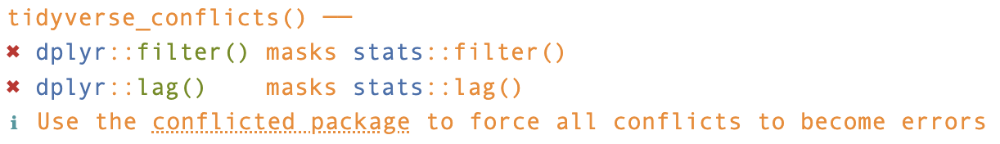

**Setup code - run this at the beginning**

```{r setup}
#| message: false
if (!requireNamespace("pacman", quietly = TRUE)) install.packages("pacman")
pacman::p_load(tidyverse, scales)
```

::: callout-note
If you ever need to update packages, the function is `update.packages()`. Using `update.packages(ask = FALSE)` prevents *R* from asking about each individual package. Note that some packages require extra tools to be installed (e.g., [Rtools](https://cran.r-project.org/bin/windows/Rtools/) for Windows, or [MacOS command line tools](https://mac.r-project.org/tools/)).
:::

# 1 - Welcome

Welcome to part 2 of the *Foundations of R for Bioinformatics* course. Last week we worked with an RNAseq results data table I had prepared earlier—one row per gene, with fold changes and *p*-values already calculated. We used this data table to do some data exploration, by plotting different aspects of the data using **ggplot2**.

Today we go back a step and start from the actual raw output that comes from RNA sequencing: a **count matrix**, in our case \~38,000 genes across 8 animals. We will use this as a demonstration of another key aspect of data science in *R*: **data wrangling.** Not all data that you generate or receive from others will be ready to use/plot in the way our example data last week was, as we will see with the count matrix we use today.

Getting from that matrix to something you can plot is what this session is ultimately about. Along the way, you'll learn to reshape and **tidy** data, join separate tables together, and use the handful of **dplyr** functions (part of the **tidyverse**) that will do the vast majority of your data wrangling for the rest of your coding career!

You may already be wondering what is meant by "tidying" data—can data even be *un*tidy? The answer, from the perspective of *R*, is yes! We will get to that later in this session.

As before, this session is inspired by [*R for Data Science (2nd Edition)*](https://r4ds.hadley.nz/) by Hadley Wickham & Garrett Grolemund, adapted for our real-world RNAseq data.

## 1.1 - Goals for session 2

By the end of this session, you will be able to:

- **Import** several related datasets into *R* and explain how they fit together

- Explain what "**tidy data**" means and why it matters

- Convert between **wide** and **long** format with `pivot_longer()`

- Combine tables with **`left_join()`**

- Apply `filter()`, `arrange()`, `select()`, `mutate()`, `group_by()` and `summarise()` to explore and transform real data

- Calculate **TPM** for comparisons of gene counts across samples

- Use the **pipe** to build clear, readable, reproducible code

## 1.2 - Packages required

We're using `readr` (import), `dplyr` (transformation), `tidyr` (reshaping), `ggplot2` (plotting) and `forcats` (factors)—all part of the `tidyverse`, so loading that covers us. I've added an extra one, called `scales`, which helps format big numbers on plot axes.

These were all loaded in the setup chunk above.

If you use the `library()` function to load a package, you might get something like the following warning:



This says that `dplyr` overwrites some functions in base *R*. If you want the base version after loading `dplyr`, you need the full name: `stats::filter()`. We've mostly ignored which package a function comes from because it doesn't usually matter—but knowing helps you find help and related functions. When we need to be precise we use *R*'s own syntax: `packagename::functionname()` (it's actually good practice to *always* do this). You saw this already with `pacman::p_load()`. This will come up again in Session 3, when we start using `DESeq2`.

------------------------------------------------------------------------

# 2 - Session 1 recap of key concepts

## 2.1 - Writing and running code

All our work happens in a Quarto document loaded into RStudio, which lets you write normal text alongside code that can be run separately. Code goes in a **chunk**, inserted with the green C button , and runs when you click the green triangle in the top right corner of each chunk:

```{r recap-maths}
1 + 1
```

Output appears below the chunk and in the console. You can also run code directly in the console by typing it in and pressing Enter. This is not usually recommended as it makes it harder to keep track of all the code you have typed. Alternatively, you can run a single line of code, either in a chunk in Quarto or in an *R* Script, by selecting your cursor to the start of that line and pressing Ctrl (Cmd on Mac) Enter.

## 2.2 - Objects, variables and functions

Data is stored in **objects** which will have some kind of **value** (this could be a single digit, or the result of some function, or it could even be an entire dataset).

Some objects are built into *R* (e.g., `pi`); most of the time, **you** create them.

You create an object using the **assignment operator** `<-`:

```{r recap-x}
x <- 12

# And you can print an object by typing it's name
x
```

This means "take the value on the right and store it in the name on the left". The object appears in your Environment pane (top right).

Every object in *R* has a **type**, which tells *R* how it can be used. The most common types are:

- **Numeric**: numbers you can do maths with. These are split into subtypes:

  - **Double:** A double allows you to store numbers as decimals. This is the default treatment for numbers. *Examples*: `3.14`, `6.0`
  - **Integer:** whole numbers. *Examples*: `1L`, `100L` (the `L` tells R it’s an integer).

- **Character**: text, always written inside quotes.

  - *Examples*: `"geneA"`, `"hello world"`

- **Logical**: true/false values (also written as `TRUE` or `FALSE`).

  - *Examples*: `TRUE`, `FALSE`

- **Factor**: categories (useful for groups or experimental conditions)

  - *Example*: `factor(c("control", "treated", "treated"))`

You can check the type of any variable with the `class()` function. For example:

```{r classes}
x <- 12
class(x)     # numeric

y <- "geneA"
class(y)     # character

z <- TRUE
class(z)     # logical
```

Last session, we used some basic **functions** and learned their overall structure. Every function takes the format `function_name()` and within those brackets you will specify **inputs** (otherwise known as **arguments**) which the function will use to produce an **output**:

```{r function-structure}
#| eval: false
function_name(argument1 = value1, argument2 = value2, ...)
```

For example, we used the `ggplot()` function to produce plots from our `results` dataset.

We are going to be using many more functions in this session, the majority of which come from the `tidyverse` **package**, which is why we have installed and loaded that package at the beginning of this session. Remember, packages are essentially just a collection of functions (and sometimes datasets) written and are maintained by other data scientists which **extend the functionality** of *R*. Without packages, we would be limited to just the functions found in **base R** and would be unable to do more complex analyses, such as those required for bioinformatics and RNAseq.

## 2.3 - The pipe `|>`

The **pipe** takes the result of one step and passes it as the first argument to the next function. You saw simple examples last week; its real power appears when combining multiple steps.

Suppose we want to take our results from last week, keep only the significant genes, sort them by fold change, and show the top few.

The logical flow is:

**data → filter by significance → arrange by fold change → select the top few**

**I** **don't expect you to know any of the functions** required to do this yet (hopefully by the end of the session you will!), but consider the 3 options we have below (**You do not need to master all three** — I’m showing them so you can see why the pipe is nicer).

First, we will load the data in, the same as last week:

```{r read-results-recap}
results <- read_csv("data/results_unfiltered.csv")
```

Here are the 3 different options for achieving what we want.

Option 1 — **nesting functions:**

```{r nesting}
head(
  select(
    arrange(
      filter(
        results,                    # our data - look how buried it is!
        !is.na(padj) & padj < 0.05
      ),
      desc(log2FoldChange)
    ),
    GeneID, log2FoldChange, padj
  )
)
```

Option 2 — **intermediate objects:**

```{r intermediate}
results_sig     <- filter(results, !is.na(padj) & padj < 0.05)
results_sorted  <- arrange(results_sig, desc(log2FoldChange))
results_slim    <- select(results_sorted, GeneID, log2FoldChange, padj)
head(results_slim)
```

Option 3 — **the pipe:**

```{r pipe-demo}
results |>                              # data right at the front
  filter(!is.na(padj) & padj < 0.05) |> 
  arrange(desc(log2FoldChange)) |> 
  select(GeneID, log2FoldChange, padj) |> 
  head()
```

**Run all three. What do you notice about the output?**

.

.

.

*Scroll down for answer*

.

.

.

.

.

.

.

.

.

.

.

*Answer*

The output is **identical**. But the piped version reads like a sentence:

1.  Take the `results` data
2.  Keep only rows where padj is below 0.05
3.  Sort by fold change, largest first
4.  Keep just three columns
5.  Show the first six rows

There's no rule about which you choose—you may find you prefer intermediate objects, and that's fine. But (in my opinion) the pipe makes code easier to type, read and troubleshoot, so it's the style used throughout this course.

## 2.4 - Exercises

**1.** Without running it, predict what this code will produce. More rows than `results`, fewer, or the same? Which columns will be present? Will `results` be overwritten?

Your answer:

```{r ex-2.4.1}
#| eval: false
results |> 
  filter(chromosome == "X") |> 
  select(GeneID, log2FoldChange)
```

**2. Fix the broken pipe.** The code below is intended to give a table of the genes on chromosome 1 that have an adjusted p-value (i.e., not `NA`), sorted from smallest to largest `padj`. The final table should contain only the `GeneID`, `log2FoldChange` and `padj` columns.

Run the code and read the error. Then rearrange the lines to fix it, without writing in any more code.

```{r ex-2.4.2}
#| error: true
results |>
  select(GeneID, log2FoldChange, padj) |>
  filter(!is.na(padj)) |>
  filter(chromosome == "1") |>
  arrange(padj)
```

# 3 - Where does RNAseq data come from?

Before we load the files we are going to be using this week, we should just quickly go over where these files actually come from. We will talk more about this in our final session, but I do want to briefly touch on it now. The following is a typical workflow for how RNA sequencing data is produced:

**1. Sequencing → FASTQ.** The sequencer reads short fragments of cDNA and writes them to a text file (FASTQ): millions of short sequences, each with a quality score. These files are enormous, often several gigabytes per sample.

**2. Alignment → BAM.** Each read is matched against a reference genome to work out where in the genome it came from. The output is a BAM file, which records the genomic coordinates for every read.

**3. Counting → count matrix.** For each gene, count how many reads landed inside it. The output is a table: **one row per gene, one column per sample**. That's one of the files we're about to open, a **count matrix**.

Steps 1 and 2 are computationally heavy and usually run on a high-performance computing cluster (e.g., the [BEAR](https://www.birmingham.ac.uk/research/arc)) rather than a laptop or standard PC—we'll look at the code for them in the appendix to Session 3. Step 3 onwards is where *R* takes over, and where you'll spend most of your time.

Our data comes from a study of rat brain after traumatic brain injury: NIH BioProject **PRJNA902029**, published as *Zhu, X., Cheng, J., Yu, J., Liu, R., Ma, H., & Zhao, Y. (2023). Nicotinamide Mononucleotides Alleviated Neurological Impairment via Anti-Neuroinflammation in Traumatic Brain Injury. International Journal of Medical Sciences, 20(3), 307–17.* <https://doi.org/10.7150/ijms.80942>

------------------------------------------------------------------------

# 4 - Importing today's data

## 4.1 - Loading the files

We need three files today, all contained within the `data` folder. Like last week, we load them all using `read_csv()` and assign them to objects with sensible names:

```{r read-all}
counts     <- read_csv("data/counts.csv")
gene_info  <- read_csv("data/gene_info.csv")
sampleinfo <- read_csv("data/sampleinfo.csv")
```

Have a look at each one:

```{r look-counts}
counts
```

`counts` is our **count matrix**. It contains the raw counts for each genomic location (roughly equivalent to gene) for each sample.

```{r look-geneinfo}
gene_info
```

`gene_info` contains 2 pieces of information for each gene: which **chromosome** it is on, and the **gene_length** in base pairs.

```{r look-sampleinfo}
sampleinfo
```

`sampleinfo` is a simple table which matches the columns in our `counts` file (the **SampleName**) and assigns each one to one of two **Group**s (either TBI or sham).

## 4.2 - Exercises

**1.** How many genes and how many columns does `counts` have? Use a function from last week: Hint: the answer will be the **dimensions** of the count matrix. How do we check the dimensions of an object in *R*?

```{r student-4.4.1}
#| eval: false

YOUR_CODE_HERE
```

**2.** What type is the `SampleName` column in `sampleinfo`? Hint: `glimpse()` might help.

```{r student-4.4.2}
#| eval: false

YOUR_CODE_HERE
```

# 5 - Tidying data with `tidyr`

In the real world, data arrives in all sorts of different formats. Biologists might get spreadsheets with samples as columns and measurements as rows; statisticians might get multiple values crammed into a single cell; social scientists might have variables spread over multiple sheets.

These formats usually make sense to humans, but they can make analysis harder.

In this section, we will cover a consistent way of organising data in *R* using a system called **tidy data**. We’ll focus on **tidyr**, a package that provides a bunch of tools to help tidy up your messy datasets. `tidyr` is also part of the larger `tidyverse` package.

Tidy data is not just about neatness. Once a dataset is tidy:

- The useful `tidyverse` functions (`filter()`, `mutate()`, `summarise()`, `ggplot()`) work consistently.

- Code becomes shorter, clearer, and easier to share.

- Complex workflows (RNAseq counts, clinical metadata, survey responses) become easier to visualise and analyse.

- Variables are placed into columns, which allows *R*'s vectorised nature (it's main advantage over other programming languages) to shine.

## 5.1 - Wide *vs* long data (i.e., untidy *vs* tidy data)

I've used the phrase "tidy data", and it might seem strange to think of data as tidy or untidy. What does this mean? Is it to do with mess? Well, not really. It's about how the data is organised into rows and columns.

A dataset is *tidy* when it follows three simple rules:

1.  Each **variable** has its own **column**
2.  Each **observation** has its own **row**
3.  Each **value** resides in its own **cell**

To demonstrate this, the `tidyverse` package has three built-in tables which hold identical information—cases of TB by country and year—organised three different ways. They're all equally intelligible to a human, but vastly different in the eyes of *R*. Let's look at them and see if we can tell what makes them tidy or not:

```{r table1}
table1
```

```{r table2}
table2
```

```{r table3}
table3
```

- `table1` follows all three rules → **tidy**

- `table2` only satisfies rule 3. The `count` column mixes two different variables (population and TB cases), violating rule 1; and each year now spans two rows when it describes one observation, violating rule 2.

- `table3` satisfies rule 2, but the `rate` column crams two values into one cell, violating rules 1 and 3.

Because the tidyverse expects tidy data, functions behave much more reliably when your data follows these rules.

## 5.2 - What about the three files we loaded?

Now look again at what we've just loaded (`counts`, `gene_info` and `sampleinfo`).

| Table | One row is... | Rows | Tidy? |
|------------------|------------------|------------------|------------------|
| `counts` | one **gene**, with 8 measurements | 38,675 | **No** - a count matrix is untidy |
| `gene_info` | one **gene** | 38,675 | **Yes** |
| `sampleinfo` | one **sample** | 8 | **Yes** |

We've loaded three tables because there are three different things being described. Gene length is a property of a *gene*—it doesn't change between animals, so storing it eight times for all 38,675 genes would be wasteful. Treatment group is a property of a *sample* (e.g., an animal in the experiment)—it's the same for all 38,675 genes in that column, so we only need one sample per row, hence there being 8 rows in `sampleinfo`.

The count matrix, `counts`, has been generated for us after counting how many times each gene region has a "hit" (more on this next session), and to make it more human-readable, it makes sense for each *column* to be a different sample and each *row* to be a different gene.

Often datasets are split like this and it matters when we want to join different datasets together.

::: callout-note
### Why isn't `counts` tidy?

Look at the column names: `TBI2`, `TBI1`, `sham4`... Those aren't variables, they're *values* of a variable you could call "sample". That breaks rule 1.
:::

Most real data arrives in **wide** format, because researchers organise data with its *collection* in mind rather than its *analysis*. (Might be worth remembering for your own work: think about how your data will be analysed *before* you start entering it.)

In wide format:

- each sample is a separate column

- each measurement is spread across columns

- humans like this layout, but computers do not.

**Our `counts` table is exactly this**. It is in wide format, which makes sense for us but is an issue when we want to apply `tidyverse` functions to it.

In **long** format, each measurement gets its own row, with extra columns saying which gene and which sample it belongs to. For example, a long format version of `counts` might look like this:

| GeneID | SampleName | Count  |
|--------|------------|--------|
| Gfap   | TBI2       | 122365 |
| Gfap   | TBI1       | 68386  |
| Gfap   | sham4      | 21462  |
| ...    | ...        | ...    |

Rearranging wide to long (or vice versa) is called **pivoting**. `tidyr` gives us the functions `pivot_longer()` and `pivot_wider()`; we'll cover `pivot_longer()` because it's far more common and what we actually need in this session. Long data is what we actually mean when we talk about data being **tidy**.

## 5.3 - `pivot_longer()`, to convert from wide to long

The first argument of this function is the data, which we achieve by piping our `counts` object into it. After this, there are three key arguments:

- `cols` — which columns need pivoting (i.e., which ones aren't variables). Uses the same syntax as `select()` (see Section 7.2). Here `!GeneID` means "everything except GeneID".
- `names_to` — what to call the new column holding the old column names.
- `values_to` — what to call the new column holding the cell values.

```{r pivot}

counts_long <- counts |> 
  pivot_longer(
    cols      = !GeneID,          # every column except GeneID
    names_to  = "SampleName",     # the old column headers become this variable
    values_to = "Count"           # the cell contents go here
  )

# Look at our new table
counts_long
```

Look at what happened:

- **9 columns → 3 columns**
- **38,675 rows → 309,400 rows** (38,675 × 8 — definitely *longer*)
- each measurement now has its own row
- the table now follows all three tidy rules

::: callout-important
### Why bother?

Long format looks worse to a human—309,400 rows is not something you'd want to scroll through. But it's the format `ggplot2` and other `tidyverse` functions are built for. Almost every time you find yourself thinking "I can't work out how to plot/run statistics on this", the answer is that your data needs pivoting first.
:::

------------------------------------------------------------------------

# 6 - Joining tables together

**The Problem:** Let's say we wanted to plot the expression of a single gene across each group in our experimental dataset. **Gfap** is a classic marker of reactive astrocytes, which are a hallmark of the brain's response to injury. If our TBI model has worked, we would expect more Gfap reads in the TBI animals than in the sham animals.

The plot we want is simple: the two groups on the x-axis, read count on the y-axis, and one point per animal. Our long version of `counts` already gets us part of the way there, and we can `filter()` to choose to look only at Gfap (see Section 7.1.1 for more on `filter()`):

```{r gfap-by-sample}
counts_long |> 
  filter(GeneID == "Gfap") |> 
  ggplot(aes(x = SampleName, y = Count)) +
  geom_point(size = 3)
```

This is useful but not exactly what we wanted. We have our eight animals, but they aren't properly arranged into groups. You can work out the groups by reading the sample names, but *R* can't: to *R*, `TBI1` is just a piece of text, it doesn't know that it belongs to the TBI group. Let's ask for the plot we actually want, by putting Group as our x-variable:

```{r gfap-no-group}
#| error: true
counts_long |> 
  filter(GeneID == "Gfap") |> 
  ggplot(aes(x = Group, y = Count)) + # note we have asked now for x to be Group
  geom_point(size = 3)
```

In the error text is an old friend from Session 1: `object 'Group' not found`. Last time, that meant a typo. This time, the spelling is fine. The problem is that `counts_long` doesn't have a column called `Group`.

So how do we get it?

## 6.1 - `left_join()`

Our long counts table knows *which sample* each measurement came from, but not *which group* that sample was in. That information resides in `sampleinfo`. To use it, we need a **join**.

`left_join()` is the most common function for joining. It keeps every row of the table on the left of the function, and adds columns from the table on the right, wherever the **key** matches. But what should we use as a key?

Notice that when we pivoted in the section above, we created a new column called `SampleName`. **Where else has this column name appeared?**

.

.

.

*Scroll down for answer*

.

.

.

.

.

.

.

.

*Answer:*

It is in our `sampleinfo` object:

```{r}
sampleinfo
```

Because `counts_long` and `sampleinfo` share this column name in common, and because the **values** of `SampleName` are shared too, we can use this as our **key** when joining together these 2 objects. Note that it doesn't matter that `sampleinfo` is only 8 rows while `counts_long` is 309,400 rows long—it is the matching of the keys which matters.

Let's do this matching now using the `left_join()` function, using **SampleName** as the key. We will save it to a new object called `counts_group`:

```{r join-sampleinfo}
counts_group <- counts_long |> 
  left_join(sampleinfo, by = "SampleName")

counts_group
```

We now have a `Group` column in our `counts_group` object. This **join** is what makes everything below possible.

::: callout-note
### The `by` argument

`by = "SampleName"` says "match rows using this column, which exists in both tables". If your two tables call the same thing by different names, you write `by = join_by(SampleName == sample)`.

If you leave `by` out entirely, `dplyr` will guess by matching every shared column name and tell you what it did. That's convenient but risky—be explicit.
:::

## 6.2 - The payoff: plotting a single gene across groups

Now we can do the thing that we couldn't do a few moments ago. **Gfap** is the classic marker of reactive astrogliosis—it's what brain tissue does in response to injury. Let's look at it's expression per **Group** now, rather than by sample:

```{r gfap}
counts_group |> 
  filter(GeneID == "Gfap") |> 
  ggplot(aes(x = Group, y = Count, colour = Group)) +
  geom_point(size = 3) +
  labs(
    title = "Gfap expression after traumatic brain injury",
    y = "Raw read count"
  ) +
  theme_minimal()
```

We can now see our 4 animals per group, and a clear separation between the groups.

**Try it yourself:** swap `Gfap` for `Emp1` or `H19` in the chunk above and re-run.

::: {.callout-tip collapse="true"}
### Now try `Ttr`

```{r ttr}
counts_group |> 
  filter(GeneID == "Ttr") |> 
  ggplot(aes(x = Group, y = Count, colour = Group)) +
  geom_point(size = 3) +
  labs(title = "Ttr — what is going on here?", y = "Raw read count") +
  theme_minimal()
```

One sham animal has around 18,600 reads for `Ttr`; every other animal in the study has fewer than 130.

`Ttr` is made by the **choroid plexus**—a small structure that produces cerebrospinal fluid. It isn't really part of the brain tissue you're trying to sample. What we're almost certainly seeing is that when this one animal was dissected, a fragment of choroid plexus came along with the sample.

This is a **technical outlier**, not a true result, and it's a good illustration of why you look at your data before you trust a statistic. `DESeq2` spots this outlier automatically and refuses to test `Ttr`: It's one of the genes with a missing p-value in our `results`. So in practice, you don't need to manually go through the counts for every gene in your data, as most differential expression tools have robust measures for dealing with outliers. But it's worth knowing how to plot individual genes if you get an unexpected result.
:::

## 6.3 - When the keys don't all match

In the `data` sub-folder, there is a `DESeq` results file which has been through `DESeq`'s filtering steps (more on this next week). Watch what happens when we try to join this to our `counts` object:

```{r join-mismatch}

results_filt <- read_csv("data/results_filtered.csv")

counts |> 
  left_join(results_filt, by = "GeneID") |> 
  summarise(
    total_genes  = n(),
    missing_padj = sum(is.na(padj))
  )
```

21,566 genes have no *p*-value, i.e., the *p-*value has been set to `NA`. **Why?**

.

.

.

.

*Scroll down for answer*

.

.

.

.

.

.

.

.

.

.

**Answer**

`counts` has 38,675 genes. `results_filt` has only 17,135. The others were **filtered out before the statistical analysis**, and the biggest reason is the following:

```{r all-zero}
counts_long |> 
  group_by(GeneID) |> 
  summarise(total_reads = sum(Count)) |> 
  filter(total_reads == 0) |> 
  nrow()
```

This adds up each gene's reads across all eight animals, then keeps the genes where the total is zero. 9,715 genes have **zero reads in all eight animals**, so there is nothing to test. Others have a handful of reads scattered across a couple of samples: technically non-zero, but nowhere near enough to say anything about.

Testing these low-count genes anyway would be actively harmful: every extra test makes the multiple-testing correction harsher, so uninformative genes would cost you statistical power on the genes you actually care about. Next session, we will do this filtering ourselves.

------------------------------------------------------------------------

To summarise the key information about joins:

- **`left_join()`** keeps every row on the left and fills unmatched ones with `NA`. Use it when the left table defines what you're interested in. If you want to only keep rows that match in both...
- **`inner_join()`** keeps only rows that match in both. Use it when you only want complete cases.
- Neither is right or wrong. Which one you want depends entirely on your question. What *is* wrong is not noticing which one you used.

## 6.4 - Exercise: annotating with gene information

a\) Suppose now we want to include the chromosome of each gene and it's length in base pairs. **What table did we load which contains this information?**

```{r ex-6.4a}
#| eval: false

YOUR_CODE_HERE

```

b\) What column does `gene_info` share with `counts_group`?

c\) Using your answer to the above, create a new object called `counts_annotated` by using `left_join()` with the appropriate key in the `by =` argument.

```{r ex-6.4c}
#| eval: false


counts_annotated <- counts_group |> 
  left_join(YOUR_CODE_HERE)

counts_annotated
```

If you've managed the above, then every row now contains its gene's chromosome and length as well as its sample's group. From three separate tables you've created one analysis-ready table in **long format**, ideal for use with our `tidyverse` functions.

------------------------------------------------------------------------

# 7 - Transforming data with `dplyr`

The following sections will introduce you to the fundamental `dplyr` **functions** which will solve the majority of your data wrangling challenges. All of these functions share a common structure:

- They take a **data frame (or tibble)** as their first input

- Then they take instructions about **what to do to the data**

- The output is always a new data frame.

- And they’re designed to work especially well with the **pipe** (`|>`), which lets us *send the data into the function* without writing it as the first argument

So even though the first argument is the data frame, we usually *pipe* the data into the function instead of typing it:

```{r}
results %>%
  filter(GeneID == "Gfap")
```

This is equivalent to:

```{r}
filter(results, GeneID == "Gfap")
```

—but the piped version is easier to read and allows you to build multi-step analyses step by step.

Each function typically does just one thing. Therefore, complex problems typically involve combining these functions one after another.

Here’s a quick example:

> *Take the count data, then group it by chromosome, then calculate the total number of reads.*

First, we will create the `counts_annotated` object if it hasn't already been made in the previous exercise:

```{r counts-annotated}
counts_annotated <- counts_group |> 
  left_join(gene_info, by = "GeneID")
```

Now we can apply our piped `dplyr` functions:

```{r dplyr-demo}

counts_annotated |>
  group_by(chromosome) |>
  summarise(total_counts = sum(Count))
```

All of these functions are organised by what they operate on: **rows**, **columns**, **groups** or **tables**. You've seen the most important example of the table functions already (`left_join()`) so the rest of the session will focus on rows, columns and groups.

## 7.1 - Rows: `filter()`, `arrange()` and `distinct()`

The 2 most important functions here are:

- `filter()` - changes which rows are present without changing their order

- `arrange()` - changes the order of the rows without changing which are present

The columns are left unchanged. Another function is `distinct()` which finds rows with unique values (and can optionally modify the columns, unlike the other two).

### 7.1.1 - `filter()`

`filter()` allows you to keep rows based on the values of the columns. The first argument is the data frame/tibble (we skip this in our case because we are piping our data *into* the function). The second and subsequent arguments are the **conditions** thatmust be **true** to keep the row.

Earlier we used this to select just the counts for Gfap. For this, the condition was that the "GeneID must equal Gfap", which is written as `GeneID == "Gfap"`:

```{r}
counts_annotated |> 
  filter(GeneID == "Gfap")
```

Note we have to use the double equals `==` here, because otherwise *R* might think we are trying to assign the name "Gfap" to `GeneID` (in other programming languages e.g., Python, the assignment operator is `=`, so *R* is very specific about when to use a single equals sign to try to avoid confusion with other languages).

Running that chunk shows us a preview of a new tibble that satisfies the requirements of our filter. Note that this **hasn't changed our original data** (we haven't overwritten it) and we also **haven't saved it to a new object**, so it literally only exists as a preview below that chunk.

We could use a different condition to select genes where their adjusted *p*-value is below a certain threshold (e.g., 0.05), like we did in Session 1. This is written as `padj < 0.05`:

```{r filter-demo}
results |> 
  filter(padj < 0.05)
```

Note again this *hasn't* changed `results`—we didn't save the output anywhere by assigning it to an object. Look at `results` in your Environment tab: still 38,675 rows. To keep the result, assign it to a new variable with a sensible name, e.g., `sig_genes`:

```{r filter-save}
sig_genes <- results |> 
  filter(padj < 0.05)

# How many genes are significant? We can just count the number of rows:
nrow(sig_genes)
```

This example reiterates the key difference between the *assignment operator `<-`* and the *pipe* `|>`.

- `<-` means assign what's on the right to the thing on the left.

- `|>` means take what's on the left and do the thing on the right to it.

Any code where we don't *assign* the result to a new object—think of this as your **working memory**. It's for testing code and quickly visualising the output, and everything is just contained within that chunk.

If we are happy with the code and want to store the output in a new *R* object, that's where the assignment operator `<-` comes in—this is more like your **long term memory.**

Alternatively, if we started that chunk of code with `results <- results |>`, what do you think would happen?

.

.

.

*Scroll down for answer*

.

.

.

.

.

.

.

.

.

Answer: we would have overwritten our `results` object with whatever changes we made to it in the pipe.

Back to `filter()`...

Among the different options for filtering are: `>` (greater than), `>=` (greater than or equal to), `<` (less than), `<=` (less than or equal to), `==` (equal to), and `!=` (not equal to). You can also combine conditions with `&` or `,` to indicate “and” (check for both conditions) or with `|` to indicate “or” (check for either condition). And `!` before something means `NOT`, e.g., `!is.na(padj)` means "NOT NA for adjusted *p-*value":

```{r filter-multi}
results |> 
  filter(!is.na(padj), padj < 0.05, abs(log2FoldChange) > 1) |> 
  nrow()
```

Those are the 1,955 red points from the volcano plot you created in Section 5.8, Exercise 2 last week—all of the genes which have an adjusted *p*-value below 0.05 and a log2 fold-change of at least 1 in either direction.

::: callout-important
### `NA` in filters

`filter()` silently drops rows where the condition is `NA`. That's usually what you want, but it means `filter(padj < 0.05)` quietly discards the untestable genes. Being explicit — `filter(!is.na(padj), padj < 0.05)` — makes your intent visible to the next person reading your code (which is often you, in six months).
:::

There’s a useful shortcut when you’re combining `|` and `==`, which is `%in%`. It keeps rows where the variable equals one of the values on the right:

```{r in}
results |> 
  filter(GeneID %in% c("Gfap", "Ttr"))
```

A common mistake is writing “or” statements like you would in English. We might read the code below as "filter the GeneIDs to only include Gfap or Ttr." With some variables, this might not cause an error (but still won't give you what you meant). In our case it does:

```{r bad-or}
#| error: true

results |>
  filter(GeneID == "Gfap" | "Ttr")
```

### 7.1.2 - `arrange()`

`arrange()` lets us **reorder the rows** of a data frame based on the values in one or more columns.

By default, it sorts **from smallest to largest**. If you sort by more than one column, the second column is only used when the first column has ties.

A useful helper function is `desc()`, which tells `arrange()` to sort in **descending order** (largest to smallest):

```{r arrange-demo}
results |> 
  filter(padj < 0.05) |> 
  arrange(desc(log2FoldChange))
```

To sort the same column from **smallest** to **largest**, we just remove `desc()`, because ascending order is the default:

```{r arrange-demo-2}
results |> 
  filter(padj < 0.05) |> 
  arrange(log2FoldChange)
```

### 7.1.3 - **`distinct()`**

`distinct()` is used to find the **unique** rows in a dataset. In other words, it removes duplicates. Our `results` dataset doesn’t actually contain duplicated rows, so running `distinct()` on the whole tibble won’t change the number of rows:

```{r distinc}
# Remove duplicate rows, if any
results |>
  distinct()
```

Since no rows are duplicates, the output is the same size as the input.

#### **Finding unique values in specific columns:**

Often, what you really want is the list of **unique values** for a single column. For example, if we want to see all the different chromosomes:

```{r}
results |>
  distinct(chromosome)
```

This returns one row per group—a quick way to check what categories exist in your dataset.

#### **Unique combinations of multiple columns**

Most of the time, however, you’ll want the distinct combination of some variables, so you can supply additional column names. Suppose now we want to find all the unique combinations of `SampleName` and `Group` in our `counts_annotated` object:

```{r distinct-combination}

counts_annotated |>
  distinct(SampleName, Group)
```

This gives us a compact summary of which samples belong to which group.

#### **`count()` - Counting how many of each group there are**

If instead of listing the groups you want to **count** how many rows fall into each one, `count()` is the better tool. It also has a built-in option to sort the results (`sort = TRUE`):

```{r count}

results |>
  count(chromosome, sort = TRUE)

```

**What is this telling you?**

.

.

.

*Scroll down for answer*

.

.

.

.

.

.

.

.

.

.

Answer:

It is the count of the number of genes per chromosome in our `results` dataset.

## 7.2 - Columns: `select()`, `mutate()`, `rename()` and `relocate()`

These functions let you change **which columns** you see, **what they’re called**, **where they appear**, or **create new ones**. They never change the number of rows.

The key functions are:

- `select()` – keep or remove columns

- `mutate()` – make new columns

- `rename()` – change column names

- `relocate()` – move columns around

### 7.2.1 - `select()`

`select()` is sort of like the columns version of `filter()` — rather than filtering for rows which fit a certain criteria, we are selecting specific columns. `select()` chooses which columns you want to keep.

You can select by name and can specify more than one at a time:

```{r select-demo}
results |> 
  select(GeneID, log2FoldChange, padj)
```

Select a **range** of columns:

```{r select-range}
results |> 
  select(GeneID:gene_length)
```

Select everything **except** a range:

```{r except-range}
results |> 
  select(!GeneID:gene_length)
```

Remove specific columns:

```{r remove}
results |> 
  select(-gene_length, -baseMean)
```

Select columns based on their **type**:

```{r select-specific-variables}
results |>
  select(where(is.character))
```

Useful helper functions inside `select()`:

- `starts_with("abc")`: matches names that begin with “abc”.

- `ends_with("xyz")`: matches names that end with “xyz”.

- `contains("ijk")`: matches names that contain “ijk”.

- `num_range("x", 1:3)`: matches `x1`, `x2` and `x3`.

You can also **rename columns** as you select them (this doesn't automatically overwrite it unless you re-assign the variable though!). The new name should go on the left-hand side of the `=`, and the old name should go on the right-hand side.

```{r select-rename}
results |> 
  select(Gene_name = GeneID)
```

### 7.2.2 - `mutate()`

`mutate()` is an incredible helpful and versatile function: it creates new columns where the values are assigned manually, or calculated from values in other columns, or the result of some function which uses the values in other columns as input. It can also modify (if the name is the same as an existing column) and delete columns (by setting their value to `NULL`).

Suppose you want to create one column which contains the negative log10 of the adjusted *p*-value (which we need for our volcano plot from last week), and another column which flags if a gene was significant or not. You give the column a name first (e.g., `significant`) and write a formula relating to other columns to calculate it:

```{r mutate-demo}
results |> 
  mutate(
    neg_log10_padj = -log10(padj),
    significant    = !is.na(padj) & padj < 0.05
  )

```

Notice now we *do* use the single `=` sign. This is because we are making a new column assignment: we give it a name on the left of the equals sign and a formula for how it is calculated (or a conditional if making a TRUE/FALSE variable) on the right. Don't ask my why the assignment symbol for this is `=` whereas it is `<-` elsewhere because I do not know—it's the wisdom of all the *R* powers-that-be!

Also notice that each new column we are making I have written on a separate line in `mutate()` following the comma of the previous: this is purely syntax style, it makes it nice and clear to look at, but isn't strictly necessary. All that matters is that there is a comma between the arguments of the `mutate()` function.

By default, new columns appear all the way on the right hand side (so you might have to scroll).

You can choose where to place them using the `.before` or `.after` argument within `mutate()`:

```{r}
results |> 
  mutate(
    neg_log10_padj = -log10(padj),
    significant    = !is.na(padj) & padj < 0.05,
    .after = chromosome
  )

```

A common pattern is **mutate → select**, especially when you want to focus on a few key columns.

For example, what if we wanted to create our new `significant` column, and then only show that column, the columns used to create it, and the GeneID?

```{r}
results |> 
  mutate(
    significant    = !is.na(padj) & padj < 0.05
  ) |>
  select(
    GeneID, padj, significant
  )
```

Again, if we want to overwrite our `results` object to contain this new column, we need to make sure we assign everything to it at the beginning:

```{r overwrite-results}
results <- results |> 
  mutate(
    significant    = !is.na(padj) & padj < 0.05
  )

results
```

Like last week, we can also fix our weird chromosome order using `mutate()`. Because chromosome is currently a `character` variable and we want it to be a `factor`, we use the `factor()` function (more on this in Section 9):

```{r convert-chromosome}
results <- results |> 
  mutate(
    chromosome = factor(chromosome, levels = c(as.character(1:20), "X", "Y", "unplaced")) # convert the chromosome column to the factor type with the numbers changed to characters and ordered from 1 to 20, and then followed by X and Y and unplaced
  )
```

#### `case_when()`

`case_when()` handles more than two outcomes. Let's classify each gene as up, down, or unchanged, store that in a new column called `direction` and count how many genes fall into each possibility:

```{r case-when}
results |> 
  mutate(
    direction = case_when(
      significant & log2FoldChange > 0 ~ "Up in TBI",
      significant & log2FoldChange < 0 ~ "Down in TBI",
      .default = "Not significant"
    )
  ) |>
  count(direction)
```

::: callout-tip
#### Reading `case_when()`

Each line is `condition ~ value`. *R* works down the list and takes the **first** condition that's true, so order matters. `.default` catches everything that fell through.
:::

### 7.2.3 - `rename()`

`select()` removes all of the other columns you haven't selected.

Use `rename()` when you want to **keep all** columns but change a few names:

```{r rename}
results |>
  rename(Gene_name = GeneID)
```

If you have a bunch of inconsistently named columns and it would be painful to fix them all by hand, there is a function in the `janitor` package called `clean_names()` which provides some useful automated cleaning.

### 7.2.4 - `relocate()`

`relocate()` moves columns around.

By default, it brings columns to the **front**:

```{r relocate}
results |>
  relocate(chromosome)
```

You can also use `.before` or `.after` for finer control, just like with `mutate()`:

```{r relocate-before}
results |>
  relocate(baseMean, .before = gene_length)
```

## 7.3 - Case study: `mutate()` with `stringr`

Some of our gene names start with `LOC`—these are predicted genes that haven't been formally characterised and named. `str_starts()` can detect them by `str_starts(GeneID, "LOC")`. `if_else()` allows us to make the conditional logic of:

- **if** GeneID starts with "LOC", the new `gene_class` value for that row is set to "predicted"

- **else**, the new `gene_class` value for that row is set to "named"

```{r gene-class}
results <- results |> 
  mutate(
    gene_class = if_else(str_starts(GeneID, "LOC"), "predicted", "named")
  )

results |> 
  count(gene_class)
```

Are predicted genes different from named genes? Let's look at the standard error of the log fold changes:

```{r gene-class-plot}
results |> 
  ggplot(aes(x = gene_class, y = lfcSE)) +
  geom_boxplot() +
  scale_y_log10() +
  labs(
    x = NULL,
    y = "Standard error of log2 fold change",
    title = "Predicted genes have much noisier fold-change estimates"
  ) +
  theme_minimal(base_size = 12)
```

Predicted genes have roughly 8 times the standard error (median 1.56 vs 0.176). That's not because they're biologically different: it's because they're expressed at much lower levels (median `baseMean` of 0.27 versus 120), and low counts give imprecise estimates.

This is the **funnel shape of the MA plot** from last week, shown a different way.

## 7.4 - Group functions: `summarise()` and `group_by()`

So far you’ve learned functions that work with **rows** and **columns**. `dplyr` becomes even more powerful when you add the ability to work with **groups**. Grouped operations let you:

- split your data into meaningful categories

- compute summaries inside each category

- optionally visualise or transform those results

The two core group functions are:

- `group_by()` – define the groups

- `summarise()` – creates one summary row per group

`summarise()` collapses many rows into one. So if we wanted to calculate the total number of reads across all of our samples:

```{r summarise-demo}
counts_annotated |> 
  summarise(total_reads = sum(Count))
```

On its own that's rarely useful. `group_by()` makes it powerful—it splits the data, applies the summary to each piece, and reassembles:

```{r library-sizes}
library_sizes <- counts_annotated |> 
  group_by(SampleName) |> 
  summarise(library_size = sum(Count))

library_sizes
```

That's the **library size** of each sample—the total number of assigned reads. This isn't just a demonstration of the `group_by()` and `summarise()` functions; **it's actually a crucial QC check in every RNAseq workflow**. Let's plot it:

```{r library-size-plot}
library_sizes |> 
  ggplot(aes(x = SampleName, y = library_size)) +
  geom_col() +
  scale_y_continuous(labels = label_comma()) + # a nice way of formatting large numbers is the label_comma() function from the scales package
  labs(
    x = NULL,
    y = "Total assigned reads",
    title = "Library sizes are comparable across all eight animals"
  ) +
  theme_minimal()
  
```

Between 14.1 and 18.4 million reads per animal—about a 1.3-fold spread. That's perfectly normal.

::: callout-important
### What you're checking for

If one sample had five million reads and another had fifty, or if all the TBI samples were systematically deeper than the shams, you would want to know **before** running any statistics. Large or group-correlated differences in library size point to a problem: poor cDNA quality, a failed library prep, or samples loaded unevenly on the flow cell.
:::

You can also group by more than one thing:

```{r group-multi}
count_per_chromosome <- counts_annotated |> 
    group_by(Group, chromosome) |> 
    summarise(mean_count = mean(Count), .groups = "drop")

count_per_chromosome
```

And a way of plotting this (first, fix the `chromosome` variable like we did earlier for `results`):

```{r}

count_per_chromosome <- count_per_chromosome |> 
  mutate(
    chromosome = factor(chromosome, levels = c(as.character(1:20), "X", "Y", "unplaced")) # convert the chromosome column to the factor type with the numbers changed to characters and ordered from 1 to 20, and then followed by X and Y and unplaced
  )

count_per_chromosome |> 
  ggplot(aes(x = chromosome, y = mean_count)) +
  geom_col() +
  labs(
    x = NULL,
    y = "Mean count"
    #title = "Library sizes are comparable across all eight animals"
  ) +
  facet_grid(rows = vars(Group)) +
  theme_minimal()
```

## 7.5 - Exercises

1.  Use `filter()` on `results` to keep only the genes which have a `baseMean > 10`. How many rows remain?

    ```{r ex-7.5.1}
    #| eval: false

    results |>
      YOUR_CODE_HERE

    ```

2.  The code chunk below attempts to filter for just Gfap and Ttr. What are the two problems with it? How can you fix it? (There are 2 possible ways to do this. Hint: one way uses `%in%`)

    ```{r ex-7.5.2}
    #| eval: false

    results |>
      filter(GeneID = "Gfap" | "Ttr")
    ```

3.  Use `select()` to show only the columns `gene_length` and `log2FoldChange`.

    ```{r ex-7.5.3}
    #| eval: false

    results |>
      YOUR_CODE_HERE
    ```

4.  How many genes are significantly changed on each chromosome? *(Hint: `filter()`, then `count()`.)*

```{r ex-7.5.4}
#| eval: false
results |> 
  YOUR_CODE_HERE
```

5.  Find the 5 genes with the largest **negative** fold change that are also significant, showing only `GeneID`, `log2FoldChange` and `padj`.

```{r ex-7.5.5}
#| eval: false

results |> 
  filter(YOUR_CODE_HERE) |> 
  arrange(YOUR_CODE_HERE) |> 
  select(YOUR_CODE_HERE) |> 
  head(5) # selects the top 5 rows
```

6.  Using the `counts_annotated` object, summarise the mean count for each `Group` for the gene `Gfap`. (If you don't have the `counts_annotated` object, run all of the chunks in Sections 5 and 6).

```{r ex-7.5.6}
#| eval: false

counts_annotated |> 
  filter(YOUR_CODE_HERE) |> 
  group_by(YOUR_CODE_HERE) |> 
  summarise(YOUR_CODE_HERE)
  
```

7.  `ifelse()` can be used to apply a conditional logic test, and determine what should happen if that test is TRUE or FALSE (effectively, its a binary version of `case_when()`). For example, the following would allow us to assign genes as "tested" or "not tested" based on whether they have a *p*-value or not: `ifelse(is.na(pvalue), "not tested", "tested")`.

    Using this, and `mutate()`, create a column in `results` indicating whether a gene was able to be tested or not. Use `.before = GeneID` to bring this column to the front of the table.

```{r ex-7.5.7}
#| eval: false

results |>
  YOUR_CODE_HERE
```

------------------------------------------------------------------------

# 8 - Factors: getting the order right

Last week and earlier in this session, we talked about how we needed to fix the order of the `chromosome` variable. Although most of the chromosomes are numbered, the presence of "X", "Y" and "unplaced" meant that *R* was forced to treat the entire variable as a `character` type rather than `numeric`: this is called **coercion.** When plotting, the default way of sorting `character` variables is the same way you would sort text— alphabetically. The fix we had to make was to convert the variable into a **factor** with explicit levels. This is why it's useful that `read_csv()` from the tidyverse let's us know what the variable types of all our columns are, as we can spot potential problems like this.

The same issue matters for our sample groups, and next week it will matter a great deal. Let's check the **class** of the `Group` variable in `sampleinfo`. One handy way of accessing specific columns in data, which is actually part of base *R* and not the tidyverse, is to type the object name, followed by `$` and then the column name:

```{r $-example}
sampleinfo$Group
```

We can then use this in the function `class()`:

```{r group-chr}
class(sampleinfo$Group)
```

Character. When *R* converts that to a factor, it sorts alphabetically to decide the order of the levels. This is one of those examples where it's actually easier to use nested functions. Read the following inside to out—it's converting the `Group` column to a factor, and then asking what **levels** exist within that factor:

```{r group-default}
levels(factor(sampleinfo$Group))
```

The first level is the **reference level**—the baseline that everything else gets compared to. In Session 3, this single fact determines whether your fold changes come out as "TBI relative to sham" or "sham relative to TBI", which flips the sign of every result in the experiment. Obviously, we therefore need to know what the reference level is in our experiment in order to be able to interpret the direction of the fold changes, which is why this concept is so important.

::: callout-important
### Never rely on alphabetical order

Whether `"sham"` or `"TBI"` sorts first actually depends on your computer's locale settings. On some systems uppercase sorts before lowercase, on others sorting ignores case. **The same code can give you opposite results on two different machines.**
:::

Fortunately, we don't need to rely on alphabetical order. We can use the `mutate()` function we learned earlier to convert this column into a `factor` and set the levels explicitly:

```{r set-levels}
sampleinfo <- sampleinfo |> 
  mutate(Group = factor(Group, levels = c("sham", "TBI"))) # levels = c() allows us to set a new list of levels. They need to be the same names as already exist in the column, but can be in a different order e.g., if we wanted to put TBI as first, i.e., the baseline.

# Check that we have changed the variable type
class(sampleinfo$Group)


# What are the levels?
levels(sampleinfo$Group)
```

`sham` first means "sham is the baseline"—a positive fold change will mean *up in TBI*. That's what we want, and now it's guaranteed rather than assumed.

`forcats` (part of the tidyverse, all its functions start `fct_`) has tools for the other common factor jobs. For example, if you wanted to reorder the library size plot we made in Section 7.4, we can use `fct_reorder` to reorder the x-variable (`SampleName`) by how big its library size was:

```{r forcats-demo}
# reorder a factor by another variable - useful for plots
library_sizes |> 
  mutate(SampleName = fct_reorder(SampleName, library_size)) |> 
  ggplot(aes(x = SampleName, y = library_size)) +
  geom_col() +
  scale_y_continuous(labels = label_comma()) +
  labs(x = NULL, y = "Total assigned reads",
       title = "Same plot as in 7.4, ordered by library size") +
  theme_minimal()
```

To make it reorder in the descending direction, it's as simple as adding the `.desc = TRUE` argument to `fct_reorder()`.

## 8.1 - Exercise

1.  Suppose you want the same plot as above but also want the samples split by their `Group` on the x-axis. Remake the `library_sizes` object, grouping by both `SampleName` and `Group` and then make this plot. You will need a `fill` aesthetic in `ggplot` in order to be able to colour each bar by `Group`.

    ```{r ex-8.1a}
    #| eval: false

    # First, fix this code
    library_sizes <- counts_annotated |> 
      group_by(YOUR_CODE_HERE) |> 
      summarise(library_size = sum(Count))
    ```

```{r ex-8.1b}
#| eval: false

# Then fix this code
library_sizes |> 
  mutate(SampleName = fct_reorder(SampleName, library_size)) |> 
  ggplot(aes(x = YOUR_CODE_HERE, y = YOUR_CODE_HERE, fill = YOUR_CODE_HERE)) +
  geom_col() +
  scale_y_continuous(labels = label_comma()) +
  labs(x = NULL, y = "Total assigned reads",
       title = "Same plot as in 7.4, ordered by library size within Groups") +
  theme_minimal()

```

------------------------------------------------------------------------

# 9 - Normalisation - calculating TPM

## 9.1 - The problem

Look back at the `Gfap` plot. Those are **raw counts**, and they have two problems that make them hard to compare.

**Problem 1: sequencing depth.** `TBI4` got 18.4 million reads and `TBI1` got 14.1 million. Every gene in `TBI4` will look bigger, purely because more of everything was sequenced.

**Problem 2: gene length.** A 10 kb gene is a bigger target than a 1 kb gene. At identical expression levels, the long gene catches more reads.

**TPM** (transcripts per million) corrects for both, and the order of operations for how we calculate it matters.

## 9.2 - Calculating it

We calculate TPM from our raw counts data. We will use our `counts_annotated` object as this table contains our raw counts, our `SampleName` and `Group`, and `gene_length` for each gene.

**Step 1:** divide by **gene length**, giving reads per kilobase, `rpk`.

**Step 2:** divide by **that sample's total**, and multiply by a million, to give `tpm`.

```{r tpm}
tpm <- counts_annotated |> 
  filter(!is.na(gene_length), gene_length > 0) |>   # avoid dividing by zero by filtering out NAs and zeros
  mutate(rpk = Count / (gene_length / 1000)) |>     # step 1: length
  group_by(SampleName) |> 
  mutate(tpm = rpk / sum(rpk) * 1e6)             # step 2: depth

# Let's just show the intersting columns:
tpm |> 
  select(GeneID, SampleName, Group, Count, gene_length, tpm)
```

::: callout-important
## `group_by()` is what makes this possible

`sum(rpk)` has to be **that sample's** total, not the total of the whole table. Take the `group_by()` out and the code still runs perfectly happily—it just gives you the wrong answer.

This is worth thinking about. "Does it run?" and "is it right?" are completely different questions, and *R* will only answer the first one for you. This is also why it's still important to understand code, even if you use generative AI to help you create it. Using code which you don't understand might "run" but not actually be correct.
:::

## 9.3 - Checking it worked

TPM has a useful property: every sample's values sum to exactly one million. That's what makes samples comparable. Let's verify that this is true:

```{r tpm-check}
tpm |> 
  group_by(SampleName) |> 
  summarise(total_tpm = sum(tpm))
```

`1e+06` is scientific notation in computer form. It means the same as 1x10^6^, i.e., 1,000,000.

You should see that all samples have 1 million reads. If they don't, something has gone wrong earlier in the code.

And now `Gfap` plotted using TPM:

```{r gfap-tpm}
tpm |> 
  filter(GeneID == "Gfap") |> 
  ggplot(aes(x = Group, y = tpm, colour = Group)) +
  geom_point(size = 3) +
  labs(y = "TPM", title = "Gfap, transcripts per million") +
  theme_minimal()
```

## 9.4 - A twist in the tale

In this section, you've learned that raw counts aren't comparable and TPM fixes them.

**Prediction question: next week we'll run DESeq2 to find differentially expressed genes. What should we give it as input—the raw counts, or the TPM?**

Write down your answer before scrolling down.

*Your answer:*

.

.

.

.

.

*Scroll down for answer*

.

.

.

.

.

.

.

.

.

.

**Answer: raw counts. Never TPM.**

Two reasons:

**1. The length correction is pointless here.** TPM has two parts. Correcting for sequencing depth is essential—`DESeq2` does it internally, using a more sophisticated method called size factors. But correcting for gene *length* only matters when you compare **different genes to each other**. When you compare **the same gene across samples**, its length is identical in every sample, so it cancels out completely.

**2. DESeq2 needs integers.** It models counts using a **negative binomial** distribution, which is defined on whole numbers. It uses the actual count to judge how precise the measurement is—5 reads out of 500 and 5,000 out of 500,000 give the same *proportion*, but wildly different *confidence*. TPM throws that information away. If you give `DESeq2` TPM, it will either refuse to run or, much worse, round your values and silently give you nonsense.

**So when is TPM right?** When you're comparing genes *within* a sample, or reporting expression levels in a paper, are perfectly legitimate uses. Just never as input to a differential expression test using `DeSeq2`.

------------------------------------------------------------------------

# 10 - Summary

Today you have:

- Imported **three related tables** and used them to build a larger dataset

- Explained what makes data **tidy**

- Reshaped wide to long with **`pivot_longer()`**

- Combined tables with **`left_join()`**

- Used a variety of `dplyr` functions for data wrangling purposes.

- Checked **library sizes** as a QC step

- Set **factor levels** explicitly

- Calculated **TPM** and learned when it is appropriate or not to use it

## What's coming next

Next week we go from `counts` to `results`. You'll build a `DESeqDataSet` from the two tables you loaded today, filter out the untestable genes yourself, run the statistics, and produce the results file you've been using since Session 1.

------------------------------------------------------------------------

# Extension

Everything below is optional reading. It's here because you'll need it eventually with your own data.

## Other `read_csv()` arguments

Real files are messier than ours. Useful arguments:

```{r read-args}
#| eval: false
read_csv("file.csv", skip = 2)                    # skip junk rows at the top
read_csv("file.csv", na = c("", "NA", "N/A"))     # what counts as missing
read_csv("file.csv", col_names = FALSE)           # file has no header row
read_csv("file.csv", col_types = cols(id = col_character()))  # force a type
```

If your column names are horrible (spaces, symbols, capitals), `janitor::clean_names()` will fix them all at once.

## Other file types

```{r other-formats}
#| eval: false
read_tsv("file.tsv")                    # tab-separated
readxl::read_excel("file.xlsx")         # Excel, first sheet
readxl::read_excel("file.xlsx", sheet = 2)
read_rds("object.rds")                  # any single R object, saved exactly as it was
```

`read_rds()` is worth knowing. Unlike a CSV, an `.rds` file preserves the exact structure of an *R* object—factors stay factors, lists stay lists. We'll use one next week.

## Writing files

```{r write}
#| eval: false
write_csv(results, "output/my_results.csv")
write_rds(results, "output/my_results.rds")
```

::: callout-note
`write_csv()` writes missing values as an empty field, and `read_csv()` reads them back as `NA`. Our untestable genes survive this round trip, but it's always worth checking after you write something out.
:::

## `pivot_wider()`

The inverse of `pivot_longer()`. Occasionally you need to go back the other way—for instance, to build a matrix for a function that requires one:

```{r pivot-wider}
counts_long |> 
  select(GeneID, SampleName, Count) |> 
  pivot_wider(names_from = SampleName, values_from = Count)
```

Which returns us exactly to where we started.

## Other joins

```{r join-types}
#| eval: false
left_join(x, y)     # all rows of x
right_join(x, y)    # all rows of y
inner_join(x, y)    # only rows in both
full_join(x, y)     # all rows of both
anti_join(x, y)     # rows of x with NO match in y - great for finding problems
```

`anti_join()` is underrated. It answers "what's in this table that isn't in that one?", which is usually the fastest way to work out why a join went wrong:

```{r anti-join}
counts |> 
  anti_join(results_filt, by = "GeneID") |> 
  nrow()
```

## The `slice_` functions

Handy alternatives to `arrange() |> head()`:

```{r slice}
results |> slice_min(padj, n = 5)                       # 5 smallest padj
results |> slice_max(log2FoldChange, n = 5)             # 5 largest fold changes
results |> slice_sample(n = 5)                          # 5 at random
```

They work beautifully with `group_by()`—for example, to see the top significant gene on every chromosome:

```{r slice-group}
results |> 
  filter(significant) |> 
  group_by(chromosome) |> 
  slice_min(padj, n = 1) |> 
  select(GeneID, chromosome, log2FoldChange, padj)
```

# Session Info

```{r session-info}
sessionInfo()
```
