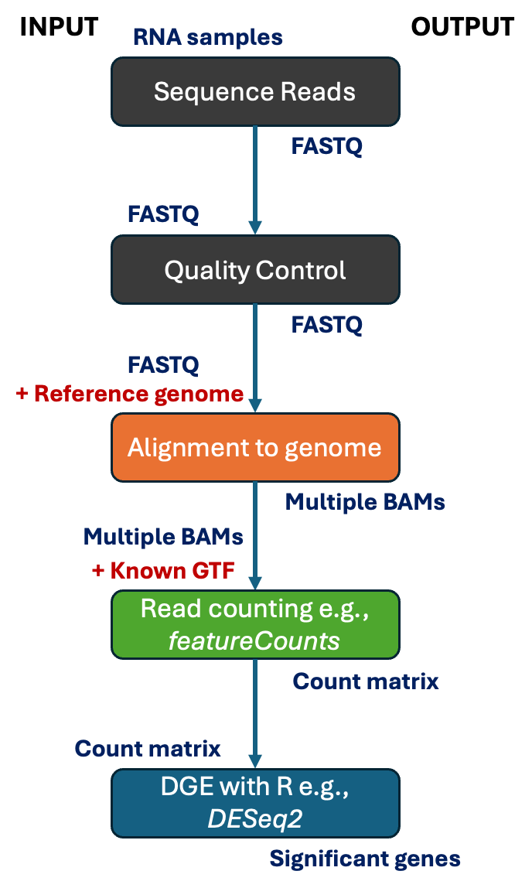
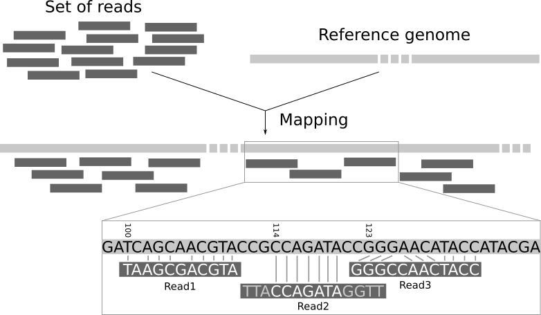
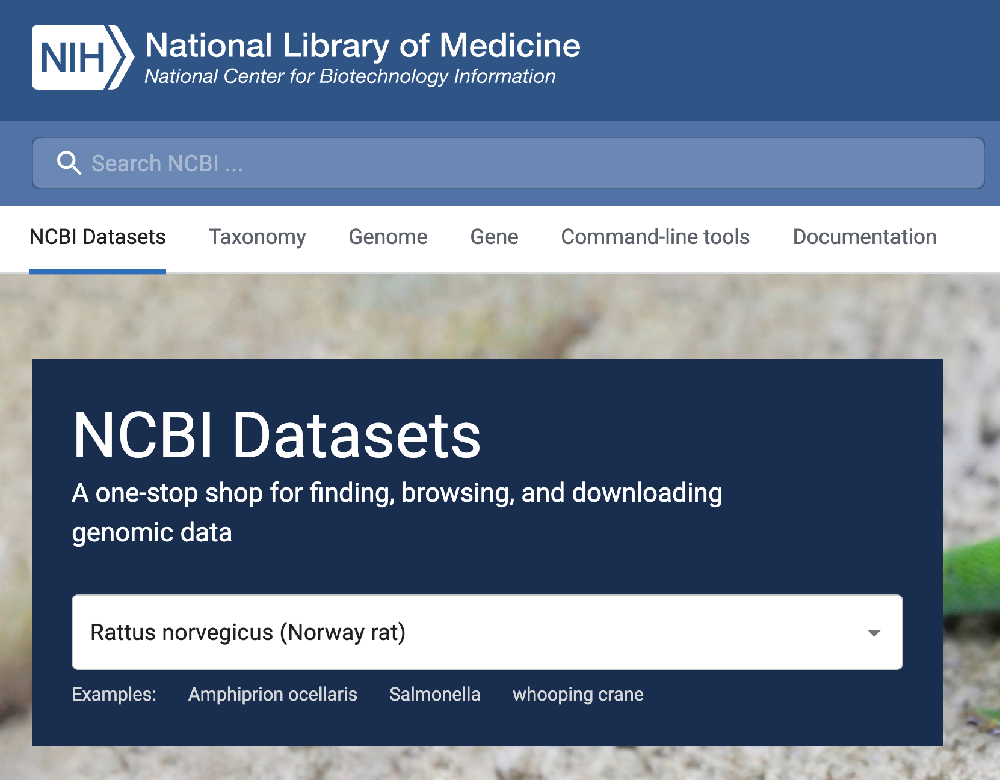
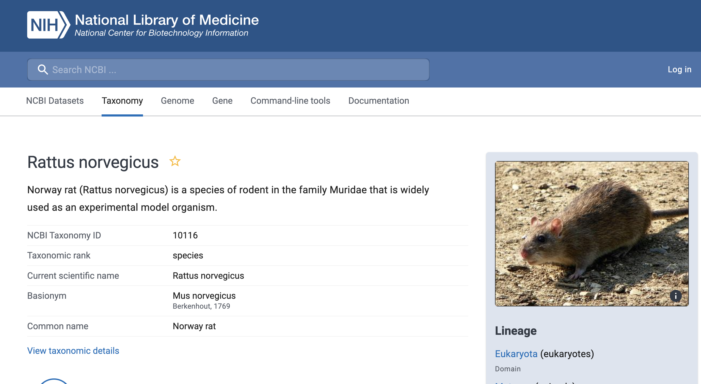
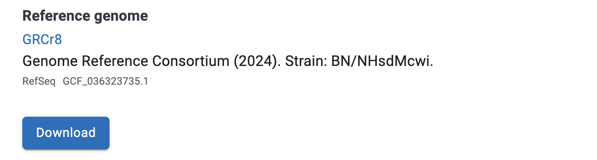
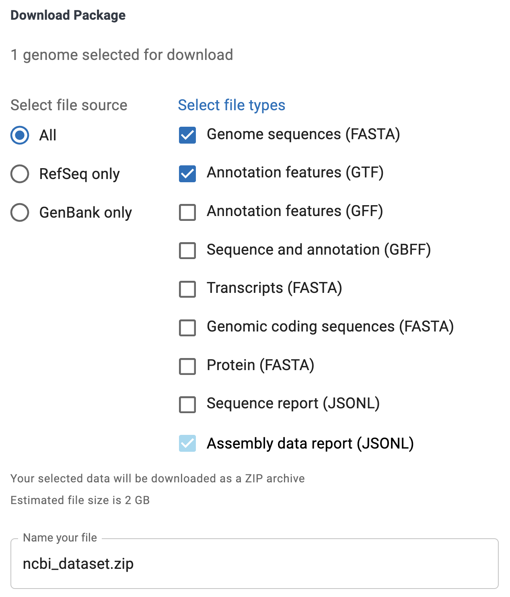
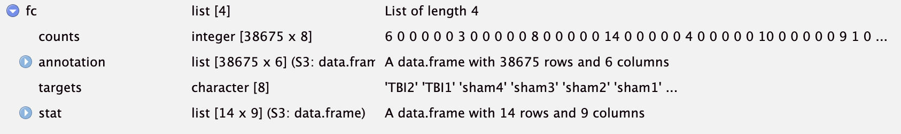

```{r setup}
#| message: false
if (!requireNamespace("pacman", quietly = TRUE)) install.packages("pacman")
if (!requireNamespace("BiocManager", quietly = TRUE)) install.packages("BiocManager")
```

# Appendix - Alignment and counting

Everything in the main session started from a count matrix. This appendix covers where that count matrix comes from. I’ve used `Rsubread` here because it runs inside *R* and lets you see each step happen. But it’s one of many options, and you may never need to align anything yourself. Many sequencing facilities will hand you a count matrix directly. If you do process raw data, community pipelines such as [nf-core/rnaseq](https://nf-co.re/rnaseq) handle alignment, counting and quality control in one go, and tools like *salmon* skip traditional alignment altogether. What matters is understanding what each step does, so you can check that it’s been done sensibly, whichever tool did it.

We need one extra package, `Rsubread`, which we can load in the usual way:

```{r appendix-setup}
#| message: false
pacman::p_load(Rsubread, tidyverse)
```

Let's say you've designed a really cool *in vitro* experiment which will look at the transcriptional responses of cells on drug X *vs* cells given a placebo. You've grown up your cells, split them into biological replicates, applied the drug for a certain amount of time, harvested the cells, extracted and purified the RNA, and sent the samples off for sequencing. The sequencing people have now got back to you with a link to download your data — you see these files with strange endings you might not have seen before (like *fastq.gz* — what does that mean?), and you also notice how large these files are; maybe tens of gigabytes? As you weep for your slow Wi-Fi download speeds, you wonder to yourself: *what am I actually meant to do with all of this data?* This question will be the focus of this appendix.

Firstly, the data — what on earth is a *fastq.gz* file? **FASTQ** is an evolution of the **FASTA** format for storing nucleotide sequences in a text-based format. The Q on the end refers to the addition of a "Quality" score, which is a way of representing the probability that the **base call** is correct or not. All sequencing is **probabilistic**, and encoding the quality score within the data allows the user to check a) how good the sequencing was overall and b) decide what cutoff to use when aligning the sequences. (The "gz" part of the name just means that the file is *compressed* using gzip, to save storage space).

Below shows an example workflow for generating bulk RNAseq data (adapted from Harvard Bioinformatics Core).

{width="398"}

The sequencing occurs outside of an *R* environment at the sequencing facility using bespoke software depending on the manufacturer of the sequencer machine. This step involves taking your RNA samples and sequencing them to produce the *fastq* files containing all of the reads.

Much of the quality control also occurs outside of *R*. For example, it is quite common to use software called [FastQC](https://www.bioinformatics.babraham.ac.uk/projects/fastqc/) to get a picture of the sequencing quality and identify any samples that might need to be excluded e.g., if the RNA quality for those samples was poor due to degradation. Another common processing tool is [**fastp**](https://academic.oup.com/bioinformatics/article/34/17/i884/5093234) which performs multiple QC steps including adapter trimming, quality filtering, per-read quality pruning, poly-G trimming, and others.

Due to lack of time and the fact that these tools are not R-based (although, inevitably, there are packages which allow you to run [these](https://cran.r-project.org/web/packages/fastqcr/index.html "fastqcr link") [functions](https://www.bioconductor.org/packages/release/bioc/html/Rfastp.html "rfastp package link") in R), I will not be covering them here; however, I do **strongly recommend** that you take the time to follow the links and read about those tools in your own time, as quality control is a *crucial* step in RNA sequencing analysis.

## A.1 - Alignment (read mapping)

The next step (orange box) is **alignment.** While this is also commonly performed outside of R, there are some excellent packages available which allow us to do this within *R* and they incorporate seamlessly into our downstream analyses. The package I will introduce to you here is called **Rsubread**, and as the title of its seminal paper says, it is "[easier, faster, cheaper and better for alignment and quantification of RNA sequencing reads](https://academic.oup.com/nar/article/47/8/e47/5345150)". What's not to like? (Of course, the authors of that paper *would* say that as they were the ones who developed *`Rsubread`*, but anyway...).

We loaded this package at the start of this appendix.

You can find a detailed user guide for *`Rsubread`* by running the command `RsubreadUsersGuide()`

```{r usersguide}
#| eval: false
RsubreadUsersGuide()
```

The basic principle of alignment is to take our reads and compare each sequence to a reference genome to see which genomic region each read matches the best (from [*Analysis of RNA-seq data in R*](https://sbc.shef.ac.uk/rnaseq-r-online/session1.nb.html#Learning_objectives_-_Session_1)):



The ingredients we need for successful **alignment** are:

- Our *fastq* files

- A reference index (i.e., a reference genome)

- An aligner algorithm

### A.1.1 - The catch

Unfortunately, alignment of reads to a genome is a *computationally-intensive process*. It's possible that the code will run on your grandma's dusty old Dell from 2009, but you might be waiting 7-10 business days for the result.

Some of you may be fortunate enough to have a powerful machine at home to do the alignment steps. However, I imagine many of you will be like me and do not have personal access to high performance computing. Fortunately, there are ways around this: here at Birmingham, research projects can be assigned access to the [BlueBEAR High Performance Clusters](https://www.birmingham.ac.uk/research/arc/bear/bluebear). Through their web portal, you can open RStudio in an interactive environment and run your scripts on there instead of your local PC, enabling you to take advantage of the processing power offered from BlueBEAR.

We won't be doing this here—instead, we will use the tutorial data directly contained within `Rsubread` as it is tiny and the code runs quickly on any device. But I thought I would point this out to you anyway.

TL;DR: **alignment (and counting, although less so) are computationally intensive; I do not recommend you run those functions locally unless you are using a high-performance computer (e.g., a CPU with at least 8 cores, and a good amount of RAM) or have plenty of time on your hands. All other steps in this course are far less intensive and can be run on any low-mid range laptop from the last few years.**

::: callout-note
## Here, you will only run a tiny alignment workflow using Rsubread’s built-in tutorial FASTA and FASTQ files. You do *not* need to download any genomes or real FASTQ files.
:::

### A.1.2 - The `buildindex()` function

The first step of alignment is to build an index from a reference genome. To do this, we need to use the `buildindex()` function, which is part of the `Rsubread` package. `buildindex()` has 2 required options: *`basename`,* which is the name you want to call the created index files, and *`reference`*, which is the name of a FASTA file containing the reference genome. Therefore, for your own experiments, you would need to download and provide a reference genome of whichever organism you are working on and extract it to your current working directory. These can be found on the [NCBI Datasets](https://www.ncbi.nlm.nih.gov/datasets/) website from the NIH National Library of Medicine.

**Example**: the RNAseq experiment using rats (*Rattus norvegicus*) that we have used throughout this course required alignment using the latest published rat genome at the time, **GRCr8**. To find this genome, I searched for "Rattus norvegicus" on the NCBI Datasets webpage: (**you [do not need]{.underline} to do these steps yourself right now**)



This brought me to this page:



Scrolling down, we have the option to download the reference genome:



You then get the following popup. Note that only "Genome sequences (FASTA)" is selected by default. I also selected "Annotation features (GTF)" as we will need that later.

{alt="I then extracted the resulting files to the working directory. Building the index for alignment was then as simple as running the following code (no need to do this now):"}

I then extracted the downloaded files to my working directory.

Building the index for alignment was then as simple as running the following code (**don't run this chunk now as it will give an error—it is just here as an example for how you can build an index from genomic DNA of any particular species)**

```{r}
#| eval: false
buildindex(basename = "GRCr8", reference = "GCF_036323735.1_GRCr8_genomic.fa")
```

However, this process is also slow on low-end machines (especially for large mammalian genomes).

### A.1.3 - Worked example for `buildindex()` - you can run the code in this section

Therefore, to demonstrate, we will use the built-in tutorial dataset from the *`Rsubread`* package:

```{r ref}
ref <- system.file("extdata", "reference.fa", package = "Rsubread")
# What have we just loaded?
ref
```

We have made a reference object we have called `ref` which points to a file within the *`Rsubread`* package called `reference.fa`. The path in the above chunk will look unique to each of you, but should all end in the same thing: `Rsubread/extdata/reference.fa`. Notice the file extension `.fa`. This tells us we have a FASTA file, which is what the *reference* option of `buildindex()` required.

Now we are ready to use `buildindex()`:

```{r buildindex}
buildindex(basename = "reference_index", reference = ref)
```

All of the functions within `Rsubread` contain lengthy and useful output code, which prints to the console (and to your Quarto document) allowing you to see for yourself what is actually happening. On my dodgy and slow MacBook Air, I get the message "WARNING: available memory is lower than 3.0 GB. The program may run very slow." This is why I am only using this very small tutorial reference to demonstrate the `buildindex()` function, as we would be here all day otherwise!

In our working directory, we now have some new files, all of which contain the prefix "reference_index" which came from our *`basename`* option above. You can see these files by clicking the "Files" pane on the right hand side of RStudio, or using the `list.files()` function.

```{r}
list.files()
```

You should see files ending in `.00.b.tab`, `.reads`, `.00.mapped`, etc. All of those files collectively make up our **reference index** which we will use next in the alignment step.

### A.1.4 - The `align()` function

Alignment in `Rsubread` is generally performed using the `align()` function, which uses a paradigm called the "seed-and-vote" mapping paradigm. More information on this can be found in their published [paper](https://academic.oup.com/nar/article/47/8/e47/5345150) and the Users Guide.

Required options for the `align()` function are *`index`*, which points the aligner to the index we just built (specifically the *`basename`* we gave it) and *`readfile1` —* this can be a single *fastq* file **or** a list of such files. Note also there are many other options we can give to `align()` (see `help(align)` for details) including *`readfile2`* which is NULL by default. This is because sequencing data can be **single-end** or **paired-end**, and `align()` will assume single-ended sequencing data by default.

If we had paired-end data, we would make a folder containing our forward-read *fastq* files to use for *`readfile1`*, and another containing our reverse-read *fastq* files to use for *`readfile2`*. We can then call these files into the `align()` function as in the example below **(do not actually run this chunk; it is just here as an example)**:

```{r example_align_paired_end}
#| eval: false

# Make list of all of the names of our forward fastq files
fastq.fwd <- list.files("./fwd_files", full.names = TRUE) # object containing names of forward fastq files
# Make list of all of the names of our reverse fastq files
fastq.rev <- list.files("./rev_files", full.names = TRUE) # object containing names of reverse fastq files

# Run the alignment using our forward and reverse fastq files
align(index = "GRCr8", readfile1 = fastq.fwd, readfile2 = fastq.rev) # alignment using paired end sequencing data
```

If you are getting unusual results e.g., poor alignment, or errors, it is likely because there is some setting in the `align()` function which is inappropriate for your data. E.g., with paired-end data you need to make sure that your *fastq* files are properly paired (by having them in the same order in your forward and reverse folders).

It is therefore important to understand the format and structure of your data and ensure that you are using the appropriate settings in `align()`.

### A.1.5 - Worked example for `align()` - you can run the code in this section

For our tutorial example, we will use a small file contained within the `Rsubread` package which pretends to be some reads from a dummy sequencing experiment:

```{r align-tutorial}
reads <- system.file("extdata", "reads.txt.gz", package = "Rsubread")

align.stat <- align(index = "reference_index", readfile1 = reads,
                    output_file = "alignResults.BAM", phredOffset = 64)
```

*Note that we have also specified an output file in this code, and a* `phredOffset` *which we don't need to worry about here.* Even on my pedestrian laptop, this code only takes a few seconds to run.

The output of the `align()` function will be a host of new files (as many as the number of unique *fastq* files, i.e., experimental samples) which are in the BAM file format (Binary Alignment Map). These are the files we need for the next step of the process — **counting.**

### A.1.6 - Questions

1.  Have a look at the help page for the `align()` function—write `help(align)` in the console and press Enter. If you have more than one topic appear, it is the one titled "Align Sequence Reads to a Reference Genome via Seed-and-Vote".

    a\) If we were aligning on a more powerful PC, is there an option we could use to make it run faster? *Hint: Is there a way of increasing the number of CPU threads which the function uses?*

    b\) What if we were aligning genomic DNA rather than RNA? Is there an option for doing this?

2.  Look at the output of the *Worked example for `align()`* chunk.

    a\) How many reads were there in total?

    b\) How many were successfully mapped onto our reference index?

    c\) What percentage does this represent?

    d\) What are some reasons a read *might not* align?

3.  Use the `list.files()` function by writing it into a new chunk and running the chunk, or type `list.files()` into the console and press Enter. What new files do we have in our working directory? Do you see any files containing `BAM`? Where have they come from? Where did we specify their name?

## A.2 - Counting

So far, we have taken our sequencing data and aligned each read to the genome. In our tutorial data, 904 of the 1,000 reads mapped successfully. Each read in our BAM file now has a position in the genome, but positions alone don't tell us much. We still need to know which *gene* each position falls in, and, crucially for quantitative RNA sequencing, how many reads landed in each gene. In other words, how many times each gene was *seen* in our data.

We therefore need some way of **counting** these features, a process known as ***read quantification**,* which produces a record of the number of occurrences of each feature in a ***count table***. Enter stage left: the `featureCounts()` function.

### A.2.1 - `featureCounts()`

The `featureCounts()` function requires 2 inputs. The first is the *`files`* option which can be a single file or a list of files in the BAM format (which we will have generated from our alignment step). The second is an *`annotation`*, which is a list of **genomic features**—basically a way of saying what the reads actually correspond to on the gene level.

`featureCounts()` has some annotation files built-in, which can be accessed using the *`annot.inbuilt`* option (e.g., for mouse data, you could use `annot.inbuilt = "mm39"`). Alternatively, you can provide your own annotation file using the *`annot.ext`* option and pointing it to a GTF, GFF or SAF file.

E.g., from our rat TBI example above: I selected a GTF file to be included in my download, and we could use this in the `featureCounts()` step like this **(do not run the chunk below—it is for demonstration purposes only)**:

```{r rat_featurecounts}
#| eval: false
bam.files <- list.files(path = "./BAM_files", pattern = ".BAM$", full.names = TRUE) # make an object containing the names of our BAM files

# Run featureCounts using our list of BAM files and our external genomic annotation, and assign it to a new object called fc
fc <- featureCounts(files = bam.files, annot.ext = "GRCr8_genomic.gtf", isGTFAnnotationFile = TRUE)
```

Note this is another area where things can go wrong if the wrong options are used:

- We have to specify `isGTFAnnotationFile = TRUE` if we are using a `.gtf` file as our annotation

- If our data is paired-end, we also have to specify `isPairedEnd = TRUE` (default is FALSE)

There are a whole list of other options to `featureCounts()`— more detail of which (and their default settings) can be found via `help(featureCounts)`.

### A.2.2 - Worked example for `featureCounts()` - you can run the code in this section

For our tiny tutorial data, we can create a small annotation tibble with some dummy genes, just to show how this can work in principle. The structure of this dummy annotation tibble is broadly similar to the structure of a GTF file:

```{r dummy_ann}
ann <- tibble(
   GeneID = c("gene1", "gene1", "gene2", "gene2"),
   Chr = "chr_dummy",
   Start = c(100, 1000, 3000, 5000),
   End = c(500, 1800, 4000, 5500),
   Strand = c("+", "+", "-", "-")
)
ann
```

We will then perform the feature counting using this dummy annotation data frame. Since we are using our own annotation rather than one which is in-built to `featureCounts()`, we need to use the `annot.ext` option.

```{r fc_dummy}
fc_dummy <- featureCounts("alignResults.BAM", annot.ext = ann)
```

If we have a look at our new `fc_dummy` object by clicking on it in the Environment tab, using `glimpse(fc_dummy)` or using `View(fc_dummy)`, we can see that it is divided into 4 sections: `counts`, `annotation`, `targets` and `stat`.

```{r}
glimpse(fc_dummy)
```

We will dig into what these mean in the following sections.

Note that on large datasets (not our dummy tutorial dataset), `featureCounts()` can take a long time on an average personal computer, so this is another function which benefits from being run on a high performance computer cluster, such as [**BlueBEAR**](https://www.birmingham.ac.uk/research/arc/bear/bluebear). Once run, the `featureCounts` object which is generated can be saved as an RDS file using the tidyverse function `write_rds()` and loaded elsewhere for downstream analysis (`read_rds()`). This requires much less computing power than generating the `featureCounts` object every time you want to do any analysis. For example, with our tutorial `fc_dummy`:

```{r save_rds}
#| eval: false

# To save the RDS file for use later
write_rds(fc_dummy, "fc_dummy.RDS")

# To load it back into an R object

fc_dummy <- read_rds("fc_dummy.RDS")

```

From here on, we will be working with a `featureCounts` RDS file generated elsewhere using the steps described in this section.

### A.2.3 - Questions

1.  Have a look at the help page for the `featureCounts()` function—write `help(featureCounts)` in the console and press Enter. If you have more than one topic appear, it is the one titled "Count Reads by Genomic Features".

    a\) As before with `align()`, is there a way we could speed the process up on a more powerful computer?

    b\) Sometimes, reads will map to multiple locations in the genome, and these are counted by default. What should we do if we do *not* wish to count these reads?

    c\) What are the different inbuilt annotations available? How many different species do they cover?

2.  Look at the output of the *Worked example for `featureCounts()`* chunk.

    a\) What was the total number of alignments which `featureCounts()` attempted to count? Where have you seen this before?

    b\) How many were successfully assigned (counted)?

    c\) What is the percentage?

    d\) Why is this figure so much lower than the number of aligned reads from before?

3.  Why do we need an annotation file? Why would we not just count using our genomic reference index we built earlier?

## A.3 - The `featureCounts` object

For the remainder of this appendix, we are going to be working with an RDS file which contains the real `featureCounts` output for the rat TBI experiment we have used throughout the course.

If you downloaded the entire session as one zip file, then in the `data` folder there should be a file called `fc.rds`. This was generated after **alignment** (using the `align()` function from `Rsubread`) and **counting** (using `featureCounts()` on those aligned BAM files).

The raw sequencing data originated from an RNAseq experiment investigating the **global transcriptional changes in rat brain samples post traumatic brain injury (TBI)**. For our purposes, I selected only the "sham" group and the "TBI" (injured) group—**each group contains 4 samples**.

For reference, the data were uploaded to the NCBI BioProject repository under the accession name PRJNA902029, and the original paper is *Zhu, Xiaolu, Jin Cheng, Jiangtao Yu, Ruining Liu, Haoli Ma, and Yan Zhao. ‘Nicotinamide Mononucleotides Alleviated Neurological Impairment via Anti-Neuroinflammation in Traumatic Brain Injury’. International Journal of Medical Sciences 20, no. 3 (2023): 307–17. <https://doi.org/10.7150/ijms.80942>.*

**Run the code below to load this data into R:**

```{r fc}
fc <- read_rds("data/fc.rds")
```

We can take a peek at what's inside our `fc` object by using `glimpse(fc)`. The `glimpse()` function is handy here, because `fc` is a really large object. If you just typed `fc` into a chunk and ran it, you might find it crashes RStudio (or takes ages to load!). We will use `glimpse()` whenever we need to peek at large *R* objects.

```{r glimpse_fc}
glimpse(fc)
```

If you find the output a bit messy and hard to interpret, you can also open `fc` by clicking on it in the right hand side 'Environment' panel. You will then see something like this:



See, for example, that `counts` and `annotation` have 38675 rows—it would therefore be difficult to view these subdivisions without `glimpse()` and is a **good example of why we use R for this process** (and not, say, Excel).

We can also use the `names()` function we encountered in Session 1 to see what the different subdivisions of `fc` are:

```{r names}
names(fc)
```

We can see from this that `fc` contains 4 sub-divisions: `counts`, `annotation`,`targets`, and `stat`. In Section 2.1.2 of the main session, we used the `$` operator to select a column from `sampleinfo`—it works the same way for subdivisions within larger objects, like `fc`. So if we wanted to select just the `counts` subdivision of `fc`, we could write `fc$counts`.

### A.3.1 - `counts`: count data

`counts` contains our count data. Every row is a unique genomic feature (mostly genes), and every column is one of our samples.

What are the names of our samples? It turns out every column of `counts` is labelled with the sample it refers to. We can look at column names using the `colnames()` function:

```{r colnames-fc-counts}
colnames(fc$counts)
```

These names reflect the 2 treatment groups in our rat TBI experiment (sham and TBI), with 4 samples in each group.

### A.3.2 - `targets`: samples

There is another way we could have seen the names of our samples: they are contained in the `targets` subdivision of `fc`.

```{r fc-targets}
fc$targets
```

### A.3.3 - `annotation`: genomic annotation data

`annotation` is a data frame containing the genomic annotation data:

```{r fc-annotation}
glimpse(fc$annotation)
```

Unsurprisingly, it has 38675 rows (one for each genomic feature), and 6 columns, which contain the GeneID, Chromosome, Start, End, Strand, and Gene Length.

### A.3.4 - `stat`: read statistics and basic quality control

Finally, `stat` contains the read statistics for each of our samples:

```{r fc-stat}
fc$stat
```

This subdivision is useful for quality control, as it can flag outliers (e.g., if you have a sample where the RNA quality was poor).

In Session 2, we checked library sizes by adding up every gene's counts in each sample. `stat` gives us the same information directly, along with the reads that *weren't* counted and why. First we will make a new **tibble** object called `stat` by assigning `fc$stat` to this name:

```{r stat}
stat <- as_tibble(fc$stat)

#have a look at our new tibble
stat
```

This new tibble is **untidy**, as it contains samples in separate columns—exactly like the count matrix from Session 2. So, just as we did with that, we use `pivot_longer()`:

```{r stat_tidy}
stat_tidy <- stat |>
    pivot_longer(
    cols = !Status,        # all columns except Status
    names_to = "Sample",   # name of the new “sample” column
    values_to = "Count"    # name of the new values column
  )

# let's look at what we've done
stat_tidy
```

Now every row contains just one observation and all of our samples are in one column. Our data is now **tidy** and ready for use in `ggplot()`. Taking our new `stat_tidy` data, we can filter for just the `Assigned` reads and plot this per sample as a bar chart:

```{r assigned-reads-plot}
stat_tidy |>
  dplyr::filter(Status == "Assigned") |> # This function filters for Assigned reads
  ggplot(aes(x = Sample, y = Count)) + # ggplot code for plotting
  geom_col() +
  scale_y_continuous(labels = scales::label_comma()) +
  labs(x = NULL, y = "Assigned reads") +
  theme_minimal()
```

Compare this with the library size plot you made in Session 2—they should be identical, because the "assigned" reads *are* the reads that ended up in the count matrix.

### A.3.5 - Questions

1.  `fc$counts` contains all of the counts of all of the genes from all of the samples (i.e., the count data). Run the following code:

    ```{r}
    dim(fc$counts)
    ```

    a\) How many rows are there? What does each row correspond to?

    b\) How many columns are there? What does each column correspond to?

2.  Use your data transformation skills from Session 2 to figure out which sample contained the highest number of `Unassigned_Unmapped` reads. *Hint: first filter for just Unassigned_Unmapped reads then arrange the count from highest to lowest*:

    ```{r}
    #| error: TRUE
    stat_tidy |>
      dplyr::filter(YOUR_CODE_HERE) |>
      dplyr::arrange(YOUR_CODE_HERE)
    ```

## A.4 - From `fc` to the files we used in the course

This is the final link in the chain. The `counts.csv` and `gene_info.csv` files you loaded in Sessions 2 and 3 were extracted from this `fc` object.

The count matrix just needs its row names turned into a `GeneID` column:

```{r counts-from-fc}
counts_from_fc <- fc$counts |>
  as_tibble(rownames = "GeneID")

counts_from_fc
```

The gene information takes a little more work. `featureCounts()` records each gene's chromosome using its RefSeq accession number (e.g., `NC_086019.1`) rather than a name like `1`, and lists it once for every exon. So we keep the first entry, and use a small lookup table to translate accession numbers into chromosome names—another `left_join()`. Anything not on a named chromosome (the `NW_` scaffolds) is labelled "unplaced" using `coalesce()`, which fills in `NA`s:

```{r gene-info-from-fc}
chromosome_key <- tibble(
  accession  = paste0("NC_0860", 19:40, ".1"),         # NC_086019.1 to NC_086040.1
  chromosome = c(as.character(1:20), "X", "Y")
)

gene_info_from_fc <- fc$annotation |>
  as_tibble() |>
  mutate(accession = str_extract(Chr, "^[^;]+")) |>    # keep the text before the first ";"
  left_join(chromosome_key, by = "accession") |>
  mutate(chromosome = coalesce(chromosome, "unplaced")) |>
  dplyr::select(GeneID, chromosome, gene_length = Length)

gene_info_from_fc |>
  dplyr::count(chromosome)
```

And to save them (into a separate `output` folder, so that we don't overwrite the files in `data`):

```{r write-csvs}
#| eval: false
dir.create("output", showWarnings = FALSE) # make the output folder if it doesn't exist yet
write_csv(counts_from_fc,    "output/counts.csv")
write_csv(gene_info_from_fc, "output/gene_info.csv")
```

So the full pipeline for this course was: **FASTQ → `align()` → BAM → `featureCounts()` → `fc.rds` → `counts.csv` + `gene_info.csv` → `DESeq2` → results**.
