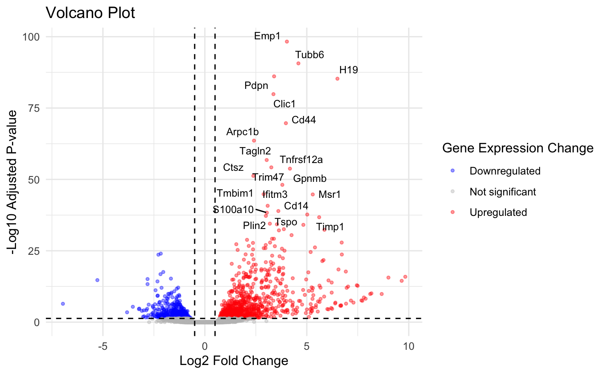

**Setup code - run this at the beginning**

```{r setup}
#| message: false
if (!requireNamespace("pacman", quietly = TRUE)) install.packages("pacman")
if (!requireNamespace("BiocManager", quietly = TRUE)) install.packages("BiocManager")

# edgeR is installed but NOT loaded: we only borrow one function from it, which we call using edgeR::
if (!requireNamespace("edgeR", quietly = TRUE)) BiocManager::install("edgeR")

# tidyverse goes LAST on purpose: packages loaded later "mask" identically-named
# functions from packages loaded earlier, and we want the tidyverse versions to win
pacman::p_load(DESeq2, tidySummarizedExperiment,
               ggrepel, scales, pheatmap, plotly,
               tidyverse)
```

That may take a few minutes the first time. Let it finish before moving on.

# 1 - Welcome

Welcome to the 3rd and final session in our *Foundations of R for Bioinformatics* course. In this session, we will finally turn our full attention to the latter part of that title and start applying what we have learned to a standard bulk RNA-sequencing workflow. This session is slightly longer than our previous two (3 hours instead of 2) but I don't want to completely fill our time with more and more information! So the actual content of this session should be roughly the same as the previous two, leaving us time at the end for practice and to go over any questions or parts of the course you found more challenging.

This document will *not* cover the biology of RNA sequencing in much detail (hopefully you will already have had a lecture or workshop on that) except where relevant to the computational steps—rather, we will be focusing on the computational side of how you actually perform each step in an *R*-based environment.

Similar to the other sessions, this document will be a comprehensive guide. The idea is that you can return to it at any point in the future to refresh your memory, and borrow/adapt the code for your own purposes (which is what 95% of coding is anyway!).

## 1.1 - Aim

Our goal for today will be to walk through all of the different steps which are *typically performed* to analyse bulk RNAseq data (although specific workflows can vary) **from the count matrix you met last week**, through basic **quality control**, to **testing for differential gene expression.** The steps which come *before* the count matrix—alignment and counting—are covered in an appendix in a separate document.

## 1.2 - The goal

Our goal for **this session** is to perform differential gene expression analysis on some real-world data and produce the following visual representation of differentially-expressed genes—a **volcano plot**. This is one of the most common data visualisation techniques following RNAseq as it allows for a clear visual summary of the differences in gene expression between 2 groups with the most significant genes labelled for future follow up. By the end of today's session, you will be able to produce a plot which looks like this:



"But we made a volcano plot in Session 1!", I hear you cry. We did—from a results table I had prepared earlier. Today you will make that results table yourself, starting from the raw counts you wrangled last week. And along the way you'll discover that the Session 1 volcano plot was answering a rather weak question ("did this gene change *at all*?"), and learn how to ask a much sharper one. The plot above has **far fewer** coloured genes than the one in Session 1, the genes are split into up- and down-regulated, and the most significant ones have a text label. This makes it a far more publication-quality plot than the one we made in Session 1, and hopefully your understanding of what it is and where it's come from has also evolved (if I've done my job correctly!).

## 1.3 - Sources and inspirations

We are finally moving away from the Hadley Wickham [*R for Data Science (2nd Edition)*](https://r4ds.hadley.nz/) as their tutorial does not cover the code required for RNAseq differential gene expression analysis. In 2-3 hours, we will only really be able to scratch the surface of what is possible when analysing RNAseq data in *R*, and there are many online tutorials covering the enormous amount of tools available. In this session, we will be mainly using the [**DESeq2**](https://bioconductor.org/packages/release/bioc/vignettes/DESeq2/inst/doc/DESeq2.html "User guide for DESeq2") package (and [**Rsubread**](https://bioconductor.org/packages/release/bioc/vignettes/Rsubread/inst/doc/Rsubread.pdf "User guide for Rsubread") in the appendix document); you can find the user guides (which we will be referring to) by clicking on those links. We will also take inspiration from the following 2 online courses:

- ***RNAseq Analysis in R: Alignment and counting*** — Stephane Ballereau, Mark Dunning, Oscar Rueda, Ashley Sawle*.* <https://bioinformatics-core-shared-training.github.io/RNAseq-R/align-and-count.nb.html>

- ***Analysis of RNAseq data in R*** — Sheffield Bioinformatics Core. <https://sbc.shef.ac.uk/rnaseq-r-online/>

As we are time limited, I will only be able to teach you the essentials which will help get you going through a standard bulk RNAseq workflow. For a highly-detailed, self-paced walkthrough of RNAseq analysis in *R*, I can also recommend the various courses from Harvard Bioinformatics Core—the one most relevant to our workshop today can be found [here](https://hbctraining.github.io/Intro-to-DGE/schedule/links-to-lessons.html), and it goes way beyond the scope of this course. You can also find links to other bioinformatics workflows there, such as for single-cell RNAseq.

## 1.4 - Goals for session 3:

By the end of this session, you will be able to:

- Convert a **data table (tibble)** into the **matrix** format that **`DESeq2`** requires

- Perform basic quality control, including **filtering** and **clustering**.

- Use **`DESeq2`** to perform **differential gene expression.**

- Use the **tidyverse** to visualise the different outputs from our RNAseq data analysis, including **MA plots**, **volcano plots**, and **heatmaps**.

- *Perform basic pathway **over-representation analysis** using **gprofiler2** (extension section)*

- *Use **Rsubread** to **align** raw sequencing data to a reference genome, and **count** the number of reads per gene (appendix document).*

## 1.5 - Packages required

As before, we will be using the `tidyverse` and its associated packages. We also need some other packages which will aid us in the analysis and visualisation of our RNAseq data. These were all installed and loaded in the setup chunk at the top of this document—I will explain what they are when we come to use them.

### 1.5.1 - Bioconductor and BiocManager

Up to this point, the data wrangling we have been doing can be broadly applied to many different fields of study—the first 2 sessions of this course would look very similar if I was teaching a group of Psychologists, although we might not use RNAseq data as the example. Therefore, we have been using packages which are hosted on [**CRAN**](https://cran.r-project.org/) (The Comprehensive *R* Archive Network). CRAN is from where *R* itself is downloaded onto your PC, and it’s also the source that `install.packages()` searches when you supply a package name.

Today, however, we are narrowing our focus to more specific, bioinformatics applications. The packages we will use today (e.g., `DESeq2`, `edgeR`...) are much more suited to **biological data science**, such as RNAseq, and they aren't on CRAN. Instead, they are collected on the website [Bioconductor.org](https://www.bioconductor.org/), which has major releases twice a year, and their installation is slightly different.

`pacman::p_load()` handles this for us—if it can't find a package on CRAN, it looks on Bioconductor instead. That's why our setup chunk looks similar to how it did in Sessions 1 and 2.

For reference, this is the traditional way of installing Bioconductor packages, which you will see in most online tutorials (**you do not need to run this**):

```{r install_bioconductor_packages}
#| eval: false
if (!require("BiocManager", quietly = TRUE))
    install.packages("BiocManager")

bioc_packages <- c("tidySummarizedExperiment", "DESeq2", "edgeR")

BiocManager::install(bioc_packages)
```

The top part of the chunk checks whether `BiocManager` is installed (required for the installation of packages from Bioconductor.org) and if it isn't, it installs it. The middle part creates a new object containing a list (vector) of the names of the bioconductor packages we need for this session. The final part uses the `install()` function inside of `BiocManager` to install all of these packages.

::: callout-note
### A note on masking

When two packages contain functions with the same name, whichever package was loaded *last* wins—the other function is "masked". Several Bioconductor packages contain functions called `count()`, `rename()`, `slice()` and `desc()`, which clash with `dplyr`. That's why `tidyverse` is the last package in our setup chunk, and why you'll see me writing `dplyr::` in front of these functions today: it tells *R* exactly which version of a function I mean, regardless of its loading order.

You'll see me do this for the functions that are known to clash (`filter()`, `select()`, `arrange()`, `count()` and `desc()`) and for functions borrowed from a package we haven't loaded (like `edgeR::filterByExpr()`). Everything else (e.g., `mutate()`, `group_by()`, `summarise()` and the joins) I leave without a prefix. Some people do it for *every* function, which is the safest option—but it can make code harder to read when you're starting out.
:::

# 2 - Building a `DESeqDataSet`

Before we can test for differential gene expression, we need to get our data into the shape that `DESeq2` expects. This is mostly the data wrangling you learned last week, with a couple of new tricks.

### A note on "tidiness"

This whole course, we have had a *tidyverse-centric* mindset to our data analysis. However, some packages in *R* (most of the Bioconductor packages included) are not designed to be naturally compatible with the tidyverse. The *`DESeqDataSet`,* which we will come to in a moment, is a subclass of the *R* objects called *`SummarizedExperiment`* objects: by default, it is *not*, for example, a **tibble**, which as we learned last week is a **tidy** representation of a data frame.

Fortunately, "where there is a will, there is a package." The *`tidySummarizedExperiment`* package (also loaded in our setup chunk) causes a *`DESeqDataSet`* to be treated as a tibble for tidyverse function purposes, while still allowing normal *`DESeq2`* functions to work properly.

## 2.1 - Count data input

*`DESeq2`* requires un-normalised count data as input, as library size differences are corrected internally. **Which of the files in our `data` folder, that we looked at last week, contains this? Fix the code below.**

```{r student-answer-2.1}
#| error: TRUE

counts <- read_csv("data/YOUR_CODE_HERE")
```

.

.

.

.

*Scroll down for answer*

.

.

.

.

.

.

.

.

.

.

.

.

We saw last week that `counts.csv` contains a count matrix where the rows are the genes and the columns are the samples, with each value being a count of how many times that gene was detected in that sample. This is our count data. We'll load two other files from this folder at the same time:

```{r model-answer-2.1}
counts     <- read_csv("data/counts.csv")
sampleinfo <- read_csv("data/sampleinfo.csv")
gene_info  <- read_csv("data/gene_info.csv")

counts
```

### 2.1.1 - Tibbles are not matrices

Here we hit our first real obstacle. `DESeq2` doesn't want a tibble. It wants a **matrix**: a rectangle where *every single value is the same type*, with the gene names stored as **row names** rather than as a column.

A simple matrix might look like the following:

```{r matrix-demo}
# a matrix of the numbers 1 to 6, with 2 rows, filled row by row
m <- matrix(1:6, nrow = 2, byrow = TRUE)
m
```

In Session 1 we extracted positions from a vector with square brackets, e.g., `samples[1]`. A matrix has two dimensions, so we give it two positions, separated by a comma: `[row, column]`. Leave one blank to mean "all of them":

```{r matrix-index}
m[1, 2]     # row 1, column 2
m[1, ]      # all of row 1
m[, 2]      # all of column 2
```

That `[rows, columns]` syntax will come back later when we filter genes.

To convert our `counts` tibble, there are a couple of sequential steps we have to do. Sequential steps means that it's the ideal candidate for using the **pipe** operator **`|>`** (which we have met many times now!), as this allows us to take the result of one step and use it as the input to the next step.

The steps we need to do are:

- convert the `GeneID` column into the row names, and then

- convert the whole thing into a matrix.

Let's first remind ourselves what `counts` looks like:

```{r}
counts
```

Remember from last week that our count matrix is in **wide** format which means that each sample is in a separate column. Despite being difficult to work with using **tidyverse** approaches, this is actually useful for converting into the matrix format that `DESeq2` needs.

The first step is to convert the `GeneID` column to row names. There is a very aptly named function `column_to_rownames()` which helps with this:

```{r}
counts |>
  column_to_rownames("GeneID")
```

A closer look at this should show you that the `GeneID` column has disappeared, and instead the values in that column have become row names.

Finally, we convert the whole thing to a matrix using `as.matrix()`. (I'm also just going to include the `head()` function on the end to only display the first few rows, otherwise it displays lots of them!):

```{r}
counts |>
  column_to_rownames("GeneID") |>
  as.matrix() |>
  head()
```

Recall from last session that writing code in this way **without** assigning the result to a new object means that nothing new is created or any old overwritten: it literally just exists within that chunk. This is kind of like a short-term memory which allows you to test your code before committing anything.

Now that we are happy, we can put this all together to make a new object called `countdata` which will contain this count matrix:

```{r countdata}
countdata <- counts |>
  column_to_rownames("GeneID") |>         # move the GeneID column into the row names
  as.matrix()                             # convert to a matrix

# Look at the first few rows
head(countdata)
```

#### Are these really whole numbers?

`read_csv()` reads numbers as **doubles** by default, but `DESeq2`'s negative binomial model is only defined on whole numbers (you can't detect half a read!). We can check that every value in our matrix is a whole number by comparing it with a rounded version of itself:

```{r check-whole-numbers}
all(countdata == round(countdata))
```

`TRUE`—every value is a whole number, even though *R* is storing them as doubles. That's fine: `DESeq2` will spot this and convert them to **integers** for us (you'll see a message saying *"converting counts to integer mode"* in a moment).

Why not just convert them ourselves with `as.integer()`? Have a look at what it does to numbers which *aren't* whole:

```{r as-integer-demo}
as.integer(c(2.2, 2.7))
```

It doesn't round—it just chops off everything after the decimal point, without any warning. If you ever had values that weren't real counts, `as.integer()` would quietly hide the problem rather than letting `DESeq2` tell you about it.

::: callout-important
### Integers, not doubles

If you ever see *"some values in assay are not integers"*, it means `DESeq2` has been given something other than raw counts. If you're tempted to fix it by rounding some normalised values (e.g., TPM), or forcing them through `as.integer()`—don't. Go back and find the raw counts.
:::

### 2.1.2 - Assigning group information (factors) to our `countdata`

If we look at the column names of `countdata`, we can see that it corresponds to the column names we saw in `counts`. We can do this using the `colnames()` function:

```{r colnames-countdata}
colnames(countdata)
```

Although we can clearly see which group each sample belongs to, *R* currently can't—we need to make it explicit.

It is generally recommended to include information (**metadata**) about your experiment in a separate object, which you can refer to yourself and also use for providing information to *`DESeq2`* about the experimental design. This is exactly what our `sampleinfo` file is, and we loaded it in alongside `counts` (if you have lots of samples and groups, making this as a CSV file in Excel is often the easiest way).

```{r sampleinfo}
sampleinfo
```

There are two things we need to do to `sampleinfo` before we can use it, and again it makes sense to use the pipe for this:

1.  the `Group` variable needs to be a **factor** with its levels set explicitly, so that "sham" is the **reference level**.

2.  `DESeq2` matches the rows of `sampleinfo` to the columns of `countdata` **by position, not by name**—so they *must* be in the same order.

For the first, we can use `mutate()` to change the `Group` column and use the `factor()` function to convert the data to a **factor** type and specify the levels in the order we want (in this case, `sham` first so that it becomes the reference level).

```{r}
sampleinfo |>
  mutate(Group = factor(Group, levels = c("sham", "TBI")))              # sham first = sham is the reference level
```

Then we can use `arrange()` to make sure the rows of `sampleinfo` are in the same order as the columns of `countdata`. Again, we can use the `factor()` function for this and specify that the levels should match the column names of `countdata`, which has the effect of putting them into the same order:

```{r}
sampleinfo |>
  mutate(Group = factor(Group, levels = c("sham", "TBI"))) |>               # sham first = sham is the reference level
  dplyr::arrange(factor(SampleName, levels = colnames(countdata)))           # put the rows in the same order as the countdata columns
```

(In this case it didn't actually do anything because I made sure that the `sampleinfo` file was already in the right order, but this is how you would do it if your metadata file was scrambled!).

Putting this together into one pipe, rather than making a new object, let's just overwrite `sampleinfo` by assigning the result of the pipe to it:

```{r sampleinfo-fix}
sampleinfo <- sampleinfo |>
  mutate(Group = factor(Group, levels = c("sham", "TBI"))) |>               # sham first = sham is the reference level
  dplyr::arrange(factor(SampleName, levels = colnames(countdata)))           # put the rows in the same order as the countdata columns

sampleinfo
```

We can check that the order matches using the `identical()` function. Note that the `$` operator is a handy way of selecting a specific column in an object:

```{r identical-colnames}
identical(colnames(countdata), sampleinfo$SampleName)

# If this is FALSE, sampleinfo is listing the samples in a different order from countdata
```

### 2.1.3 - The DESeqDataSet object

In *`DESeq2`*, read counts and the intermediate values generated during analysis are stored in a special object called a **DESeqDataSet**, usually represented in code as an object `dds`. A *`DESeqDataSet`* can be generated in different ways; but here, we will generate it using our count matrix, `countdata`.

Every `DESeqDataSet` requires a **design formula**, which specifies the variables to be included in the model. We only have one variable of interest, which is a column in our `sampleinfo` tibble: `Group`. This variable is how we will distinguish the samples which came from the "sham" controls from those which came from the "TBI" injured animals. We have made this column a `factor` variable type, as we want to use it as a **categorical variable.**

The design formula begins with a tilde (`~`), followed by all the variables you want to consider separated by `+` signs (if you have more than one variable). E.g., if we had the variables `Group`, `Diet`, `Sex`, our design could be:

`design = ~ Group + Diet + Sex`

You can change the design later, but keep in mind that all differential expression steps must then be re-run, since the design formula is used when estimating dispersions and calculating log2 fold changes.

Because we are creating a *`DESeqDataSet`* from a count matrix, we need to use the (very robustly named) function `DESeqDataSetFromMatrix()`. As inputs to this function, we need to provide the **counts matrix**, the **information** **about the samples** (the columns of the count matrix) **as a data frame/tibble**, and the **design formula**.

With the count matrix, `countdata`, and the sample information, `sampleinfo`, we can construct a *`DESeqDataSet`*. Our design uses the `Group` column from our `sampleinfo` object (i.e., that is the independent variable which differential gene expression is measured against—the differences between the groups).

```{r dds-deseqdatasetfrommatrix}
dds <- DESeqDataSetFromMatrix(countData = countdata,
                              colData = sampleinfo,
                              design = ~ Group)
dds
```

Printing `dds` shows its standard Bioconductor summary: **38,675 features** (rows, our genes) and **8 samples** (columns), the same dimensions as our count matrix. But because we loaded *`tidySummarizedExperiment`*, we can still use tidyverse functions on it as if it were a tibble, while it keeps hold of its assays (`counts`), row metadata and column metadata.

#### Checking the reference level

The `Group` variable in our *`DESeqDataSet`* tells *`DESeq2`* which samples belong to which experimental group. Because *R* orders factor levels alphabetically by default, it’s good practice to explicitly set the reference level so that *`DESeq2`* compares other groups against it. We did this in section 2.1.2, when we set `levels = c("sham", "TBI")` in `sampleinfo`—but it's always worth checking that it has carried through into our `dds` object.

The easiest way to see if this has worked is to use the function `levels()` and access the `Group` variable using `dds$Group`:

```{r levels}
levels(dds$Group)
```

`sham` is first, so it is the reference level. This means we can now be confident that a positive log2 fold change will mean **up in TBI**, and vice versa for negative log2 fold change.

### 2.1.4 - Exercise: what if the order is wrong?

I said in section 2.1.2 that `DESeq2` matches samples **by position, not by name**. Let's see what that actually means. The code below makes a deliberately scrambled copy of `sampleinfo` (sorted alphabetically backwards), and then uses it to build a `DESeqDataSet`.

*You might get a warning about `when()` being deprecated. This is a function inside `tidySummarizedExperiment` that hasn’t been updated yet; it doesn’t affect the results.*

**Before you run it: do you think `DESeqDataSetFromMatrix()` will give you an error? Then run the chunk and look carefully at the output—does each sample have the right `Group`?**

```{r scrambled}
scrambled <- sampleinfo |>
  dplyr::arrange(dplyr::desc(SampleName))

identical(colnames(countdata), scrambled$SampleName)

dds_scrambled <- DESeqDataSetFromMatrix(countData = countdata,
                                        colData = scrambled,
                                        design = ~ Group)

# .sample is the column name from countdata; SampleName and Group came from scrambled
dds_scrambled |>
  distinct(.sample, SampleName, Group)
```

.

*Write your answer here:*

.

.

*Then scroll down for answer*

.

.

.

.

.

.

.

.

No error! `DESeq2` happily built the object—but look at the `.sample` and `SampleName` columns. They no longer match, which means that some of our TBI animals have been labelled as sham and vice versa. Any results from this object would be complete nonsense, and nothing would warn you.

This is why that `identical()` check in 2.1.2 is worth the one line of code it takes.

### 2.1.5 - Exercises: Exploring `dds` using `dplyr` functions

We can use some of those tidyverse functions we learned about last week to explore our `dds` object a little bit to understand it a bit better.

**Look at the following functions and predict what will happen for each one (you can note it down on your version of this document). Run the chunk. Did the results match your prediction?**

#### `filter()`

Your prediction:

```{r filter}
dds |>
  dplyr::filter(Group == "TBI") |>
  as_tibble() # convert the result to a plain tibble for display
```

#### `group_by()` and `summarise()`

Your prediction:

```{r group_by-summarise}
dds |>
    group_by(SampleName) |>
    summarise(total_counts = sum(counts))
```

#### `group_by()`, `mutate()`, `filter()`

Your prediction:

```{r group_by-mutate-filter}
dds |>
  group_by(.feature) |>
  mutate(mean_count = mean(counts)) |>
  dplyr::filter(mean_count > 10)
```

#### `group_by()`, `summarise()`, `filter()`

Your prediction:

```{r group-by-summarise-filter}
dds |>
  group_by(.feature) |>   # .feature is our GeneID, which were the row names in the matrix we made
  summarise(mean_count = mean(counts)) |>
  dplyr::filter(mean_count > 10)
```

You’ll notice a message from `tidySummarizedExperiment` explaining that "a data frame is returned." Because the result no longer has one row per gene per sample, it's no longer a `DESeqDataSet`. These messages are not errors. But don't worry, we haven't overwritten `dds` because we haven't used the assignment operator `<-`.

### 2.1.6 - Plotting

Thanks to `tidySummarizedExperiment`, we can also treat our `dds` object as a normal tibble for plotting in `ggplot2`. For example, if we wanted to plot the distribution of counts per sample (on a log10 scale), **which is a very common QC step. Note that we plot counts + 1, to avoid zeros**:

```{r count-distribution}
dds |>
    ggplot(aes(counts + 1, group = SampleName, colour = Group)) + # +1 to counts to avoid zeros
    geom_density() + # using a density plot geom
    scale_x_log10() +
    theme_minimal()
```

### 2.1.7 - Pre-filtering

You can see from the plot we made above that our samples have a peak on the left hand side of the plot—this represents genes with very low counts. This is also a **useful QC** step, as if any of our samples were significant outliers, it would show on this plot.

Remember the **funnel** shape of the MA plot from Session 1? On the left-hand side, where genes have very low counts, the fold changes scattered wildly, because a change from 3 reads to 6 reads is a "two-fold change" based on almost nothing. These are the genes we are about to remove.

While it is not strictly necessary to pre-filter low count genes before running the *`DESeq2`* functions, there are two reasons which make pre-filtering useful: by removing rows in which there are very few reads, we reduce the memory size of the `dds` data object, and we increase the speed of count modelling within *`DESeq2`*. It can also improve visualisations, as features with no information for differential expression are not plotted in dispersion plots or MA-plots.

Pre-filtering can be performed **manually**. For example, one common method is **to keep only rows that have a count of at least 10 for a minimal number of samples**. A recommendation for the minimal number of samples is to specify the smallest group size, e.g., for our example, that would be n = 4. The *`DESeq2`* vignette provides [an example of how to do this](https://bioconductor.org/packages/release/bioc/vignettes/DESeq2/inst/doc/DESeq2.html#pre-filtering).

For **automatic** pre-filtering, we can borrow a function from the *`edgeR`* package, called `filterByExpr()`. We will call every row where we want to keep the data "keep" and use this to filter our `dds` object:

```{r filterByExpr}
# Check dimensions before filtering
dim(dds)

# Make an object called keep which will determine whether a gene should be kept (TRUE) or not (FALSE)
keep <- edgeR::filterByExpr(counts(dds), group = dds$Group)

```

What does `keep` look like? (Might be easier to see what's happening if you use the pop-out data view in Quarto)

```{r keep}
head(keep) # just print the first few positions of keep
```

You can see we now have what is known as a *named vector*—every position of the vector `keep` corresponds to a `GeneID`, and the value is a *logical* (i.e., `TRUE` or `FALSE`). We can use this to filter our `dds` object to keep only the rows where this value is true. (Here it makes way more sense to *not* use a tidyverse approach but to rather use the `[rows, columns]` matrix subsetting we learned about in section 2.1.1):

```{r dds-keep}
dds <- dds[keep,] # select only the ROWS where the gene ID is TRUE in our keep vector
```

Only run that chunk once. If you run it more than once, you will get an error (but don't worry - this won't have broken anything).

If it has worked, we should see that the dimensions of our `dds` object have changed:

```{r}
dim(dds)
```

We still have 8 columns (which are our 8 samples), but now we only have 17,138 rows, i.e., genes. Low expression, uninformative genes, have been filtered out. This will make the statistics of our differential gene expression analysis **more powerful**.

### 2.1.8 - Questions

1.  How many genes did `filterByExpr()` remove, and what percentage of the original 38,675 is that? *Hint: you can do maths directly in R, e.g., `38675 - 17138`.*

    ```{r}

    ```

2.  How does filtering affect our density plot which we made in **2.1.6**? Try plotting it again for yourselves:

    ```{r}

    ```

3.  How does `filterByExpr()` compare with a simple manual rule? We still have the *unfiltered* count matrix, `countdata`, from earlier. `countdata >= 10` gives a matrix of `TRUE`/`FALSE` values, and `rowSums()` adds up the number of `TRUE`s in each row (i.e., for each gene). Fix the code below to count how many genes would be kept by each rule:

    - the `DESeq2` vignette rule: at least 10 reads in at least 4 samples
    - the rule from Session 2, Exercise 7.3.2: at least 10 reads in **all 8** samples

    Which is the strictest? Where does `filterByExpr()` (17,138 genes) sit?

    ```{r}
    #| error: true

    # at least 10 reads in at least 4 samples
    sum(rowSums(countdata >= 10) >= YOUR_CODE_HERE)

    # at least 10 reads in all 8 samples
    sum(rowSums(countdata >= 10) == YOUR_CODE_HERE)
    ```

# 3 - Data quality assessment - demonstration

Data quality assessment and quality control (i.e. the removal of insufficiently good data) are essential steps of any data analysis. These steps should typically be performed very early in the analysis of a new data set, preceding or in parallel to the differential expression testing.

We define the term "quality" as *fitness for purpose*. Our purpose is the detection of differentially expressed genes, and we are looking in particular for samples whose experimental treatment suffered from an abnormality that renders the data points obtained from these particular samples detrimental to our purpose.

## 3.1 - Checking the data - PCA

A **principal components analysis (PCA)** is an example of an unsupervised analysis, where we don’t specify the grouping of the samples. If your experiment is well controlled and has worked well, we should see that replicate samples cluster closely, whilst the greatest sources of variation in the data should be between treatments/sample groups or genotypes. It is also an incredibly useful tool for checking for outliers and batch effects.

### Worked example

To run the PCA we should first normalise our data for library size and transform to a log scale. *`DESeq2`* provides two commands that can be used to do this: here we will use the command *`rlog()`*. *`rlog()`* performs a log2 scale transformation in a way that compensates for differences between samples for genes with low read count and also normalises between samples for library size.

```{r rlog}
rld <- rlog(dds, blind = TRUE)
```

Next, we will use this as our input for running the PCA, using the `plotPCA()` function from `DESeq2`. To save computational power, this function will by default only use the top 500 most variable features to calculate the PCA. In addition, we can specify `pcsToUse` to select the principal components we want to analyse (defaults to 1 and 2).

```{r plotPCA}
plotPCA(rld, intgroup = "Group", # intgroup specifies a variable we are splitting the samples by: in our case, Group
        pcsToUse = 1:2 # pcsToUse specifies which principal components to plot (default is first 2)
        )
```

This plot is actually a `ggplot` object, meaning we can customise it to look however we want. First, we extract the PCA data itself by using the option `returnData = TRUE` inside `plotPCA()`.

```{r pca_data}
pca_data <- plotPCA(rld, intgroup = "Group", pcsToUse = 1:2, returnData = TRUE)

pca_data
```

We also need a small object which contains the percentage variance explained by each principal component, which will be useful for labelling our x and y axes.

```{r percentVar}
percentVar <- round(100 * attr(pca_data, "percentVar"), 1) # round to 1 dp
```

Now we are ready to plot using `ggplot2`. The following chunk contains a lot of code but try to read it line by line to figure out what each part is doing. I have added in the `geom_text_repel` geom from the `ggrepel` package, which enables labelling of the points with the sample names (which `plotPCA()` stores in a column called `name`). I am also specifying which shape I want to be in the legend using the `guides()` layer. **Have a go at changing some of the values in the geoms—what effects do your changes have on the figure?**

```{r pca_plot-ggplot}
pca_plot <- pca_data |>
  ggplot(aes(x = PC1, y = PC2, fill = Group, shape = Group)) + # plot PC1 and PC2
  geom_point(size = 5) +
  geom_text_repel(aes(label = name), size = 4, # Add sample labels
                  box.padding = 1,      # Increases space around labels
                  point.padding = 1,    # Increases distance from points
                  min.segment.length = 0) + # Minimum distance from label before it draws a line connector
  scale_shape_manual(values = c(21, 24)) + # Change this depending on how many shapes you want (i.e., how many groups), shapes 21-25 are decent
  guides(fill = guide_legend(override.aes = list(shape = 22))) + # specify the shape I want the legend to contain
  theme_minimal() + # remove some of the plot background
  labs( # set the labels i.e., title, x and y axes labels.
    title = "PCA Plot of RNA-seq Samples",
    x = paste0("PC1 (", percentVar[1], "% variance)"), # paste0 pastes text together
    y = paste0("PC2 (", percentVar[2], "% variance)")
  )

pca_plot
```

Quick note on `paste0`—this is a great way to *dynamically label* our axes depending on values calculated elsewhere. In our example, we have calculated the percentage variance explained by each PC and stored it in a vector we called `percentVar`. We could just look at that vector and find the relevant numbers and manually label our axes as such. However, using `paste0`, we don't need to, as it will automatically grab whatever we put inside of it (so if we changed the parameters and calculated the percentage variance again, we wouldn't need to manually change the axes labels).

Just to make it explicit what `paste0` is doing:

```{r paste0}
paste0("PC1 (", percentVar[1], "% variance)")
```

If we wanted to manually say how much variance was explained:

```{r paste0-2}
paste0("PC1 (", 82, "% variance)")
```

Let's look at our PCA plot again:

```{r pca-plot-full}
pca_plot
```

This plot is telling us that about 82% of our variance is explained on the x axis (by PC1), and about 6% is explained on the y axis (PC2). This is expected, as the variance explained decreases with each principal component. The distance between samples on the plot corresponds to how similar or different they are from each other. The good news is that our samples separate by their `Group` along PC1, with the `sham` samples at one end and the `TBI` samples at the other.

Which end each group ends up on doesn't actually mean anything—the direction of a principal component is arbitrary, and could flip if you ran this on a different computer or package version. What matters is that the groups *separate*.

#### Try it yourself

`plotPCA()` has two options which are worth playing with. **Run the chunk below and compare the plots with the one above. Does the separation between our groups hold up?**

- `pcsToUse = 2:3` plots PC2 against PC3 instead of PC1 against PC2
- `ntop` changes how many of the most variable genes are used (the default is 500). Here we use *all* of them, with `nrow(rld)`

```{r pca-try-it}
plotPCA(rld, intgroup = "Group", pcsToUse = 2:3)

plotPCA(rld, intgroup = "Group", ntop = nrow(rld))
```

Your answer:

## 3.2 - Checking the data - heatmaps

A **heatmap** is a colour-coded representation of a data matrix—in RNA-seq, typically **genes (rows)** by **samples (columns)**, with colours indicating expression levels (often after transformation such as *rlog* or *vst*).

Before diving into differential expression, heatmaps help you visually check data structure and sample relationships. They are useful for:

1.  **Detecting sample clustering and group separation**

    - When you cluster both rows (genes) and columns (samples), samples from the same experimental group should cluster together.

    - If a sample clusters with the wrong group, that can suggest **sample mislabelling**, **batch effects**, or **outliers**.

2.  **Identifying outlier samples**

    - An outlier sample will show a **distinct colour pattern** (e.g., consistently higher or lower expression across most genes).

    - This can flag **technical issues** such as low library complexity, contamination, or failed normalisation.

3.  **Visualising high-variance or most variable genes**

    - Heatmaps of the top 500–1000 most variable genes give an overview of biological variability versus noise.

    - It’s a quick way to see whether biological signal dominates technical variation.

### Worked example

We will use the `pheatmap` package for plotting our heatmap. Unfortunately, it isn't completely tidyverse friendly, but we can still use our tidyverse functions and the `|>` pipe to prepare our data for `pheatmap`. We will use the `rld` object which contains an rlog transformation of our `dds` *`DESeqDataSet`.*

Firstly, we will extract the rlog-normalised counts from `rld` using `assay()`:

```{r normalized-counts}
# Extract the transformed values
normalized_counts <- assay(rld)
head(normalized_counts)
```

We want to plot the 500 most variable genes in our dataset. To do this, we will calculate the row variances using `rowVars`, turn the result into a **tibble** with the gene IDs in their own column using `enframe()`, and arrange by variance from highest to lowest:

```{r variance-per-gene}
# Compute variance per gene
row_variances <- rowVars(normalized_counts, useNames = TRUE) |> # useNames = TRUE keeps the gene IDs attached
  enframe(name = "GeneID", value = "variance") |> # named vector -> two-column tibble
  dplyr::arrange(dplyr::desc(variance))

row_variances
```

Next, we extract the GeneIDs for the top 500 most variable genes in our dataset. Since we have arranged our `row_variances` tibble from most to least variable, we can use `head()` to extract from the top. In addition, the `pull()` function allows us to just extract the names of the genes in the `GeneID` column:

```{r geneIDs}
# Identify top 500 most variable genes
topVarGenes <- row_variances |>
  head(500) |> # select top 500 rows; we've already arranged them by variance in the chunk above
  pull(GeneID) # we "pull" because we only need the names of these genes, which is contained in the GeneID column

head(topVarGenes) # look at the top most variable
```

Finally, we can use this to subset our `normalized_counts` matrix as input for `pheatmap()`. Note that `pheatmap()`, like `DESeqDataSetFromMatrix()`, requires a matrix as input so we will have to use a matrix subsetting technique on `normalized_counts`*.* We use the `%in%` function because we are looking for the row names of `normalized_counts` which match the names of our top variable `GeneIDs`.

We'll also give `pheatmap()` our `sampleinfo` so it can draw a coloured bar showing which `Group` each sample belongs to. Like the counts, `pheatmap()` wants the sample names as row names, so we use `column_to_rownames()` again. We can create this object before making our heatmap, and name it `annotation_col`:

```{r heatmap-annotation}
annotation_col <- sampleinfo |>
  column_to_rownames("SampleName")
```

Now we can plot the heatmap:

```{r heatmap}
#| fig-height: 6
# Subset and plot
pheatmap(
  normalized_counts[rownames(normalized_counts) %in% topVarGenes, ], # this subsets the normalized_counts matrix to only those whose rownames match the names in topVarGenes
  annotation_col = annotation_col, # coloured bar showing Group
  scale = "row", # show each gene relative to its own average
  cluster_rows = TRUE,
  cluster_cols = TRUE,
  show_rownames = FALSE # with this many genes, would be too messy if set to TRUE
)
```

In this heatmap, each row is a gene and each column is a sample. We have designated that we want to cluster by rows and columns (feel free to experiment with what happens if you set either or both of those to FALSE)—so genes with most similar expression are closest together, and samples with most similar patterns of gene expression are closest together. Blue cells indicate lower gene expression, while red cells indicate higher gene expression (relative to that gene's average across all eight samples, because we set `scale = "row"`).

We can see, like our PCA, that our samples have clustered together by their `Group` (i.e., all of our shams are next to each other and all of our TBIs are next to each other). We also can see that generally the expression of genes is well conserved across each sample in each group (e.g., genes that are lowly expressed in one sham sample are also lowly expressed in the other sham samples) meaning that the variation is due to `Group` differences and not sample differences.

# 4 - Differential expression analysis

After the basic quality control steps we have performed above, we are now ready to start the differential expression analysis.

There are numerous fantastic tools for downstream analysis of RNAseq data, including [*edgeR*](https://bioconductor.org/packages/release/bioc/html/edgeR.html), [*limma*](https://bioconductor.org/packages/release/bioc/html/limma.html)*,* and [*DESeq2*](https://bioconductor.org/packages/release/bioc/html/DESeq2.html)*,* to name a few. All of these tools have similar design ideas—they take raw read counts, apply some kind of normalisation to the data, and perform something called [empirical Bayes shrinkage](https://en.wikipedia.org/wiki/Empirical_Bayes_method) to stabilise variance estimates across genes. The subtle differences between them come later—`edgeR` and `DESeq2` assume that the data follow a [negative binomial distribution](https://en.wikipedia.org/wiki/Negative_binomial_distribution), while `limma` involves transforming the data to log counts per million and applying linear modelling.

We will be using **`DESeq2`** as it is particularly well suited to dealing with small sample sizes, which is what you will likely be faced with if you ever perform your own RNAseq experiments. A highly detailed walkthrough of how to use `DESeq2` to analyse RNAseq data can be found in its [*vignette*](https://bioconductor.org/packages/release/bioc/vignettes/DESeq2/inst/doc/DESeq2.html) on Bioconductor. *Note that if you do look at that for reference, our tutorial starts from the section where it talks about using count matrices as input. Alternatively, a slower-paced walkthrough, which also includes a different way to generate count data from* fastq *files, can be found [here](https://master.bioconductor.org/packages/release/workflows/vignettes/rnaseqGene/inst/doc/rnaseqGene.html).*

I’m not suggesting `DESeq2` is the only right answer; `edgeR` and `limma` are equally respected, and the choice often comes down to your lab’s habits or your data. The point of today is the workflow: getting data into the right shape, checking its quality, choosing a sensible statistical question and interpreting the answer. Those skills transfer to whichever tool you end up using.

The standard steps for differential expression in `DESeq2` are contained within the function `DESeq()`. For detailed information on how this function performs differential expression analysis, see the help pages using `help(DESeq)` and the original paper [here](https://pmc.ncbi.nlm.nih.gov/articles/PMC4302049/). You will find various different options in the help page, but I personally normally just use the default settings!

## 4.1 - `DESeq()`

**Performing differential expression analysis is as simple as running the code in the following chunk.** Note that we want to overwrite `dds` with our differential expression analysis, so we use the assignment operator `<-`:

```{r deseq}
dds <- DESeq(dds)
```

You should see in the output that we get a series of messages, which tell us exactly what the function is doing while it is running.

- **estimating size factors**: correcting for differences in sequencing depth between samples (remember our library sizes from last week?). This isn't the same as TPM, which is applied to the data beforehand and also corrects for gene length. `DESeq2` builds the size factors into its statistical model, which needs raw counts. Gene length doesn't matter here because we only ever compare the same gene between samples.

- **estimating dispersions**: working out how *variable* each gene is between replicates in the same group. A gene that's very consistent across our four sham animals gives us more confidence in any change than one that jumps around all over the place. This happens in three stages:

  - **gene-wise dispersion estimates**: first, a variability estimate for each gene on its own. With only 4 animals per group, these individual estimates are pretty noisy.
  - **mean-dispersion relationship**: next, `DESeq2` looks across *all* of the genes and fits a trend line for how variability changes with expression level (low-count genes tend to be more variable; the funnel in the MA plot from Session 1).
  - **final dispersion estimates**: finally, each gene's noisy estimate is pulled ("shrunk") towards that trend line. This is called *empirical Bayes shrinkage*: each gene borrows information from all the others, which is why `DESeq2` copes well with small sample sizes.

- **fitting model and testing**: last of all, `DESeq2` fits a negative binomial model to each gene and tests whether the difference between our groups (`~ Group`) is bigger than you'd expect by chance. This is where the log2 fold changes and *p*-values come from.

All of these steps happen automatically, but it's worth knowing what they are. If you ever want to see the dispersion step for yourself, `plotDispEsts(dds)` plots the gene-wise estimates (black), the trend line (red) and the final shrunken estimates (blue):

```{r}
plotDispEsts(dds)
```

## 4.2 - `results()`

The `results()` function extracts a result table from a *`DESeq`* analysis giving **base means** across samples, **log2 fold change**, **standard errors**, **test statistics**, **p-values**, and **adjusted p-values** for each gene.

```{r}
results(dds)
```

You can probably notice that the table above looks quite similar to the `results` object you were working with in sessions 1 and 2; this is not a coincidence!

If you run `results()` without any extra options, `DESeq2` will automatically use the **last variable** in your design formula to define the comparison. If that variable is a factor, `DESeq2` compares the **last level** of the factor against its **reference level** (see earlier note on setting factor levels).

For example, our design was (see [2.1.3 - The DESeqDataSet object]):

`design = ~ Group`

Our `Group` variable had the levels "sham" and "TBI" (with "sham" as the reference). Running `results(dds)` will test **TBI vs sham** and return the log2 fold change for that comparison.

If you have more than one variable in your design, or want to test a specific contrast, you can specify it explicitly using the `contrast` option. For instance:

```{r results}
# run results() function and assign it to the object res
res <- results(dds, contrast = c("Group", "TBI", "sham")) # this reads as "Use the Group variable and compare TBI vs sham"

# have a look at res
res
```

As always, more detail on the `results()` function and the options available can be found using `help(results)`

::: callout-note
## Where the tidy approach stops

Notice that `res` doesn't print like a tibble. `results()` returns a `DESeqResults` object, which is not a tidyverse object and sits outside of what `tidySummarizedExperiment` can help with. For the next few steps we'll mostly use `DESeq2`'s own functions on it.

Whenever we *do* want to use tidyverse functions on it, we convert it to a tibble with `as_tibble(rownames = "GeneID")`. The `rownames = "GeneID"` part is important: the gene IDs are stored as row names in `res`, and tibbles don't have row names, so this moves them into a proper column called `GeneID` rather than throwing them away. You'll see this a few times before we properly make a tibble version of our results in Section 5.
:::

## 4.3 - `summary()`

To get some summary statistics on our results, we can use the `summary()` function:

```{r summary}
summary(res)
```

This gives us a lot of information. It tells us how many genes we were testing (17138), what our adjusted p-value threshold was (0.1), what log2 fold change values we were interested in (anything \> or \< 0, so **any change at all**), how many genes fell into each category, how many outliers there were, and how many low counts there were.

### 4.3.1 - Exercises

1.  Why are there zero genes classed as "low counts" in this example? What would we have to do in order to see any genes show up as "low counts" (*Hint: there are 2 things, and you might need to look at the help page for `results()` to see one of them*)
2.  How many adjusted p-values were less than 0.1 (i.e., significant as defined by the default settings)? Fix the code below.

```{r student-answer-4.3}
#| error: true
res |>
  as_tibble(rownames = "GeneID") |>
  dplyr::filter(YOUR_CODE_HERE) |>
  nrow()
```

## 4.4 - log2 fold change thresholds and false discovery rate

By default, `results()` does not take into account the **magnitude** of the log2 fold change—i.e., it will test for significant differential expression regardless of whether the log2 fold change is tiny (and potentially biologically insignificant). In addition, the default adjusted p-value cutoff (i.e., the false discovery rate (FDR), ***alpha***) is 0.1.

::: callout-note
## Why `padj` and not `pvalue`?

In Session 1, I promised we would come back to this. We are testing 17,138 genes at once. If we used a raw *p*-value cutoff of 0.05, then even if *no* genes had truly changed, we would expect about 5% of them—around 850 genes—to look "significant" purely by chance.

The adjusted *p*-value (`padj`) corrects for this, using a method called **Benjamini–Hochberg**, which controls the **false discovery rate (FDR)**: if you take all of the genes with `padj < 0.05`, you would expect roughly 5% of *that list* to be false positives. That's why the terms `alpha`, adjusted *p*-value cutoff and FDR all get used interchangeably here.

This is also one more reason the pre-filtering in 2.1.7 helped: fewer pointless tests means a less harsh correction for the genes we actually care about.
:::

If you want to be more **stringent**, you specify a higher log2 fold change threshold, `lfcThreshold` (e.g., 1) and a lower `alpha` value (e.g., 0.05). We shall do this below and save it to an object called `res05`:

```{r res05}
res05 <- results(dds, lfcThreshold = 1, alpha = 0.05, contrast = c("Group","TBI","sham"))
res05
```

**How do you predict this will affect the number of significant differentially-expressed genes we discover? How can you tell if you are right? Write the code we need below:**

```{r student-answer-4.4}
#| error: true
# What function do we need to get some summary statistics of this results object?
YOUR_CODE_HERE
```

.

.

.

*Scroll down for answer*

.

.

.

.

.

.

.

.

.

.

.

```{r model-answer-4.4}
summary(res05)
```

*As you can see, there are far fewer significant genes than when we used the default settings—we have been more **stringent.***

### 4.4.1 - MA plots

The MA plot is a visualisation that plots the log2-fold-change between experimental groups (M) against the mean expression across all the samples (A) for each gene. *`DESeq2`* contains a function called `plotMA()` for this purpose. We can use this to visualise the effects of different parameters in `results()`.

Points are coloured in blue if their adjusted p-value is below the *`alpha`* value specified in `results()`. For a quick look at our default results:

```{r plotMA}
DESeq2::plotMA(res, ylim = c(-5, 5))
```

You might recognise this shape—it's very similar to the MA plot you built yourselves in Session 1, funnel and all (although the very noisiest genes on the left-hand side have gone, because we filtered them out in 2.1.7). Just like `plotPCA()`, `plotMA()` will hand us the underlying data if we ask for `returnData = TRUE`, so we can rebuild it in `ggplot2` and customise it however we like. Let's do this for our more stringent `res05` object:

```{r plotMA-data}
ma_data <- DESeq2::plotMA(res05, returnData = TRUE)

ma_data
```

`mean` is the mean of the normalised counts, `lfc` is the log2 fold change, and `isDE` is `TRUE` if the gene is significant at our chosen `alpha`. We can therefore use these variables in our aesthetics (`aes()`) when plotting in `ggplot()`. `mean` and `lfc` are numeric, so they can go on the x and y axes, while `isDE` is a categorical variable (of the type `logical`) so we can show this using colour. Because we specified a log2 fold change cutoff, we can also add horizontal lines to the plot depicting that using `geom_hline()`:

```{r draw-line}
ma_data |>
  ggplot(aes(x = mean, y = lfc, colour = isDE)) +
  geom_point(size = 0.5, alpha = 0.5) +
  geom_hline(yintercept = c(-1, 1), colour = "dodgerblue", linewidth = 1) + # our lfcThreshold
  scale_x_log10() + # log scale for the mean
  scale_colour_manual(values = c("grey60", "dodgerblue")) +
  labs(x = "Mean of normalised counts (log10 scale)", y = "log2 fold change", colour = "Significant") +
  theme_minimal()
```

Compare this with the quick plot of `res` above. Notice how fewer points are now coloured in blue (as we were more stringent with our adjusted p-value threshold) and none of them are contained within the horizontal blue lines (the log2 fold change threshold).

## 4.5 - Directionality of hypothesis testing

The `results()` function also allows you to specify which direction you want to test for differences in gene expression—e.g., you might (for some reason) only care about genes which *increase* in expression above a certain log2 fold change. The `altHypothesis` option in `results()` allows you to specify the specific values of log2 fold change you are interested in finding. If the log2 fold change specified by *name* or by *contrast* is taken as ***β**,* then the possible values for `altHypothesis` represent the following alternate hypotheses:

- "greaterAbs": **\|*β*\| \> lfcThreshold**. p-values are two-tailed. **The default** and most common.

- "lessAbs": **\|*β*\| \< lfcThreshold**. p-values are the maximum of the upper and lower tests. This one flips the question around: it looks for genes which have *not* changed by more than the threshold, i.e., genes you can be confident are **stable**. This is sometimes called an *equivalence test*. Why would you want this? Say you wanted to show that a housekeeping gene really is unchanged between your conditions, or that a drug had *rescued* a gene back to control levels. Remember that a non-significant result from the standard test does **not** tell you that a gene hasn't changed (absence of evidence is not evidence of absence!)—this is the test that actually does.

- "greater": ***β*** **\> lfcThreshold**

- "less": ***β*** **\< -lfcThreshold**

The four possible values of `altHypothesis` are demonstrated in the following code, and visually by MA-plots in the chunk after that. Notice how we can use `bind_rows()` to stack the four sets of MA plot data into one tibble, with a new column (`.id`) recording which hypothesis each row came from—then `facet_wrap()` gives us one panel per hypothesis, which is a nice way of showing multiple graphs on one figure:

```{r althypothesis}
resGA <- results(dds, lfcThreshold = 1, altHypothesis = "greaterAbs")
resLA <- results(dds, lfcThreshold = 1, altHypothesis = "lessAbs")
resG <- results(dds, lfcThreshold = 1, altHypothesis = "greater")
resL <- results(dds, lfcThreshold = 1, altHypothesis = "less")
```

```{r althypothesis-table}
alt_hypotheses <- bind_rows(
    greaterAbs = DESeq2::plotMA(resGA, returnData = TRUE),
    lessAbs    = DESeq2::plotMA(resLA, returnData = TRUE),
    greater    = DESeq2::plotMA(resG,  returnData = TRUE),
    less       = DESeq2::plotMA(resL,  returnData = TRUE),
    .id = "altHypothesis"
)

alt_hypotheses
```

Plotting this below, you can see how those different hypotheses affect which genes get labelled as significant:

```{r althypothesis-plot}
#| fig-height: 6
alt_hypotheses |>
ggplot(aes(x = mean, y = lfc, colour = isDE)) +
  geom_point(size = 0.4, alpha = 0.5) +
  geom_hline(yintercept = c(-1, 1), colour = "dodgerblue", linewidth = 1) +
  scale_x_log10() +
  scale_colour_manual(values = c("grey60", "dodgerblue")) +
  facet_wrap(~ altHypothesis) + # one panel per hypothesis
  labs(x = "Mean of normalised counts (log10 scale)", y = "log2 fold change", colour = "Significant") +
  theme_minimal()
```

## 4.6 - Exercise: Putting it all together

Putting this together, **say you wanted to test for DEGs along the following parameters of \|log2FC\| \> 0.5 and FDR \< 0.05 comparing the TBI group vs the sham group:** **how would you fix the code below?**

```{r student-answer-4.6}
#| error: true

res <- results(dds, lfcThreshold = YOUR_CODE_HERE, alpha = YOUR_CODE_HERE, contrast = c("Group","TBI","sham"))

res
```

.

.

.

.

*Scroll down for answer*

.

.

.

.

.

.

.

.

.

.

.

.

.

```{r model-answer-4.6}
res <- results(dds, lfcThreshold = 0.5, alpha = 0.05, contrast = c("Group","TBI","sham"))
res
```

And produce an MA plot to visualise:

```{r plotMA-res}
DESeq2::plotMA(res, returnData = TRUE) |>
  ggplot(aes(x = mean, y = lfc, colour = isDE)) +
  geom_point(size = 0.5, alpha = 0.5) +
  geom_hline(yintercept = c(-0.5, 0.5), colour = "dodgerblue", linewidth = 1) +
  scale_x_log10() +
  scale_colour_manual(values = c("grey60", "dodgerblue")) +
  coord_cartesian(ylim = c(-8, 8)) +
  labs(x = "Mean of normalised counts (log10 scale)", y = "log2 fold change", colour = "Significant") +
  theme_minimal()
```

### 4.6.1 - Exercise: testing a threshold vs filtering afterwards

A very common approach (and exactly what you did in Session 1, Question 5.8.2, when you added `abs(log2FoldChange) > 1` to the `significant` flag) is to run the standard test, and then *afterwards* filter for genes with a big enough log2 fold change. **Is that the same thing as what we've just done using `lfcThreshold`?**

*Your answer here:*

The chunk below makes a standard results table (no log2 fold change threshold), turns it into a tibble, and filters it afterwards. **Fix the code to keep genes with padj \< 0.05 and an absolute log2 fold change \> 0.5, then compare the number with the up + down totals from `summary(res)`.**

```{r student-answer-4.6.1}
#| error: true
res_standard <- results(dds, alpha = 0.05, contrast = c("Group", "TBI", "sham"))

res_standard |>
  as_tibble(rownames = "GeneID") |>
  dplyr::filter(YOUR_CODE_HERE) |>
  nrow()

# compared to summary(res)
summary(res)
```

.

*Write your answer here:*

.

.

*Then scroll down for answer*

.

.

.

.

.

.

.

.

.

.

.

```{r model-answer-4.6.1}
res_standard <- results(dds, alpha = 0.05, contrast = c("Group", "TBI", "sham"))


res_standard |>
  as_tibble(rownames = "GeneID") |>
  dplyr::filter(padj < 0.05, abs(log2FoldChange) > 0.5) |>
  nrow()

# compared to summary(res)

summary(res)
```

Filtering afterwards gives you **more** genes than building the threshold into the test. Why?

The standard test asks "is this gene's change different from *zero*?". Filtering afterwards then just checks whether the *estimate* of the log2 fold change happens to be bigger than 0.5. It ignores how *uncertain* that estimate is.

Take a gene with an estimated log2 fold change of 0.55 and a standard error of 0.15. Its 95% confidence interval runs from roughly 0.26 to 0.84: we can be confident that it has changed, but its *true* change could easily be smaller than 0.5.

- **Standard test, then filter:** 0.55 is well clear of zero (*p* ≈ 0.0002), and 0.55 \> 0.5, so the gene passes both steps.

- **`lfcThreshold = 0.5`:** 0.55 is barely above 0.5 compared with its uncertainty (*p* ≈ 0.74), so the gene doesn't pass.

Using `lfcThreshold`, we ask "am I confident this gene's change is bigger than 0.5?", which is a harder question to pass and potentially the one we actually care about.

## 4.7 - `summary()` revisited

To get a summary of our results object, `res`:

```{r summary-res}
summary(res)
```

We've seen this summary a few times now but it's worth digging in to what it's telling us:

The first line says we have a total of 17138 genes which we are testing for differential expression. We pre-filtered our data to ensure we had no genes with a read count of zero, but it's worth knowing that *`DESeq2`* **would have excluded them anyway**, as seen here.

The next line tells us what we had set as our FDR: i.e., an adjusted p-value cutoff of 0.05.

The following 2 lines are self explanatory: we have 914 significant genes with a positive log2 fold change of at least 0.5, which is 5.3% of our total genes; and we have 451 significant genes with a negative log2 fold change of below -0.5, which is 2.6% of our total genes.

26 genes have been flagged as outliers, as identified by a statistical test called [Cook's distance](https://en.wikipedia.org/wiki/Cook%27s_distance). Here, its application is to flag genes where a **single sample** has a disproportionately large influence on the fitted log2 fold change—i.e., one count which is way out of line with the other samples in its group. Because we have fewer than 7 replicates per group, `DESeq2` doesn't try to "fix" these; it just refuses to give them a *p*-value (more on this below).

We have 0 genes with low counts (defined here as mean count \< 7); again, this is likely due to our pre-filtering step.

In the next and final section, we will be working primarily with this `res` object and seeing how we can extract useful information from it and visualise the data using common plotting techniques.

### 4.7.1 - The 26 outliers

Genes flagged by Cook's distance get `NA` for both their p-value and adjusted p-value—`DESeq2` refuses to test them rather than give you an answer it doesn't trust. Let's see who they are:

```{r outliers}
res |>
  as_tibble(rownames = "GeneID") |>
  dplyr::filter(is.na(pvalue)) |>
  dplyr::arrange(dplyr::desc(abs(log2FoldChange))) |>
  dplyr::select(GeneID, baseMean, log2FoldChange)
```

**Do any of these look familiar? What do you make of the list?**

Before you look at the answer, let's look at some of them for ourselves. The `plotCounts()` function from `DESeq2` gives us the **normalised** counts for a single gene (i.e., corrected for library size), and just like `plotPCA()` and `plotMA()`, we can ask for the data and plot it ourselves. I've used `geom_text_repel()` again to label every point with its sample name. **Try swapping `Fos` for some of the other genes in the list (e.g., `Egr1`, `Arc`, `Ttr`). Is it the same animal sticking out each time?**

*Make some notes on your observations here:*

```{r plotcounts-outlier}
# If you change gene = "", you can plot different genes in the data

DESeq2::plotCounts(dds, gene = "Fos", intgroup = "Group", returnData = TRUE) |>
  as_tibble(rownames = "SampleName") |>
  ggplot(aes(x = Group, y = count, colour = Group)) +
  geom_point(size = 3) +
  geom_text_repel(aes(label = SampleName), show.legend = FALSE) +
  labs(y = "Normalised counts") +
  theme_minimal()
```

::: {.callout-tip collapse="true"}
#### Some explanation

There are two distinct groups in there.

**The immediate early genes.** `Fos`, `Fosb`, `Junb`, `Egr1`, `Egr2`, `Arc`, `Npas4`, `Nr4a1`—this is the classic activity-dependent transcription programme, the set of genes neurons switch on within minutes of being stimulated. After a brain injury you might well expect these to fire. But be careful: these genes are also famously sensitive to how the tissue was *handled*. Stress during handling, or how long the brain sat before it was frozen, can switch them on too. So this could be real biology with high inter-animal variability—or it could be technical. If your plots showed the same animal sticking out for all of them, that points more towards something about how that one animal was handled.

**The choroid plexus genes.** `Ttr`, `Clic6`, `Kcnj13`, `Folr1`, `Aqp1`. One sham animal has around 18,600 `Ttr` reads while everyone else has fewer than 130. This is dissection variability: how much choroid plexus (the structure which makes cerebrospinal fluid) came along with each brain sample.

The important lesson is that **Cook's distance cannot tell the difference**. It sees "one sample dominates this gene" in every case. Telling real biology apart from a technical artefact is your job—and sometimes the data alone can't tell you, and you need to know how the experiment was actually done.
:::

# 5 - Exploring and exporting results from differential gene expression

## 5.1 - Exploring the `res` object

If you click on the `res` object in the right hand Environment sidebar, you can get some information about what this object is by default. For example, you can see that its object class is *`DESeqResults`* which is a special class of object unique to the *`DESeq2`* package. It also tells us that we have 17138 rows, which are the number of genes that have been **tested** for differential expression in total (**not** the number of *significant* genes).

Of particular use is the **metadata** subsection, which contains our **alpha** and **lfcThreshold—**handy in case you had lost or forgotten the parameters you had set when making the object. It's worth keeping this version of the object around, but unfortunately a *`DESeqResults`* object does not play nicely with tidyverse functions.

### 5.1.1 - Making `res` tidyverse-friendly

To make our data exploration and export more convenient and tidyverse-friendly, we will make a **tibble** version of our `res` object, using the `as_tibble(rownames = "GeneID")` trick we've already been using in Section 4. Recall from Session 1 that a tibble is basically an improved version of the basic *R* data frame. This object unfortunately does not contain all of the extra information and metadata which `res` contains, which is why we are not overwriting `res` directly. We shall call this new object `res_tbl`.

```{r res_tbl}
res_tbl <- res |>
  as_tibble(rownames = "GeneID")
```

```{r look-at-res_tbl}
res_tbl
```

You can see from the preview that this object has the columns `GeneID`, `baseMean`, `log2FoldChange`, `lfcSE` (standard error), `stat`, `pvalue` and `padj`. At the moment, the table is just in the same order as the genes in our original `counts` file.

A more useful ordering might be by adjusted p-value, from smallest to largest (so that our most significant genes are at the top):

```{r arrange}
res_tbl <- res_tbl |>
  dplyr::arrange(padj)

res_tbl
```

### 5.1.2 - Adding gene information

Our results have gene IDs but no chromosome or gene length. Those live in `gene_info`, which we loaded at the start of the session.

```{r}
gene_info
```

To bring them together, we use a **join**.

`left_join()` keeps every row of the table on the left, and adds the columns from the table on the right wherever a **key** column matches. Here, both tables have a `GeneID` column, so that's our key:

```{r join-geneinfo}
res_tbl <- res_tbl |>
  left_join(gene_info, by = "GeneID") |>
  relocate(chromosome, gene_length, .after = GeneID)

res_tbl
```

`relocate()` just moves our two new columns to sit next to `GeneID`. This now has the same columns as the `results` tables you have been using since Session 1.

### 5.1.3 - Exporting results as a CSV file

If we just want to save a data table of all of our results from the differential gene expression, we could export this table as a CSV using the `write_csv` function:

```{r write_csv}
#| eval: false
write_csv(res_tbl, "full_results.csv")
```

This is now saved in our current working directory, and can be opened in Excel or shared with your less *R*-confident colleagues and friends!

### 5.1.4 - Questions

1.  You might just want to save only the genes which show significant differential gene expression, i.e., those with a FDR (adjusted p-value) of less than your accepted alpha value. Say we want to filter for genes with adjusted p-value of less than 0.05. **How could we do this using a tidyverse function we learned about last session? Fix the code below.**

```{r}
#| error: true

res_sig <- res_tbl |>
  dplyr::filter(YOUR_CODE_HERE)

res_sig

```

2.  How would you export this as a CSV file?
3.  Fix the code below to create a new object, `resOrdered`, which is made by sorting `res_tbl` by `log2FoldChange` from highest to lowest. (Bonus points if you can do it by the absolute value of `log2FoldChange`).

```{r}
#| error: true

resOrdered <- res_tbl |>
  dplyr::arrange(YOUR_CODE_HERE)

resOrdered
```

4.  In Section 3.2, we made a heatmap of the 500 most *variable* genes. A more common heatmap *after* differential expression is of the top *significant* genes, with their names shown. Because `res_tbl` is already sorted by `padj`, we can just take the first 30 rows. **Fix the code below. You can reuse the `normalized_counts` and `annotation_col` objects from Section 3.2.**

```{r}
#| error: true
#| fig-height: 7

top_de_genes <- res_tbl |>
  head(YOUR_CODE_HERE) |>
  pull(YOUR_CODE_HERE)

pheatmap(
  normalized_counts[rownames(normalized_counts) %in% top_de_genes, ],
  annotation_col = annotation_col,
  scale = "row",
  show_rownames = YOUR_CODE_HERE # with only 30 genes, we can show their names
)
```

## 5.2 - Volcano plots

### 5.2.1 - Using `ggplot2`

A **volcano plot** is a type of **scatter plot** which displays the relationship between **fold change** (on the x-axis) and **statistical significance**, typically represented by the **negative log of the p-value** (on the y-axis), for each gene in the dataset. Genes with large changes in expression (either upregulated or downregulated) and high statistical significance are found further from the origin, typically forming the “wings” of the volcano shape. The plot helps to quickly identify genes that are both highly differentially expressed and statistically significant, which are potential candidates for further study.

You've done this before! In Session 1, you built a volcano plot step by step from my results table. This time we'll build it from *your* results table, `res_tbl`, and add a few new features along the way. I'll go through the new parts in more detail, but for the parts you've already seen, **see if you can remember how to do them before scrolling down in each section**.

Let's set up a basic plot. We will use our `res_tbl` object and use this to create a *`ggplot`* object we will call `volcano_plot`. Firstly, we will specify our axes. We want `log2FoldChange` on the x-axis, and `-log10(adjusted p-value)` on the y-axis. Make sure we use the correct column names from our `res_tbl` object.

```{r volcano_plot_data}
volcano_plot <- res_tbl |>
  ggplot(aes(x = log2FoldChange, y = -log10(padj)))

volcano_plot
```

We now have our blank canvas. Next, we need our data points (i.e., our genes). We want to depict these as points. **What geom do we need for this?**

```{r student-answer-5.2.1}
#| error: true

volcano_plot + YOUR_CODE_HERE

```

.

.

.

.

*Scroll down for answer*

.

.

.

.

.

.

.

.

.

.

.

.

.

The geom we need is `geom_point()`. Note that because `volcano_plot` is a *`ggplot`* object, we can just write in `volcano_plot` and add layers to it with `+`. Remember too that we can use `size =` to control the point size, and `alpha =` to control how transparent each point is:

```{r model-answer-5.2.1}
#| warning: false
volcano_plot + geom_point(alpha = 0.4, size = 0.9)

```

You can already start to see a volcano shape taking place! But it doesn't look *quite* like the one from Session 1. Notice that the bottom of the volcano is completely flat in the middle.

That's because of the `lfcThreshold = 0.5` we used in `results()`. We asked `DESeq2` "is this gene's change *bigger than 0.5*?", so any gene whose log2 fold change is smaller than 0.5 (in either direction) can't possibly pass, and gets a *p*-value of 1—which means a `-log10(padj)` of 0. The Session 1 volcano was made using the standard test, which only asks whether a gene changed *at all*, so it didn't have this flat floor.

*(You'll also get a warning about rows being removed if you don't use `#| warning: false`—these are the genes with an `NA` for `padj`, which `ggplot` can't plot.)*

One common visualisation technique which people like to add to volcano plots is to colour the points based on significance and directionality. For example, we might decide to:

- Colour significantly upregulated genes red (LFC \> 0.5 and padj \< 0.05)

- Colour significantly downregulated genes blue (LFC \< -0.5 and padj \< 0.05)

- Colour all other genes grey

The easiest way to do this is to add a new column to our original data (which we can call anything, but let's call it "significance" as this makes the most sense). We will say that the values of this column can take one of three values—either "`Upregulated`", "`Downregulated`" or "`Not significant`". We will then colour the points based on the value within this table.

I introduced `case_when()` in last week's document: it lets us have more than two outcomes, working down the list and taking the **first** condition that's true, with `.default` catching everything else. Let's now use `case_when()` to add this new column to our `res_tbl` based on the criteria we set in our bullet points above:

```{r case-when}
res_tbl <- res_tbl |>
  mutate(significance = case_when(
    padj < 0.05 & log2FoldChange > 0.5  ~ "Upregulated",
    padj < 0.05 & log2FoldChange < -0.5 ~ "Downregulated",
    .default = "Not significant"
  ))

res_tbl |>
  dplyr::count(significance)
```

Strictly speaking, the `log2FoldChange` parts of those conditions are doing less work than they look here. Because of our `lfcThreshold` test, any gene with `padj < 0.05` *already* must have a log2 fold change beyond ±0.5 by definition, so here they are really just telling us the **direction**. I've left them in so that this code still works if you ever use it on results from the standard test.

We can now use this column to add colour to our points:

```{r volcano-coloured}
#| warning: false
volcano_plot <- res_tbl |>
  ggplot(aes(x = log2FoldChange, y = -log10(padj))) +
  geom_point(aes(colour = significance), alpha = 0.4, size = 0.9)

volcano_plot
```

This is almost what we were after (we have colour), but not quite. *R* has just given us some default colours, which look a bit naff to be honest. Remember from Session 1 that to change the colours, we need to provide a **scale**, which tells `ggplot` *how to translate the data values* into colours, using `scale_colour_manual()`.

We have 3 different options this time (`Upregulated`, `Downregulated` and `Not significant`)—this means we need 3 different colours. Rather than relying on the order of the colours, it's best practice to *name* each one so it can't end up attached to the wrong category:

```{r scale_colour_manual}
#| warning: false
volcano_plot <- volcano_plot +
  scale_colour_manual(values = c("Downregulated"   = "blue",
                                 "Not significant" = "grey",
                                 "Upregulated"     = "red"))

volcano_plot
```

Things are really starting to come together! Next, add dashed lines at our *p*-value and log2 fold change cutoffs. **Which two geoms do we need?** Have a look at [this ggplot2 cheat sheet](https://rstudio.github.io/cheatsheets/data-visualization.pdf) if you're not sure (it's in the section "Line Segments").

```{r student-answer-lines}
#| error: true
volcano_plot +
  YOUR_CODE_HERE(yintercept = -log10(0.05), linetype = "dashed", colour = "black") +
  YOUR_CODE_HERE(xintercept = c(-0.5, 0.5), linetype = "dashed", colour = "black")
```

.

.

.

*Scroll down for answer*

.

.

.

.

.

.

.

.

.

.

.

We use `geom_hline()` for horizontal lines, and `geom_vline()` for vertical lines:

```{r lines}
#| warning: false
volcano_plot <- volcano_plot +
  geom_hline(yintercept = -log10(0.05), linetype = "dashed", colour = "black") +  # Horizontal line at p-value threshold
  geom_vline(xintercept = c(-0.5, 0.5), linetype = "dashed", colour = "black")  # Vertical lines at LFC = -0.5 and 0.5

volcano_plot
```

This is a useful plot for visualising roughly how many significant differentially expressed genes we have in our experiment, and whether they are up- or down-regulated. However, from this, we can't actually tell what those genes are.

One final addition to our plot would be to label a sensible number of the most significant genes using text labels. Let's say we want to label the top 20 most significant genes. We can make a small tibble containing just those genes by arranging our `res_tbl` by adjusted *p*-value (smallest to largest) and extracting the top 20 using the `head()` function—here, we want the 20 minimum values for `padj`:

```{r top-genes}
top_genes <- res_tbl |>
  dplyr::arrange(padj) |>
  head(20)

top_genes
```

Then we give *only* that tibble to `geom_text_repel()`, using its `data` argument. This actually demonstrates another really useful feature of `ggplot2`: **Every layer of a `ggplot` can have its own data**—so the points come from all 17,138 genes, but the labels only come from our top 20:

```{r labels}
#| warning: false
volcano_plot <- volcano_plot +
  geom_text_repel(data = top_genes, aes(label = GeneID), size = 3, max.overlaps = 10) # labelling top 20 genes

volcano_plot

```

***Quick note—don't run the above chunk more than once, otherwise you will get a duplication of your labels as ggplot tries to add more layers of text on the graph!***

Finally, we will tidy up the axes labels and remove the grey background from the plot using `theme_minimal()`. There are actually an enormous amount of adjustments you can make to the look of a plot using [`theme()`](https://ggplot2.tidyverse.org/reference/theme.html) which we don't have time to go into today, but worth checking out—all of the options available can be found at that link or by using `help(theme)`.

```{r adding_theme}
#| warning: false
volcano_plot <- volcano_plot +
  theme_minimal() +
  labs(title = "Volcano Plot", x = "Log2 Fold Change", y = "-Log10 Adjusted P-value",
       colour = "Gene Expression Change")

volcano_plot
```

### Final Challenge:

**Putting it together, what is the full code we would use to create this volcano plot from scratch rather than step-by-step?**

```{r student-answer-final-challenge}
#| error: true
volcano_plot <- res_tbl |>
  ggplot(aes(YOUR_CODE_HERE)) +
  geom_point(aes(YOUR_CODE_HERE)) +
  scale_colour_manual(YOUR_CODE_HERE) +
  geom_hline(YOUR_CODE_HERE) +
  geom_vline(YOUR_CODE_HERE) +
  geom_text_repel(YOUR_CODE_HERE) + # labelling top 20 genes
  theme_minimal() +
  labs(title = "Volcano Plot", x = "Log2 Fold Change", y = "-Log10 Adjusted P-value",
       colour = "Gene Expression Change") # setting our theme and labels

volcano_plot

```

.

.

.

.

*Scroll down for answer*

.

.

.

.

.

.

.

.

.

.

.

.

```{r model-answer-final-challenge}
#| warning: false
volcano_plot <- res_tbl |>
  ggplot(aes(x = log2FoldChange, y = -log10(padj))) +
  geom_point(aes(colour = significance), alpha = 0.4, size = 0.9) +
  scale_colour_manual(values = c("Downregulated"   = "blue",
                                 "Not significant" = "grey",
                                 "Upregulated"     = "red")) +
  geom_hline(yintercept = -log10(0.05), linetype = "dashed", colour = "black") +
  geom_vline(xintercept = c(-0.5, 0.5), linetype = "dashed", colour = "black") +
  geom_text_repel(data = top_genes, aes(label = GeneID), size = 3, max.overlaps = 10) + # labelling top 20 genes
  theme_minimal() +
  labs(title = "Volcano Plot", x = "Log2 Fold Change", y = "-Log10 Adjusted P-value",
       colour = "Gene Expression Change") # setting our theme and labels

volcano_plot
```

We now have something that looks like a publication quality volcano plot, which gives a clear visual overview of the number of genes significantly up and downregulated in our TBI samples compared to the sham control, with the most significant genes labelled.

Compare it with the volcano plot from the very start of Session 1. That one coloured around 6,000 genes, because it only asked whether each gene had changed *at all*. This one asked whether each gene had changed by *more than* a log2 fold change of 0.5—a question built into the statistical test itself via `lfcThreshold`, rather than filtered on afterwards (as you saw in 4.6.1, that's not the same thing)—and around 1,400 genes passed. Fewer genes, but ones you can be more confident about.

## 5.3 - Did it work? (For information only!)

One last thing. The results tables you've been using since Session 1 were made by the same steps you have just carried out. The closest match to what we've done today is the `results_filtered.csv` file in your `data` folder (you might have spotted it in the Session 2 extension material), which went through the same `filterByExpr()` step. Let's check whether your version matches mine. We'll make a fresh results table with the standard (no threshold) test, because that's what I used:

```{r compare}
my_results <- results(dds, alpha = 0.05, contrast = c("Group", "TBI", "sham")) |>
  as_tibble(rownames = "GeneID")

course_results <- read_csv("data/results_filtered.csv", show_col_types = FALSE)

```

We can check if any rows of the two tables we just made do not exist in the other table using `anti_join()`, which keeps the rows of the left table that have NO match in the right table:

```{r}
# Are there any genes in one table but not the other?
# anti_join() keeps the rows of the left table that have NO match in the right table
my_results |> anti_join(course_results, by = "GeneID")
course_results |> anti_join(my_results, by = "GeneID")
```

The next chunk uses `inner_join()`, which (unlike `left_join()`) only keeps the genes that appear in *both* tables, so that we can compare their numbers side by side. Both of these joins are in the Session 2 extension material if you want more detail.

```{r compare-numbers}
course_results |>
  dplyr::select(GeneID, lfc_course = log2FoldChange, p_course = pvalue, padj_course = padj) |>
  inner_join(my_results, by = "GeneID") |>
  summarise(
    n_genes       = n(),
    max_lfc_diff  = max(abs(lfc_course - log2FoldChange), na.rm = TRUE),
    max_p_diff    = max(abs(p_course - pvalue), na.rm = TRUE),
    max_padj_diff = max(abs(padj_course - padj), na.rm = TRUE)
  )
```

You should hopefully find that there are no genes in one table but not the other, and that the biggest differences in the numbers are *tiny*—something like `1e-07` (that's 0.0000001) or smaller, way past the number of decimal places anyone would ever report. Differences this small usually just come from running a slightly different version of a package, or from the limits of how precisely a computer stores decimal numbers.

If the differences are that small, **you have reproduced the entire analysis**—from 38,675 raw counts across 8 animals, through filtering, quality control and modelling, to the results that you have been using throughout this course. That's what reproducibility actually means, and it's the real point of using *R* for your data analysis.

# Wrap-up

## Where the tidy approach works (and where it doesn't)

This whole course has been built around the tidyverse, and I hope you've seen how useful it can be, especially for exploratory data analysis. But today you also saw that sometimes, packages aren't completely tidy-friendly, and so we need to be flexible in our approach.

**Where it worked well:**

- Exploring and plotting our `dds` object with familiar `dplyr` and `ggplot2` functions, thanks to `tidySummarizedExperiment`
- Wrangling `sampleinfo` into the right order and the right factor levels
- Everything we did *after* converting our results into a tibble—filtering, sorting, joining, exporting and building our volcano plot

**Where we had to step outside of it:**

- `DESeq2` (and `pheatmap`) wanted a **matrix** with row names, not a tibble
- Filtering genes with `dds[keep, ]` was easier with base *R* `[rows, columns]` subsetting than with any tidyverse function
- `results()` gives a `DESeqResults` object, which none of our tidyverse tools understand until we convert it
- **Masking**: the more packages you load, the more likely two of them use the same function name.

None of this means the tidyverse is the "wrong" choice. It just means that in real-world bioinformatics, you will be moving between the tidy world and the Bioconductor world all the time. The skill isn't sticking to one style—it's knowing what shape your data needs to be in for the tool you're using, and how to get it there.

## Summary

Today you have:

- Converted a tibble into a **matrix** with row names
- Built a **`DESeqDataSet`** with a design formula, and checked the sample order and **reference level**
- Explored it with `dplyr` thanks to **`tidySummarizedExperiment`**
- **Pre-filtered** low-count genes with `filterByExpr()`
- Checked data quality with a **PCA** and a **heatmap**
- Run **`DESeq()`** and extracted results with **`results()`**, including log2 fold change **thresholds** and different **alternative hypotheses**
- Visualised your results with **MA plots** and a **volcano plot**
- **Reproduced** the results table you have been using since Session 1

## Final words

With that, we have come to the end of our three part course on *Foundations of R for Bioinformatics*. We have covered an awful lot of ground in a short space of time (especially today) and I do not expect you all to now be experts in *R* programming (I certainly am not!). But hopefully you now feel a bit more confident about tackling your own RNAseq analysis if ever you need to—and maybe can apply your new found *R* skills to all sorts of other data analysis you will come across in your career.

These Quarto notebooks are yours to keep and do whatever you like with! Hopefully, the code is sufficiently detailed that you could adapt it to your own experiment with very few changes required. With how I have written these documents, I am hopeful they could provide a framework for your own RNAseq data analysis, should you ever do so. In most cases, you can just copy the code over to a new *R* script or Quarto document, maybe just change the names of the samples or files (e.g., if you are using a different organism to rat), and it should just work. Copying other people's code and tweaking it for your own purposes is the basis of computer programming anyway!

If you would like more in depth information on anything I've covered, please follow the links which I have put throughout these notebooks—there are so many more manuals, worked examples and tutorials out there that I have barely scratched the surface of. It is also easy to find [communities](https://forum.posit.co/) of like-minded [researchers](https://support.bioconductor.org/), [coders](https://stackoverflow.com/questions), data-analysts, [bioinformaticians](https://www.biostars.org/)—the list goes on—who are passionate about open source data science and helping people with their code and data analyses.

# Extension

## Interactive volcano plot using `plotly`

There are other packages which allow you to go further and make volcano plots which are interactive. For example, wouldn't it be useful if you could mouse over any of those other points and find out what gene it corresponds to? It is possible to do this using the `plotly` package. Helpfully, `plotly` has a function called `ggplotly()` which converts a `ggplot` into an interactive plot—so we can use exactly the same `ggplot2` code we just learned. The only addition is a `text` aesthetic, which tells `plotly` what to show when you mouse over a point:

```{r plotly-volcano}
#| warning: false

# first, make the volcano plot again
interactive_volcano <- res_tbl |>
  ggplot(aes(x = log2FoldChange, y = -log10(padj), colour = significance, text = GeneID)) +
  geom_point(alpha = 0.6, size = 1) +
  scale_colour_manual(values = c("Downregulated"   = "blue",
                                 "Not significant" = "grey",
                                 "Upregulated"     = "red")) +
  geom_hline(yintercept = -log10(0.05), linetype = "dashed", colour = "black") +
  geom_vline(xintercept = c(-0.5, 0.5), linetype = "dashed", colour = "black") +
  theme_minimal() +
  labs(title = "Interactive Volcano Plot", x = "Log2 Fold Change", y = "-Log10 Adjusted P-value",
       colour = "Gene Expression Change")

# Convert to a plotly plot and show it:
ggplotly(interactive_volcano, tooltip = c("text", "x", "y"))
```

If you mouse over the points above, you should now see some information about the gene it corresponds to. That's pretty cool, right?!

This plot is still interactive even when you render this document into a HTML file and open it in a web browser, which makes sharing these results with your colleague/supervisor/friend/granny extremely simple.

## Shrinking log2 fold changes with `lfcShrink()`

Remember the funnel from the MA plot? Even after filtering, genes with fairly low counts have noisy log2 fold change estimates—a few reads either way can make a big difference. `DESeq2` has a function called `lfcShrink()` which "shrinks" these noisy estimates back towards zero, while leaving the well-measured (high count) genes mostly alone. The most commonly recommended method uses the `apeglm` package.

Shrunken log2 fold changes are best for **ranking** genes (e.g., "which genes changed the most?") and for **plotting**, because the noisy low-count genes no longer dominate the extremes. You still use the *p*-values from `results()` to decide which genes are significant.

```{r lfcshrink}
#| eval: false
pacman::p_load(apeglm)

# lfcShrink() needs the name of the coefficient, which we can find using:
resultsNames(dds)

res_shrunk <- lfcShrink(dds, coef = "Group_TBI_vs_sham", type = "apeglm")

# compare with the first MA plot in Section 4.4.1 (our default results). What has happened to the funnel?
DESeq2::plotMA(res_shrunk, ylim = c(-5, 5))
```

# Session Info

```{r session-info}
sessionInfo()
```

------------------------------------------------------------------------
